### **源端代理程序**

当源端为物理服务器、独立虚拟机（如 KVM、Xen、Hyper-V 等）或未提供无代理接口的云主机时，需在源端操作系统内部安装 **源端代理程序（Agent）** 来采集磁盘数据并执行灾备复制。

* **适用场景**：全场景通用，涵盖各类 x86 物理机、公有云/私有云主机及异构虚拟化平台；
* **支持矩阵**：[查看源端 Agent 操作系统支持矩阵](https://oneprocloud.feishu.cn/sheets/VRqksSPEPhRTPStp3kVcItXNnyh?sheet=Y9fpqO)。

#### **前置准备与网络策略**

1. **环境准备**
   * 具备待保护主机的管理员权限账号（Linux `root`、Windows `Administrator`）；
   * 已完成 HyperBDR 平台与云同步网关的基础部署；
   * 若 Windows 主机运行了杀毒或防护软件，请提前将 Agent 安装目录加入信任白名单。

2. **网络策略要求**

| **源端** | **目标端** | **端口 / 协议** | **用途说明** |
| :--- | :--- | :--- | :--- |
| 受保护主机 (Agent) | HyperBDR Console | 10443 / TCP | 认证通信与任务调度心跳 |
| 受保护主机 (Agent) | HyperBDR Console | 30080 / TCP | Agent 安装包下载与自动升级 |
| 受保护主机 (Agent) | 云同步网关 (Cloud Sync Gateway) | 13260 / TCP | 块存储模式数据传输通道 |
| 受保护主机 (Agent) | 云同步网关 (Cloud Sync Gateway) | 443 / TCP (HTTPS) | 块存储模式加密传输端口 |
| 受保护主机 (Agent) | 对象存储服务 (OBS/S3/OSS 等) | 443 / TCP (HTTPS) | 对象存储模式直传端口（需确保证书与域名解析正常） |

---

#### **Linux Agent**

##### **安装 Linux Agent**

1. 登录 HyperBDR 控制台，点击 **“生产站点配置”** > **“源端代理程序”**。
2. 在 Linux 选项卡下，点击 **“复制命令”** 获取一键安装脚本指令。

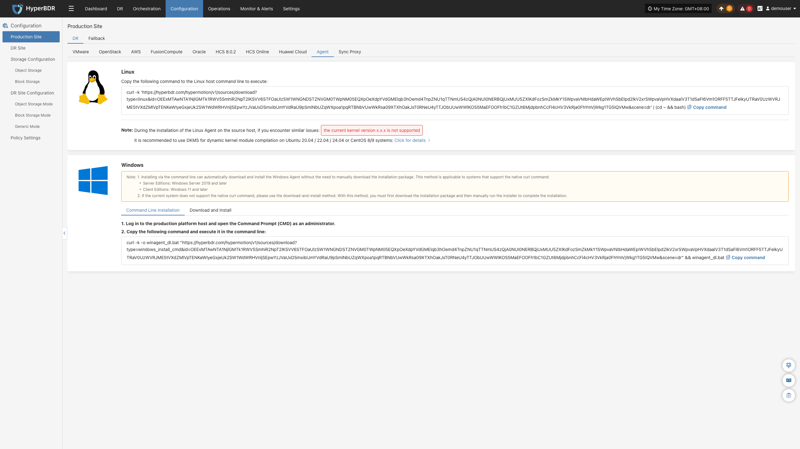

3. 登录源端 Linux 服务器，以 `root` 用户身份在终端执行复制的命令。

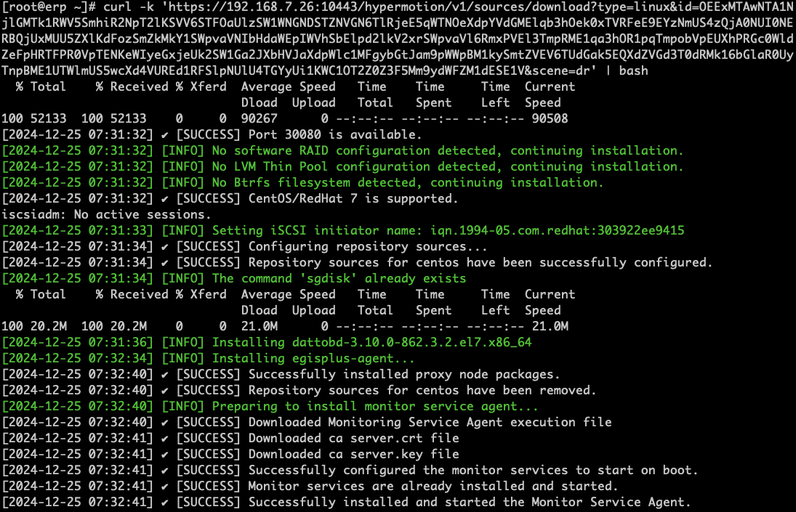

4. 等待脚本自动下载依赖、部署服务并完成主机身份注册。输出安装成功后，即可在平台主机列表中查看已纳管的主机。

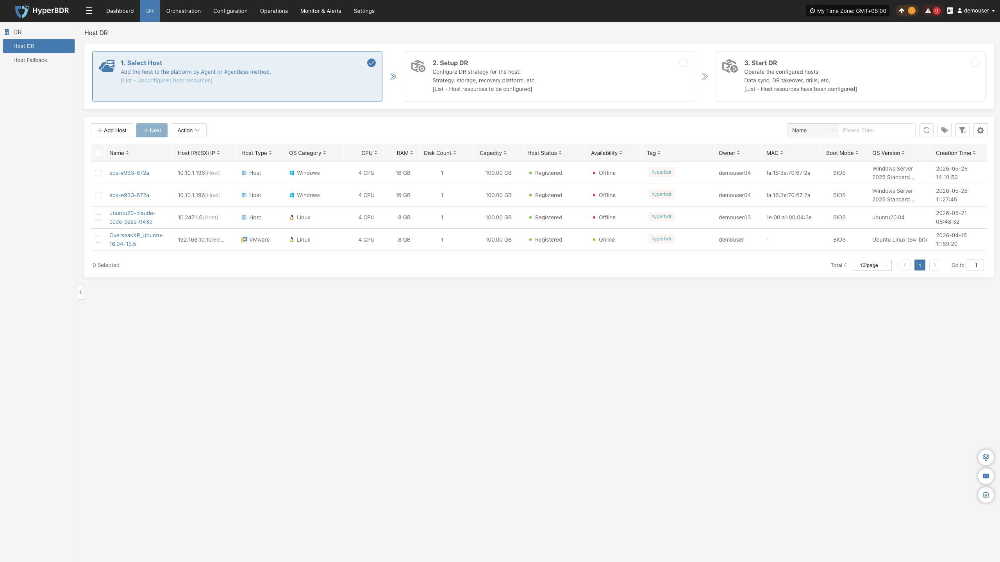

##### **卸载 Linux Agent**

> **注意：** 卸载 Agent 前，请确认已在 HyperBDR 控制台的 **“主机容灾”** > **“选择主机”** 页面对该主机执行 **“解除注册”**。

1. 登录源端 Linux 操作系统终端。
2. 执行官方一键卸载脚本：
   ```bash
   bash /var/lib/egisplus-agent/uninstall_agent.sh
   ```
3. 控制台输出卸载成功提示后，系统服务及临时依赖即被彻底清理。


---

#### **Windows Agent**

##### **安装 Windows Agent**

1. 在控制台 **“生产站点配置”** > **“源端代理程序”** 页面，点击 **“立即下载”** 获取 Windows Agent 安装包（`windows-agent.zip`）。


2. 将安装包解压到源端 Windows 服务器本地目录。

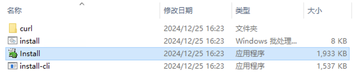

3. 鼠标右键点击 `Install.exe`，选择 **“以管理员身份运行”**。

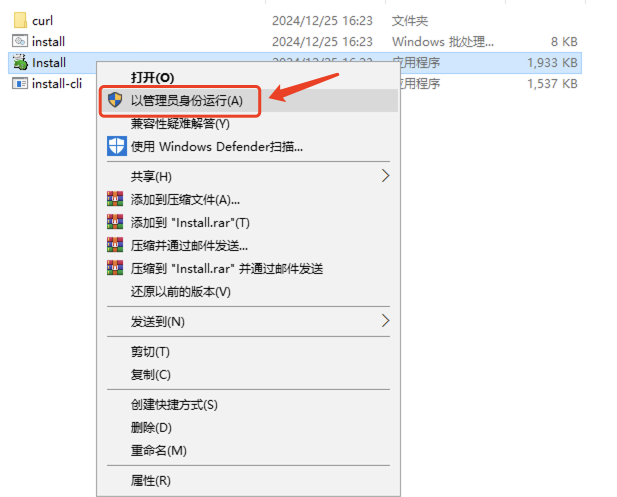

4. 在安装界面点击 **“Install >”** 开始安装。若弹出防病毒软件提示，请确认已将 Agent 程序加入白名单，点击 **“确定”** 继续。

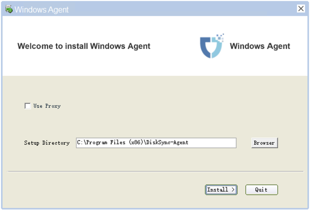

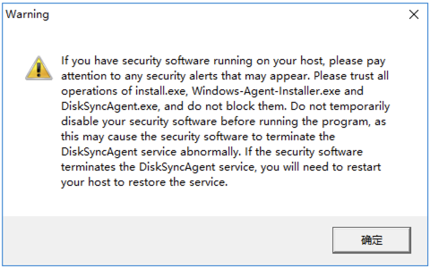


5. 安装完成后，弹窗提示启动服务，点击 **“是”** 进入服务初始化向导。

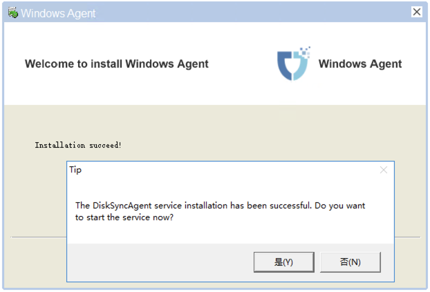

##### **启动与环境预检 (Precheck)**

1. 在服务管理窗口中，先点击左下角 **“Precheck”** 执行环境健康度巡检。


* **Precheck 核心巡检项目说明：**

| **检查项** | **检查项目** | **检查说明与建议处理** |
| :---: | :--- | :--- |
| **1/9** | 服务启动权限 | 检查当前账户是否具备启动 Windows 服务的管理权限。 |
| **2/9** | 语言环境支持 | 检查系统用户语言环境是否支持英语。 |
| **3/9** | VSS 快照命令权限 | 验证 `vssadmin` 命令能否正常创建和删除 VSS 卷影快照。 |
| **4/9** | 防病毒拦截拦截检查 | 检查是否有安全软件拦截 Agent 服务注册与启动。 |
| **5/9** | 磁盘文件系统与剩余空间 | 检查各数据卷格式及可用空间是否满足同步缓存要求。 |
| **6/9** | 卷类型支持性 | 确认不存在不支持的动态卷（不支持 RAID-5、镜像、条带和跨区卷）。 |
| **7/9** | 关键补丁检查 | 对 Windows Server 2008 / 2008 R2 环境，需确保已安装 KB4474419 补丁。 |
| **8/9** | 第三方 VSS 冲突 | 检查是否存在第三方备份软件遗留的锁死 VSS 卷影。 |
| **9/9** | Windows 系统备份计划 | 建议临时关闭系统自带的定时备份计划以防锁卷冲突。 |

2. 预检查全部通过（显示绿色 PASS）后，点击 **“OK”**。


3. 点击 **“Start Services”** 启动核心同步守护服务。


4. 确认服务状态为正常运行（Running）后，点击 **“OK”** 完成配置。

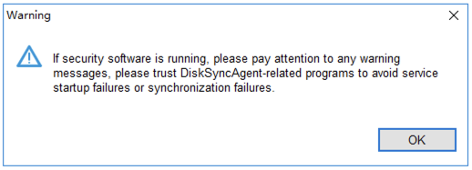


5. 返回 HyperBDR 控制台，在主机列表中即可查看到该 Windows 主机已自动注册上线。


##### **卸载 Windows Agent**

1. 在源端 Windows 服务器打开 **“控制面板”** > **“程序和功能”**（卸载程序）。

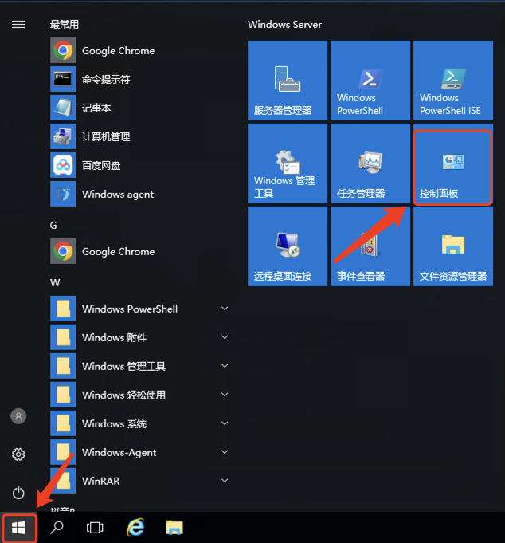

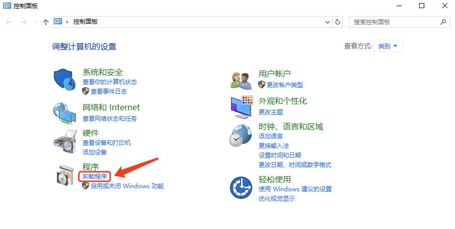

2. 在列表中找到 **Windows_Agent**（发布者为 OneProCloud），右键选择 **“卸载”**。

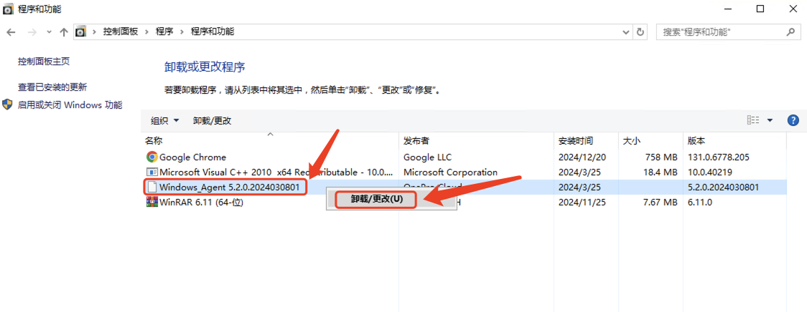

3. 在确认对话框中点击 **“是”**，等待卸载程序清理服务和驱动后点击 **“确定”** 完成。

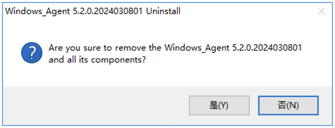

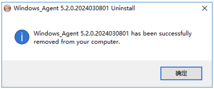

---
