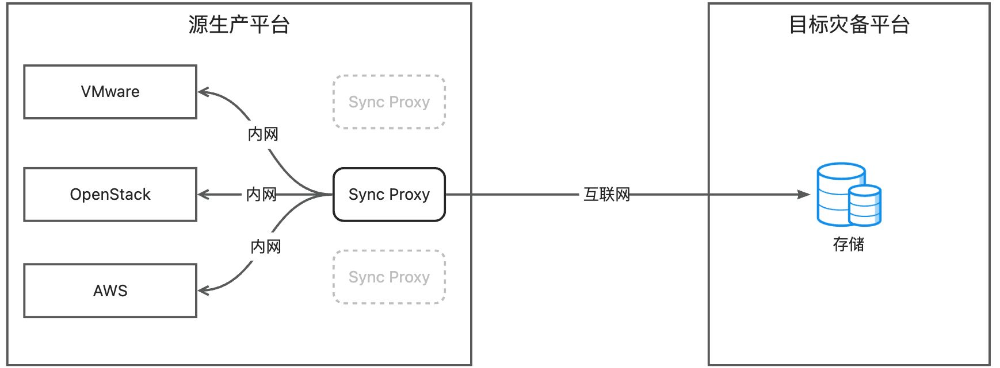
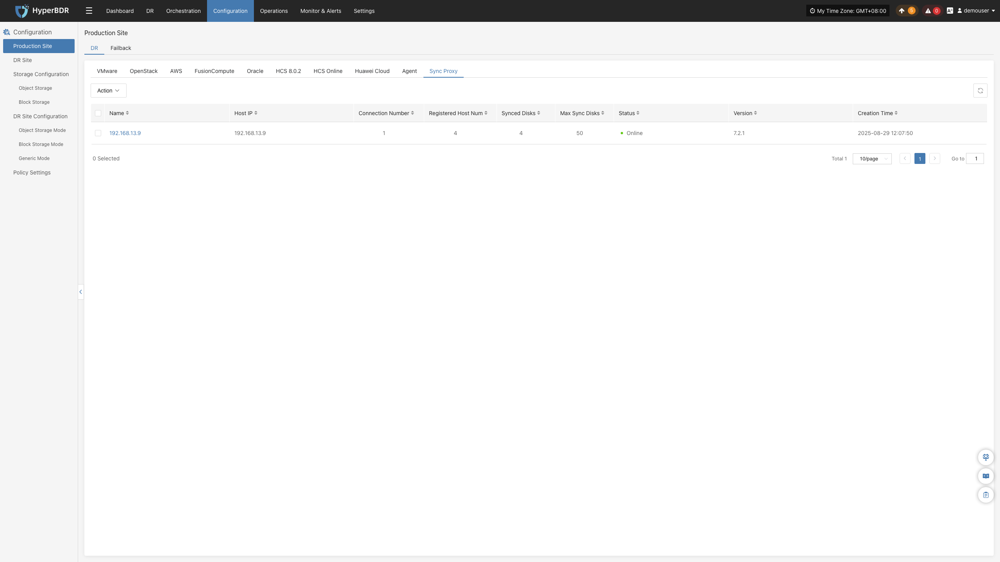
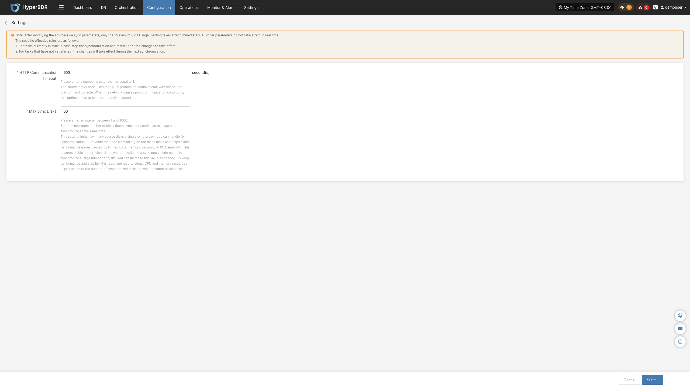
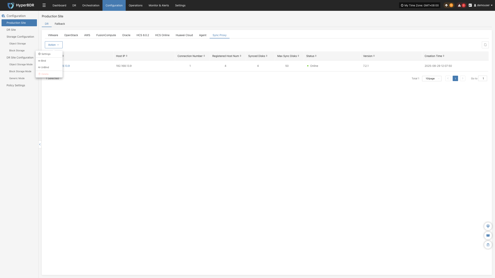

### **源端同步代理**

#### **技术架构与原理说明**

源端同步代理（Sync Proxy）是 HyperBDR 在无代理（Agentless）灾备场景下的核心数据同步组件，适用于 **VMware、OpenStack + Ceph、AWS EC2、FusionCompute、Oracle Cloud、HCS 及华为云** 等源端生产环境。

通过在源生产侧内网部署轻量级的 Sync Proxy，通过原生 API 接口近距离读取虚拟化或云平台的磁盘快照数据，并通过安全网络将备份数据高效传输至目标灾备侧。该设计避免了跨公网远距离调用生产平台原生接口的安全风险与性能损耗。

* **对内调用**：Sync Proxy 仅需访问源端生产平台的管理网络（API 鉴权与快照控制）和存储网络（读取磁盘数据）。
* **对外传输**：Sync Proxy 仅需开通与 HyperBDR 控制台及目标灾备侧的通信网络，隔离并保护源生产平台的网络拓扑。

#### **节点规格与网络要求**

##### **推荐规格**

Sync Proxy 采用 Ubuntu 24.04 运行环境。单台 Sync Proxy 默认最大支持并发挂载 **50 块磁盘** 进行同步传输。当受保护主机数量或并发磁盘较多时，可随时横向扩展（Scale-out）部署多台 Sync Proxy 节点。

| **参数** | **推荐规格** | **说明** |
| :--- | :--- | :--- |
| **操作系统** | Ubuntu 24.04 LTS | 官方标准镜像或提供的 OVA / QCOW2 模板 |
| **CPU** | 4 核 (4 vCPU) | 高并发场景可根据需求上调 |
| **内存** | 8 GB | 建议预留充足内存以保障数据缓存 |
| **系统盘** | 50 GB | 用于系统运行与临时日志缓存 |

##### **网络策略与端口要求**

部署 Sync Proxy 的虚机/主机需满足以下网络连通性要求：

| **源端** | **目标端** | **端口 / 协议** | **用途说明** |
| :--- | :--- | :--- | :--- |
| Sync Proxy | HyperBDR Console | 10443 / TCP | 控制通信与节点双向认证 |
| Sync Proxy | HyperBDR Console | 30080 / TCP | 同步代理程序安装包下载与组件更新 |
| Sync Proxy | 源端生产平台管理与存储平面 | 各平台原生端口 | 调用源端 API（如 vCenter 443、Keystone 5000 等）及存储接口 |
| Sync Proxy | 灾备侧云同步网关 / 存储服务 | 13260 / 443 / TCP | 备份数据向灾备端传输 |

#### **节点管理与更多操作**

在进入各生产平台向导完成 Sync Proxy 部署并自动注册后，可在 **“源端同步代理”** 页面对节点执行生命周期管理。

##### **设置**

在同步代理列表中，点击目标节点所在行右侧的 **“更多操作”** > **“设置”**，可调优该代理节点的运行参数：

| **配置项** | **默认值** | **功能说明** |
| :--- | :---: | :--- |
| **HTTP 通讯超时时间** | 600 秒 | 代理节点与源端生产平台及控制台通信的超时阈值。当跨网络环境较差或大批量 API 响应缓慢时，可适当调大此值以避免重试失败。 |
| **最大挂盘数量** | 50 | 单节点允许同时挂载进行数据读取的最大磁盘数量。如调高该值，需相应提升虚拟机的 CPU 和内存配置，官方建议单节点最大不超过 150。 |

##### **绑定**

点击 **“更多操作”** > **“绑定”**，将该同步代理关联至已添加的源端生产平台。绑定后，该节点即可承担该平台的磁盘数据同步任务。

> **多节点并发机制说明：**
> * **一对多**：单台 Sync Proxy 节点可同时绑定多个源生产平台提供同步服务；
> * **多对一**：一个源端生产平台可绑定多个 Sync Proxy 节点。系统将根据内部负载调度算法，在多个代理节点间自动分摊磁盘挂载与传输任务，显著提升海量主机的备份并发吞吐。
> 
> **注意**：多节点主要提供并发扩展能力。若某个代理节点发生物理或网络中断，当前节点正在执行的同步任务将失败报错，需排查恢复代理节点后重试，不会自动将进行中的单次任务无缝故障转移至其他节点。

##### **解绑**

点击 **“更多操作”** > **“解绑”**，解除当前代理节点与指定生产平台的关联。

> **注意：** 执行解绑前，请确认当前 Sync Proxy 没有正在进行中的同步备份任务。解绑后，该节点可重新绑定至其他生产平台或执行删除。

##### **删除**

点击 **“更多操作”** > **“删除”**，从系统中彻底移除该同步代理节点。

> **注意：** 已绑定生产平台的代理节点无法直接删除，必须先执行 **“解绑”**，待节点处于完全游离状态后方可删除。

---
