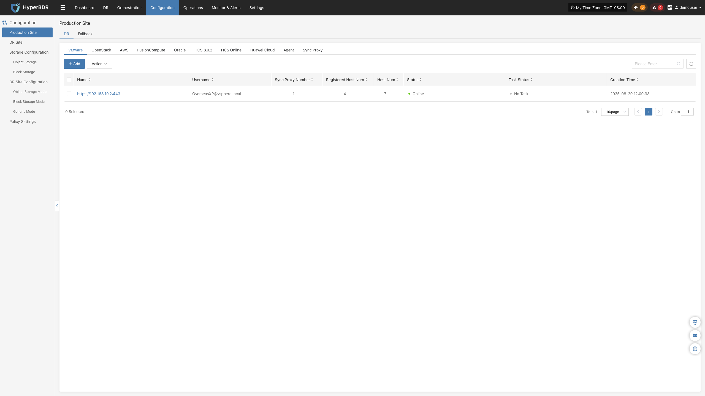
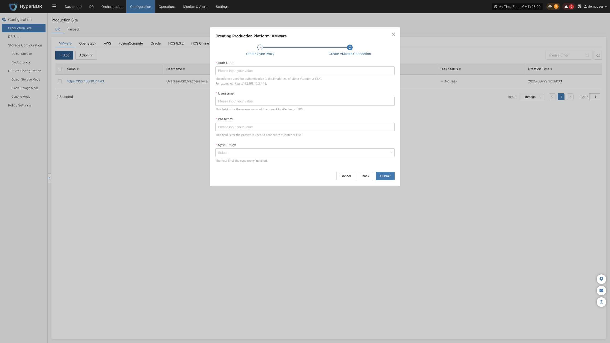

### **VMware**

VMware 页面用于配置和管理 VMware 无代理（Agentless）生产平台，包括平台鉴权、同步代理绑定及无代理连接状态监控。

#### **添加 VMware 平台**

在控制台左侧导航栏点击 **“生产站点配置”** > **“VMware”**，点击 **“添加”** 按钮，根据弹出的向导完成平台接入。

##### **部署同步代理**

VMware 平台采用无代理（Agentless）模式，需在源端 VMware 集群中部署源端同步代理（Sync Proxy）：

1. **下载 OVA 模板**：
   * 可直接点击向导中的下载链接，或通过下列链接下载：<https://downloads.oneprocloud.com/proxy-agent_BaseOS.ova>
2. **导入虚拟机**：
   * 将 OVA 导入到源端 VMware 集群，创建一台或多台源端同步代理虚拟机，并配置网络 IP 地址。
3. **登录虚拟机**：
   * 登录新创建的同步代理虚拟机，系统默认初始凭证为 `root` / `Acb@132.Inst`。
4. **一键安装注册**：
   * 在向导界面复制安装指令，在同步代理终端内粘贴执行。执行成功后，该节点将自动注册到 HyperBDR 平台。

> **说明：** Sync Proxy 推荐规格为 **4C / 8G / 50GB**，单节点支持最大 50 块磁盘并发挂载同步。详细规格与多节点横向扩展说明，请参见 [源端同步代理](#源端同步代理)。

##### **创建 VMware 生产平台**

在向导第二步中，配置 VMware 连接鉴权信息并确认网络互通：

1. **鉴权参数配置**

| **参数项** | **示例 / 格式** | **参数说明** |
| :--- | :--- | :--- |
| **鉴权地址** | https://<vCenter_or_ESXi_IP_or_Domain>:443 | vCenter 或独立 ESXi 主机的访问地址。若使用域名，需提前在 HyperBDR 控制台配置相应的 hosts 解析。 |
| **用户名** | 管理员或专用备份账号 | 具备相应 API 调用权限的用户名（如 `administrator@vsphere.local` 或自定义角色账号）。 |
| **密码** | 对应账号密码 | 连接 vCenter 或 ESXi 的密码。 |
| **源端同步代理** | 下拉选择已注册节点 | 从下拉列表中选择刚部署完成的源端同步代理节点，无需手动输入 IP。 |

2. **网络策略要求**

| **源端** | **目标端** | **端口 / 协议** | **用途说明** |
| :--- | :--- | :--- | :--- |
| Sync Proxy | vCenter / ESXi | 443 / TCP | 管理认证与虚拟机元数据交互 |
| Sync Proxy | ESXi Hosts | 902 / TCP | VMware 原生数据流通道。若受保护虚拟机分布在多个 ESXi 主机上，需确保 Sync Proxy 与所有涉及的 ESXi 主机 902 端口双向连通。 |

3. **权限与 CBT 机制**

HyperBDR 依赖 VMware 官方 CBT（Changed Block Tracking，修改块跟踪）技术实现秒级增量备份。所使用的 vCenter 账号需具备快照管理、虚拟机配置及 CBT 相关的最小权限。详细权限清单请参见 [VMware 用户权限要求](../../../poc/vmware-pre-settings.md#vmware用户权限要求)。

确认配置无误后，点击 **“确定”** 提交。

##### **完成 VMware 添加**

添加完成后返回 VMware 生产平台列表。等待平台状态变为 **“正常”**，并成功识别到集群纳管的宿主机及虚拟机数量，即表示接入成功，可继续进行后续容灾保护。

> **说明：** 重复上述步骤可添加多个不同的 vCenter 集群或独立的 ESXi 主机。

#### **更多操作**

在 VMware 生产平台列表中，点击目标平台操作栏的 **“更多操作”** 下拉菜单，可执行 **设置**、**绑定**、**解绑**、**重载虚拟机**、**更新链接** 与 **删除** 操作。详细操作步骤请参见 [生产站点管理](#生产站点管理)。

---
