# **策略设置**

**策略设置模块**用于统一配置和管理容灾与回切过程中的关键控制策略，帮助用户灵活制定数据同步频率、网络资源调度与存储快照保留方案。系统支持三类核心策略类型：
- **同步策略**：定义数据全量及增量同步的触发频率与调度方式。
- **限速策略**：根据业务高峰期与非高峰期，灵活控制数据传输过程中的主机网络带宽占用。
- **保留策略**：通过设定快照或副本的保留时限与数量，优化目标端存储空间占用并满足数据恢复点目标（RPO）需求。

---

## **创建策略**

### **操作步骤**

1. 登录 HyperBDR 控制台，在顶部导航菜单中依次点击【配置管理】 > 【策略设置】。
2. 页面支持在**“容灾”**和**“回切”**两个模块中独立维护策略，切换至目标业务场景模块。
3. 点击页面右上方的【创建策略】按钮，进入策略配置全屏对话框。
4. 在基础信息区域，填写策略名称、设置快照保留数量并选择初始策略状态。

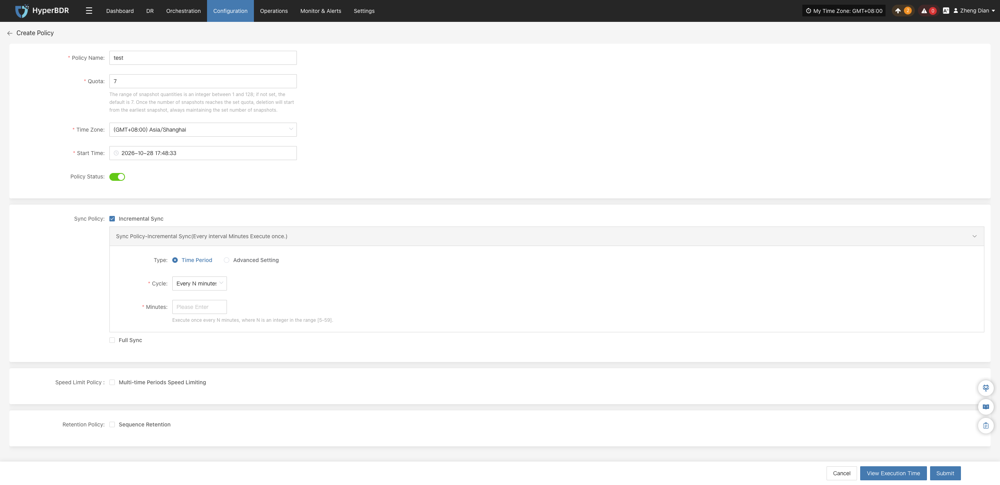

#### **基础信息配置说明**

| **配置项** | **说明** |
| :--- | :--- |
| **策略名称** | 策略的唯一标识名称，建议按业务系统或应用级别规范命名。 |
| **快照保留数量** | 设定目标端保留的最大快照副本数。超出数量后将依据保留策略自动轮转清理。 |
| **策略状态** | 设置策略创建后的默认运行状态（启用 / 禁用）。 |

---

### **同步策略**

在策略设置中，用户可通过配置**增量同步**与**全量同步**两种模式，构建灵活的数据同步计划。

::: note
增量同步与全量同步可并行配置使用。为保障任务顺利执行，建议合理规划执行时刻，避免调度重叠造成网络和存储 IO 资源竞争。
:::

#### **增量同步**

增量同步用于在初始全量备份完成后，按照设定周期持续复制源端变化数据，实现轻量级、低开销的持续数据保护。支持以下两种调度类型：

##### **1. 时间周期模式**

按固定的时间间隔循环触发增量同步任务。

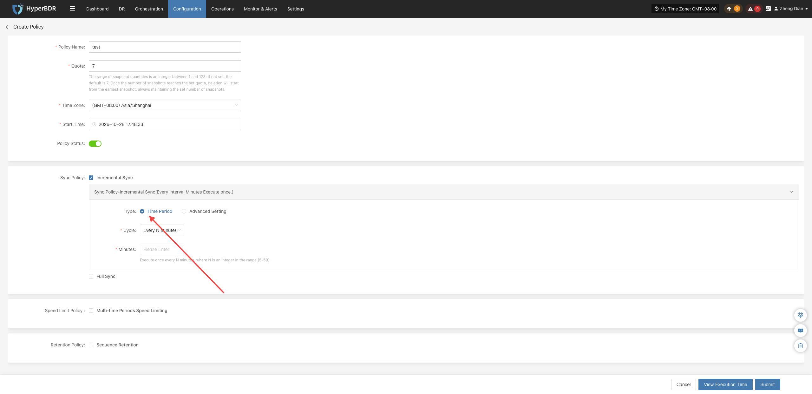

| **配置项** | **配置值示例** | **说明** |
| :--- | :--- | :--- |
| **类型** | 时间周期 | 基础周期性调度模式。 |
| **周期** | 每间隔 N 分钟 | 表示按固定的时间间隔循环触发。 |
| **分钟数** | `30` | 任务执行间隔，有效取值范围为 `5` 至 `59` 之间的整数。 |
| **开始时间** | `2025-05-27 00:00:00` | 同步任务首次执行的生效时刻，后续将依此时间按固定周期递推。 |
| **时区** | `(GMT+08:00) Asia/Shanghai` | 任务调度依据的时区基准，建议与业务所在区域保持一致以避免时间偏差。 |

##### **2. 高级配置模式 (Crontab)**

使用标准 5 位 Crontab 表达式配置复杂的灵活时间规则。

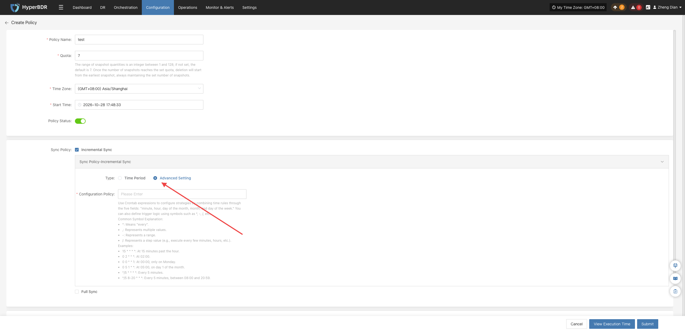

| **配置项** | **配置值示例** | **说明** |
| :--- | :--- | :--- |
| **类型** | 高级配置 | 使用 Crontab 表达式定制复杂的调度时间规则。 |
| **配置策略** | `*/30 * * * *` | 通过“分钟、小时、日期、月份、星期”五个字段组合时间规则。  **常用通配符说明：** • `*`：表示每个时间点； • `,`：表示枚举多个值； • `-`：表示连续区间范围； • `/`：表示步长（例如每隔 N 分钟/小时）。  **常用表达式示例：** • `15 * * * *`：每小时的第 15 分钟触发； • `0 2 * * *`：每天凌晨 2:00 执行； • `0 0 * * 1`：每周一凌晨 0:00 执行； • `0 5 1 * *`：每月 1 号凌晨 5:00 执行； • `*/5 * * * *`：每隔 5 分钟执行一次； • `*/5 8-20 * * *`：工作时段（8:00–20:00）内每 5 分钟执行一次。 |
| **开始时间** | `2025-05-27 00:00:00` | 策略正式生效的基准时间。 |
| **时区** | `(GMT+08:00) Asia/Shanghai` | 调度所依据的时区。 |

---

#### **全量同步**

全量同步用于对源端主机进行完整的数据基线同步。由于全量过程会读取完整磁盘并占用相对较多的网络带宽，通常建议安排在业务低峰期执行。

##### **1. 时间周期模式**

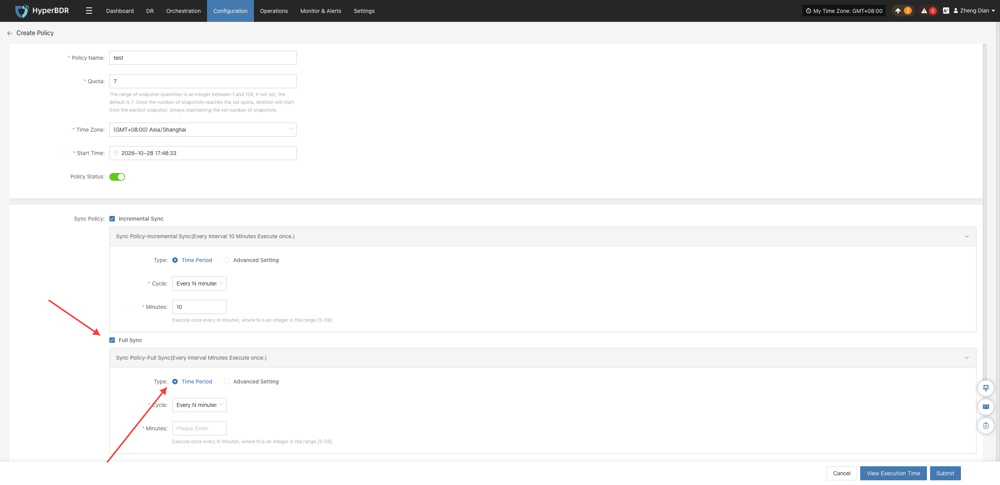

| **配置项** | **配置值示例** | **说明** |
| :--- | :--- | :--- |
| **类型** | 时间周期 | 固定时间间隔调度全量任务。 |
| **周期** | 每间隔 N 分钟 | 循环周期设置。 |
| **分钟数** | `30` | 有效取值范围为 `5` 至 `59` 之间的整数。 |
| **开始时间** | `2025-05-27 00:00:00` | 全量同步计划生效时刻。 |
| **时区** | `(GMT+08:00) Asia/Shanghai` | 调度使用的时区基准。 |

##### **2. 高级配置模式 (Crontab)**

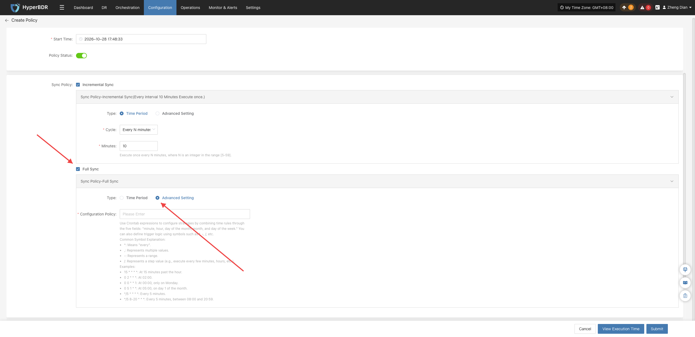

| **配置项** | **配置值示例** | **说明** |
| :--- | :--- | :--- |
| **类型** | 高级配置 | 使用 Crontab 表达式定制全量同步时机。 |
| **配置策略** | `*/30 * * * *` | 依据标准 Crontab 规则执行（语法说明同增量高级配置）。 |
| **开始时间** | `2025-05-27 00:00:00` | 计划生效时间。 |
| **时区** | `(GMT+08:00) Asia/Shanghai` | 调度时区基准。 |

---

#### **查看执行时间**

在配置完成同步策略参数后，用户可点击弹窗下方的【查看执行时间】按钮，系统将根据设置的开始时间、周期分钟数或 Crontab 表达式自动推算后续的执行时刻列表，便于在保存前直观核对调度逻辑。

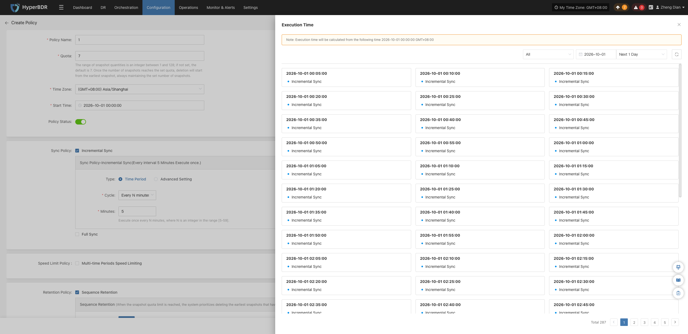

---

### **限速策略**

限速策略允许用户按不同时间段为同步任务设定独立的带宽上限，避免容灾同步流量挤占白天生产业务网络。

::: tip
支持在同一周期内配置多个不同时间段的限速规则；若切换周期类型，已有的时段设置将被重置清除。
:::

#### **多时段限速**

勾选启用多时段限速后，可配置不同时段的主机传输速率限制。

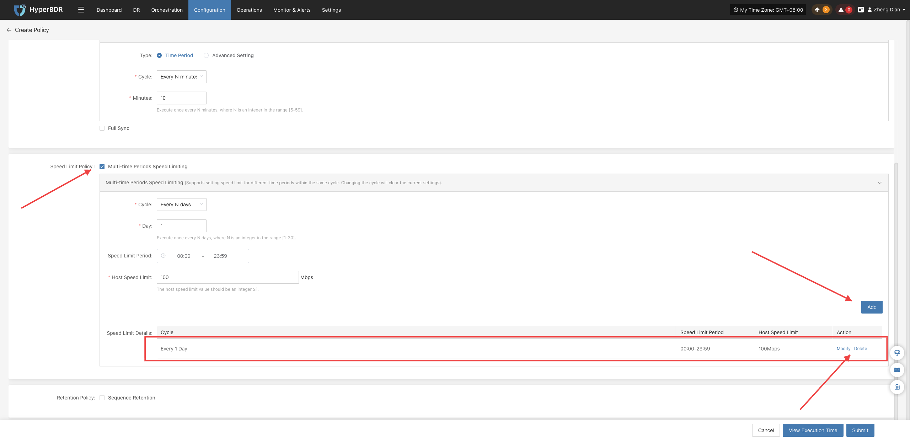

| **配置项** | **示例值** | **说明** |
| :--- | :--- | :--- |
| **周期** | 每 N 天 / 每周 / 每月 | 限速生效的循环周期类型，支持每日步进、指定周几或指定每月固定日。 |
| **天数** | `1` | 当周期为“每 N 天”时，天数表示间隔频率，取值范围为 `[1–30]` 的整数。 |
| **日期** | 星期一、星期三 | 当周期为“每周”时，指定具体的星期，支持多选。 |
| **日期** | 5 号 | 当周期为“每月”时，指定具体的几号生效，支持多选。 |
| **限速时间** | `00:00 - 23:59` | 该限速规则在一天内生效的时间区间。 |
| **时区** | `(GMT+08:00) Asia/Shanghai` | 限速区间所参考的标准时区。 |
| **主机限速** | `10 Mbps` | 同步过程中主机的最大传输带宽限制，单位为 Mbps。 |
| **限速详情** | （表格列表） | 添加配置项后，已生效的所有时段限速规则将在该列表中汇总展示。 |

---

### **保留策略**

保留策略用于管理目标端存储副本生命周期，防止数据无限增长耗尽存储资源。

::: caution
设置保留策略时，请确保目标存储具有足够的可用配额以支持生成新快照，否则快照制作失败可能导致同步任务中断。
:::

#### **按序列保留**

系统按照同步备份完成的时间序列保留最新的若干份副本。当快照数超出设定上限时，系统将自动回收淘汰最旧的历史副本。

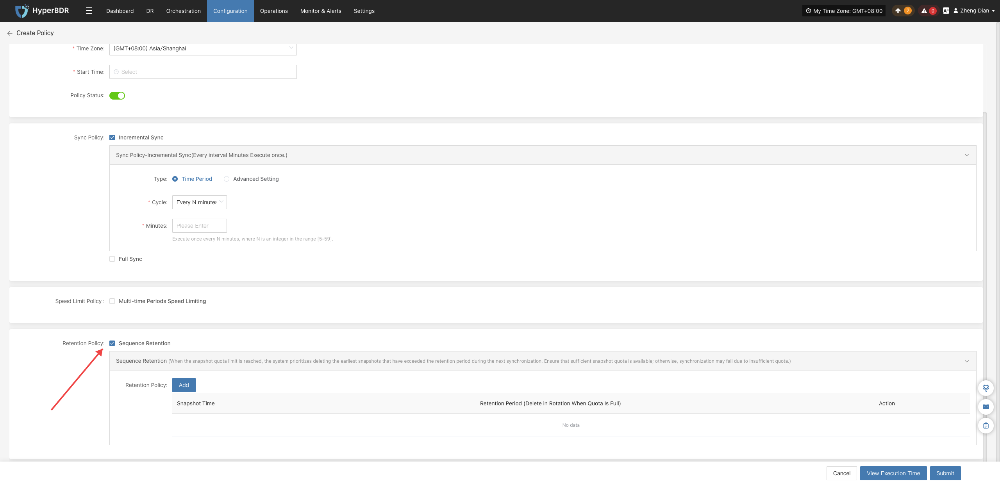

#### **按序列保留配置说明**

用户可通过下拉菜单，灵活设定在天、周、月、年四个时间粒度下的快照保留数量：

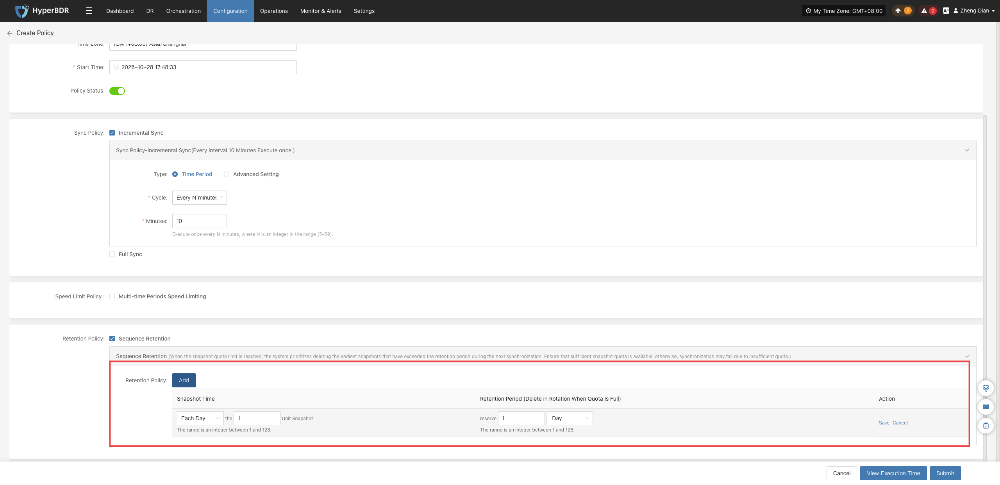

::: note
每个粒度的保留数量最小值为 `1`，最大值不超过 `129`。系统会智能合并冗余备份，保证在各个时间粒度下保留指定份数的最优恢复点。
:::

---

## **更多操作**

在策略设置列表页面中，选中目标策略记录前的复选框，点击表格上方的【更多操作】下拉按钮，即可执行以下运维管理操作。

### **修改**

当需要调整策略名称、快照保留数或同步计划时，可使用修改功能：

1. 在策略列表中勾选目标策略，点击【更多操作】并悬停选择【修改】。
   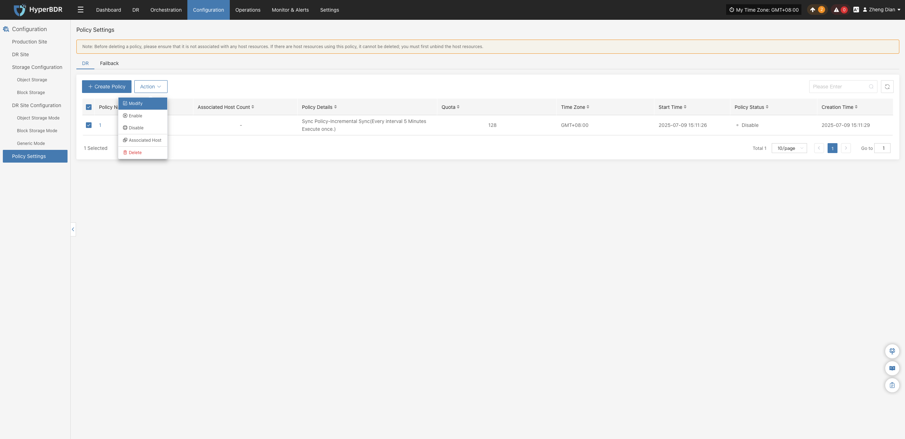
2. 在弹出的【修改策略】对话框中按需调整参数，点击【确定】即可保存生效。
   

---

### **启用**

当策略处于禁用状态需要重新激活时：
1. 勾选目标策略复选框。
2. 点击【更多操作】>【启用】，策略状态将立即切换为“启用”，按既定调度计划恢复执行。

---

### **禁用**

当需要临时暂停策略的调度任务（例如生产端维护或网络检修期间）时：
1. 勾选目标策略复选框。
2. 点击【更多操作】>【禁用】，该策略下的所有定时同步与轮转任务将暂停执行。

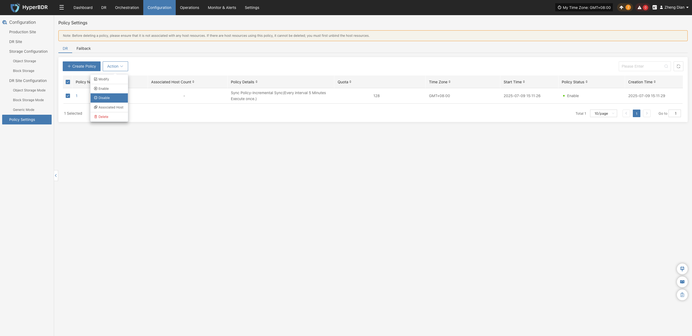

---

### **关联主机**

将需要应用该策略保护的主机资源批量绑定至当前策略：

1. 勾选目标策略复选框，点击【更多操作】>【关联主机】。
   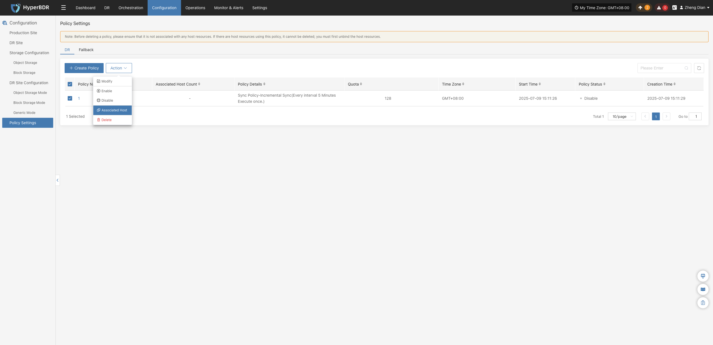
2. 在弹出的【关联主机】对话框中，勾选需要保护的目标主机，点击【确定】完成关联绑定。
   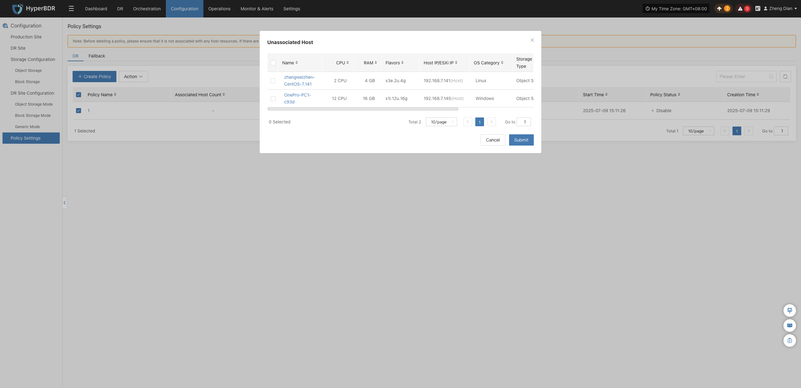

---

### **删除**

如需彻底移除某条策略配置：

1. 勾选目标策略复选框，点击【更多操作】>【删除】。
   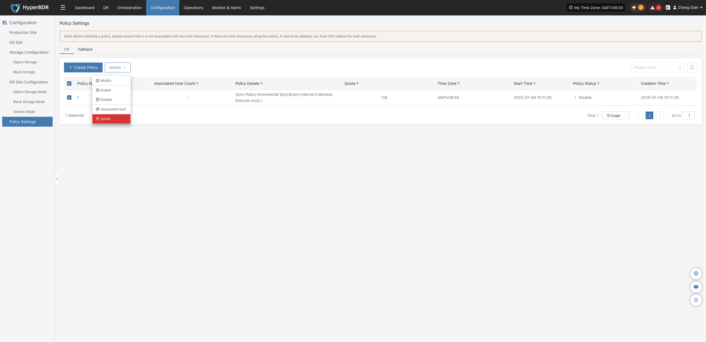
2. 弹出【删除策略】二次确认提示框，核对信息后点击【确认删除】完成清理。

::: warning
在删除策略之前，必须确保该策略下**未绑定任何主机资源**。如果存在正在使用该策略的主机，系统将拦截删除操作，需先解绑主机后方可删除。
:::

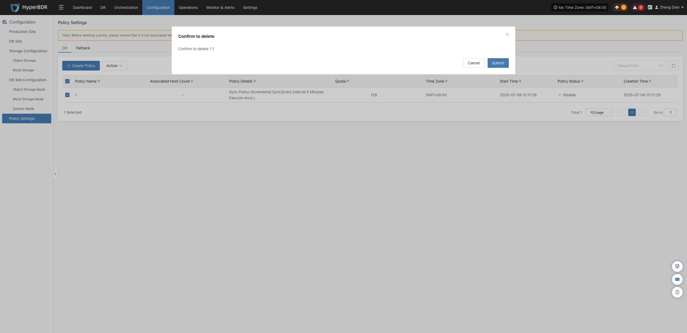

---

## **策略设置详情**

点击策略列表中任意记录的**策略名称**，页面右侧将滑出该策略的详细信息抽屉，方便用户核查配置与关联关系。

### **概览**

在详情抽屉的【概览】标签页中，可以全面查看该策略的基础配置、同步模式（增量/全量）、限速计划和快照保留数量等完整汇总信息。

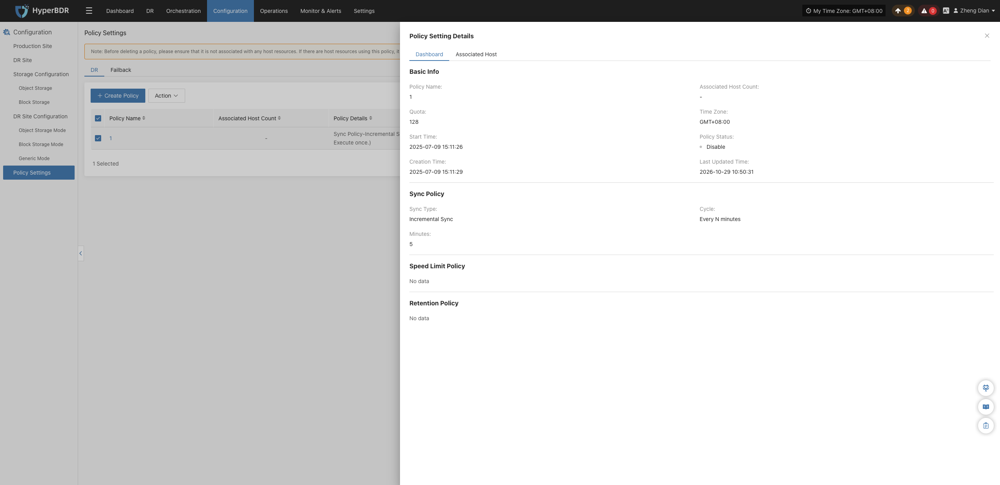

---

### **关联主机**

切换至【关联主机】标签页，可以完整查阅所有已应用该策略的主机清单，包含主机名称、IP 地址、所属平台等详细信息。

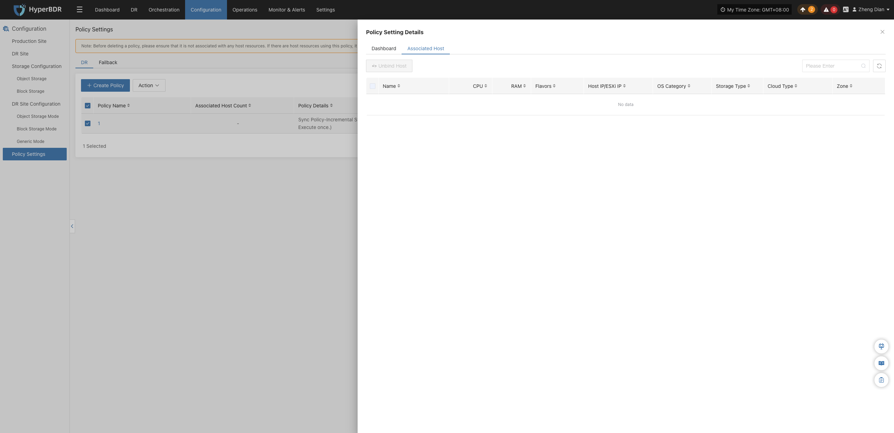

---

### **解绑主机**

若某台主机需变更保护策略或不再执行容灾保护，可在此处解除关联：

1. 在【关联主机】列表中，勾选需要解绑的主机复选框。
2. 点击表格上方的【解绑主机】按钮，在弹出的确认提示中确认操作，即可安全解除该主机与当前策略的绑定。

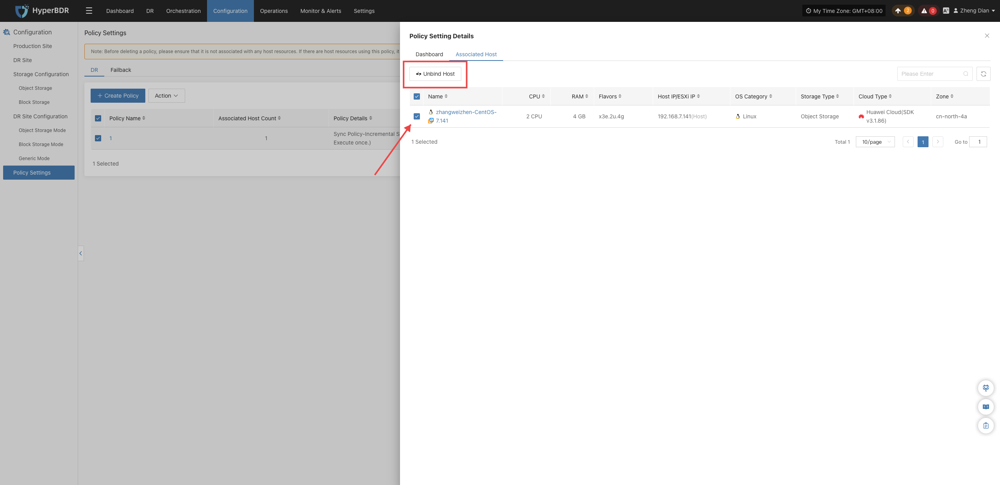
