# **华为云(推荐使用，SDKv3.1.86)**

## **添加块存储**

通过顶部导航栏依次选择 **“配置管理” → “存储配置” → “块存储”** 进入块存储页面，点击右上角“添加”按钮，可进行块存储的新增配置操作。

### **鉴权信息**

块存储平台通过下拉列表选择“华为云(推荐使用，SDKv3.1.86)”，根据接入块存储的实际情况，填写以下平台鉴权信息：

> 若您不确定相关信息如何获取，可点击下方“点击查看”了解详细操作说明。 
> [👉 点击查看](https://qa.oneprocloud.com/questions/D1W2)

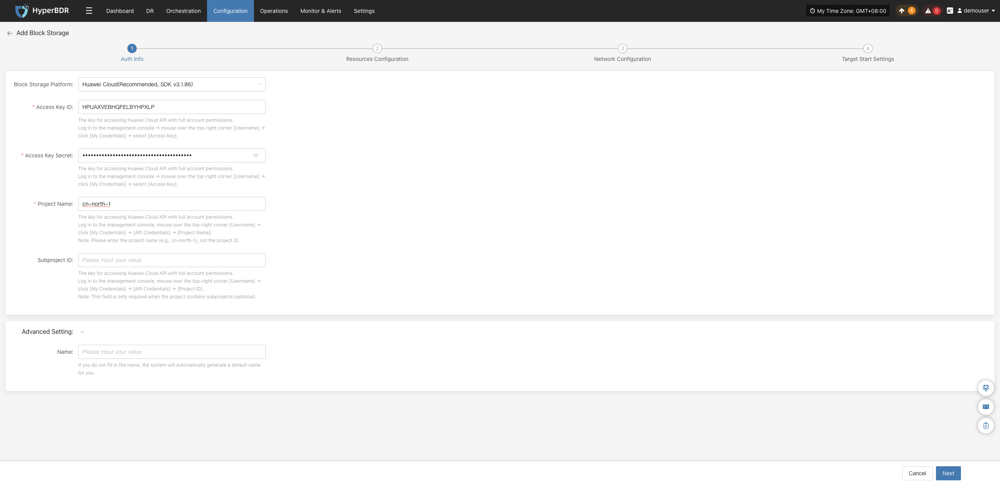

* **鉴权信息说明**

| **配置项**           | **示例值**                          | **说明**                                                                      |
| ----------------- | -------------------------------- | --------------------------------------------------------------------------- |
| 块存储平台 | 华为云(推荐使用，SDKv3.1.86) | 通过下拉列表选择块存储平台，此处选择华为云。推荐使用 SDK v3.1.86 版本。 |
| Access Key ID | HPUAAG0B2••••••••••••••• | 用于访问华为云 API 的身份凭证。登录华为云管理控制台，单击右上角“用户名”>“我的凭证”>“访问密钥”，获取 Access Key ID。 |
| Access Key Secret | •••••••••••••••••••••••••••••••• | 用于访问华为云 API 的身份凭证，与 Access Key ID 配合使用。登录华为云管理控制台，单击右上角“用户名”>“我的凭证”>“访问密钥”，获取 Access Key Secret。 |
| 区域 | cn-east-5 | 填写目标资源所在区域对应的项目名称。登录华为云管理控制台，单击右上角“用户名”>“我的凭证”>“API 凭证”，在“项目”中查看。注意：此处填写项目名称（例如：cn-north-1），而非项目 ID。 |
| 子项目 ID | ••••••••••••••••• | 填写子项目 ID。登录华为云管理控制台，单击右上角“用户名”>“我的凭证”>“API 凭证”，在“项目 ID”中查看。仅当项目包含子项目时需要填写，此项为非必填。 |
| 名称 | test | 自定义配置名称。如果不填写，系统将自动生成默认名称。 |

鉴权信息填写完毕后，点击“下一步”开始进行 **“资源配置”**。

### **资源配置**

为云同步网关分配计算、存储资源，确保其在目标环境中稳定高效运行。

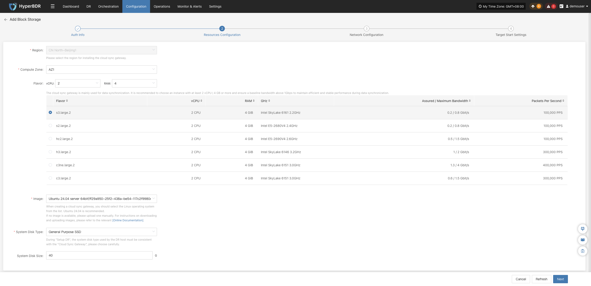

* **资源配置说明**

| **配置项**     | **示例值**                                   | **说明**                                                                                                                             |
|----------------|----------------------------------------------|--------------------------------------------------------------------------------------------------------------------------------------|
| 区域           | 华东-青岛 | 已完成鉴权配置的目标区域，不可更改。 |
| 可用区         | 可用区1 | 通过下拉列表选择对应区域内的可用区。 |
| 实例规格        | 2 vCPU \| 4 GB | 通过下拉列表选择 vCPU 和内存规格，选择后自动刷新下方示例规格。具体以实际可选规格为准。云同步网关主要用于数据同步，建议选择至少 2 vCPU、4 GB 内存的实例，并确保基准带宽高于 1 Gbps，以保证数据同步效率和性能稳定。 |
| 镜像           | Ubuntu 24.04 | 通过下拉列表选择 Linux 操作系统镜像。创建云同步网关时，必须选择 Linux 操作系统镜像。如果列表中没有符合要求的镜像，请手动上传 Ubuntu 24.04 镜像。为避免镜像名称不规范导致误选，请仔细核对镜像信息，确保选择符合要求的操作系统镜像。 |
| 系统卷类型      | 高 IO | 根据实际存储性能需求选择合适的系统卷类型，具体以目标云平台支持的类型为准。 |
| 系统卷大小      | 40 GB | 用户可根据实例需求和云同步网关工作负载自定义。默认大小为 40 GB。 |

资源配置填写完毕后，点击“下一步”开始进行 **“网络配置”**。

### **网络配置**

为云同步网关分配网络资源，确保其在目标环境中稳定高效运行。

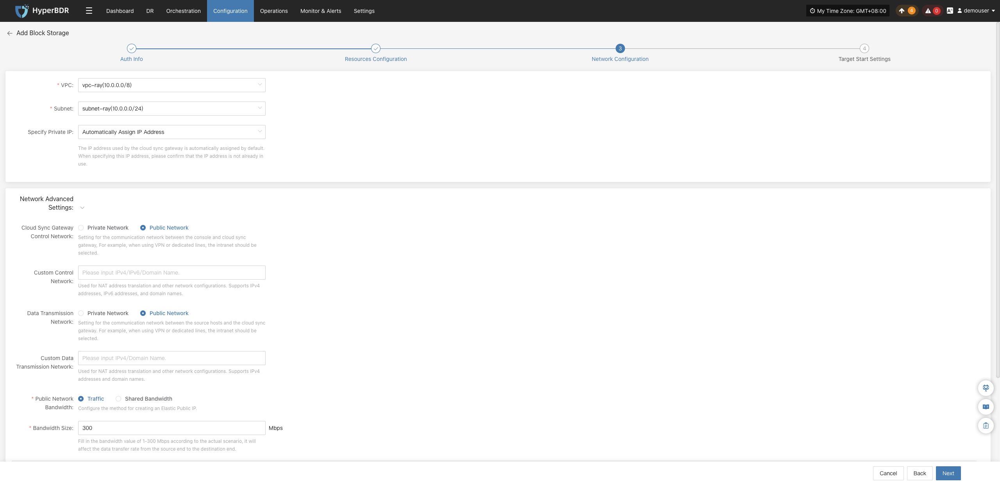

* **网络配置说明**

| **配置项** | **示例值**                                                 | **说明**                                                                     |
| ------- | ------------------------------------------------------- | -------------------------------------------------------------------------- |
| 专有网络    | project-vpc (xxx.xxx.xxx.xxx/xx)                        | 通过下拉列表选择云同步网关所属的私有网络，具体以实际为准                                               |
| 子网      | project-subnet-public1-cn-north-1a (xxx.xxx.xxx.xxx/xx) | 通过下拉列表选择所属可用区中的子网，具体以实际为准                                                  |
| 指定私有 IP | 自动分配 IP 地址                                              | 默认自动分配云同步网关的私有 IP 地址。如需指定 IP 地址，可在下拉列表中选择手动分配，并填写所需的 IP 地址。指定 IP 地址前，请确认该地址未被占用。 |

* **网络高级设置**

| **配置项**         | **示例值**                                                                                                     | **说明**                                                                                                               |
|--------------------|---------------------------------------------------------------------------------------------------------------|------------------------------------------------------------------------------------------------------------------------|
| 云同步网关控制网络   | 内网 | 设置控制台与云同步网关之间的控制指令下发网络。使用 VPN 或专线时，建议选择内网。 |
| 自定义控制网络      | example.com | 默认无需配置。仅在需要按指定地址连接时配置，例如 NAT 地址转换场景。支持 IPv4、IPv6 地址和域名。 |
| 数据传输网络       | 内网 | 设置源端与云同步网关之间的数据传输网络。使用 VPN 或专线时，建议选择内网。 |
| 自定义数据传输网络   | example.com | 默认无需配置。仅在需要按指定地址连接时配置，例如 NAT 地址转换场景。支持 IPv4、IPv6 地址和域名。 |
| 驱动适配网络方式     | 公网网络不使用代理 | 设置驱动适配主机的网络连接方式。可选：公网网络不使用代理、内网网络不使用代理、公网网络并通过云同步网关代理、内网网络并通过云同步网关代理。 |
| 公网带宽          | 100 Mbps | 根据实际场景配置，支持 1–200 Mbps。该参数影响从源端到目标端的数据传输速率。 |

* **数据传输高级设置**

| **配置项** | **示例值**                   | **说明**                                                                                 |
| ------- | ------------------------- | -------------------------------------------------------------------------------------- |
| 数据传输协议 | S3Block | 设置源端与云同步网关之间的数据传输协议。可选：S3Block、iSCSI（即将退役，不推荐）。 |

* **备份卷高级设置**

| **配置项** | **示例值** | **说明**                |
| ------- | ------- | --------------------- |
| 最大备份卷 | 23 | 设置最大备份卷数量，支持设置为 23 或 59。选择 59 时，平台最多支持 23 台主机。 |

网络配置完毕后，点击“下一步”开始进行 **“目标启动设置”**。

### **目标启动设置**

用于配置目标端在恢复或演练过程中启动所需的关键参数，确保资源能够顺利接管与运行。

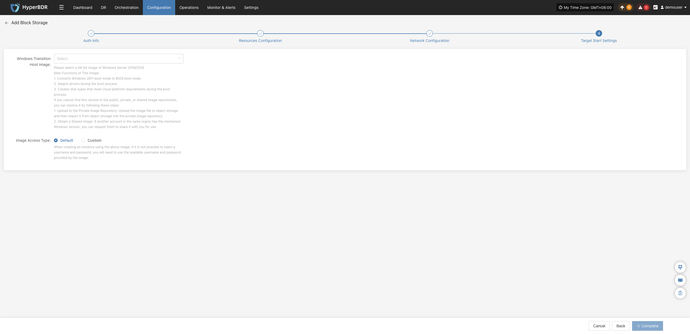

* **目标启动设置说明**

| **配置项**             | **示例值**                                          | **说明**                                                                                                                                                                                                                                                                                                                                                                                                                                                                                                                                                                                                                                     |
|------------------------|-----------------------------------------------------|----------------------------------------------------------------------------------------------------------------------------------------------------------------------------------------------------------------------------------------------------------------------------------------------------------------------------------------------------------------------------------------------------------------------------------------------------------------------------------------------------------------------------------------------------------------------------------------------------------------------------------------------|
| Windows 过渡主机镜像 | Windows Server-2019-English-Full-Base-2025.05.15 | 用于系统启动适配与引导修复，确保实例在目标平台正常启动。请选择与示例版本兼容的 Windows Server 2019 64 位镜像。 |
| 镜像访问方式 | 默认 | 用于设置实例凭据注入方式。支持默认和自定义两种模式。如果目标云平台不支持 Cloud-init，无法自动注入用户名和密码，则必须选择自定义模式，手动设置可用的账号和密码。 |

目标启动设置完成后，点击“完成”，系统将开始自动创建云同步网关及过渡主机镜像。

### **查看详情**

点击块存储名称，可查看块存储的详细配置信息。

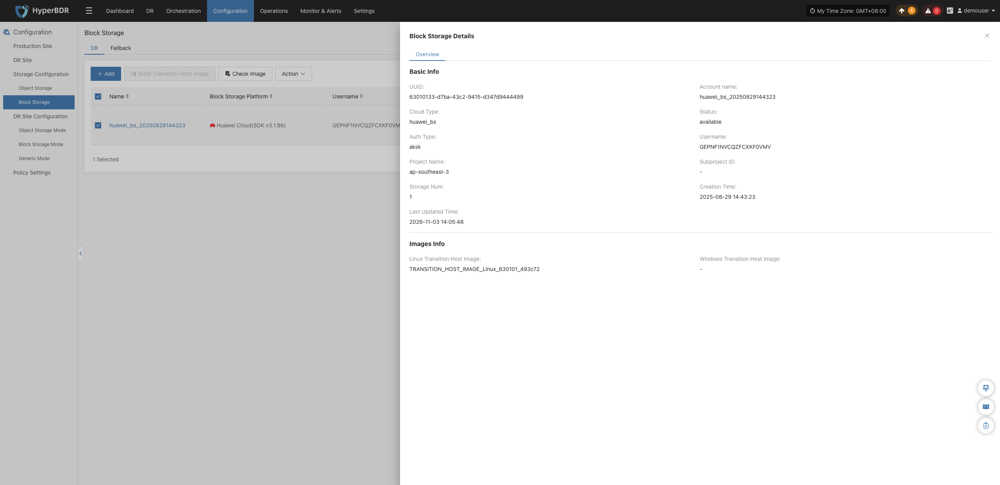

#### 网关可用性

在“网关可用性”列中，点击“点击查看列表”，即可查看云同步网关列表。

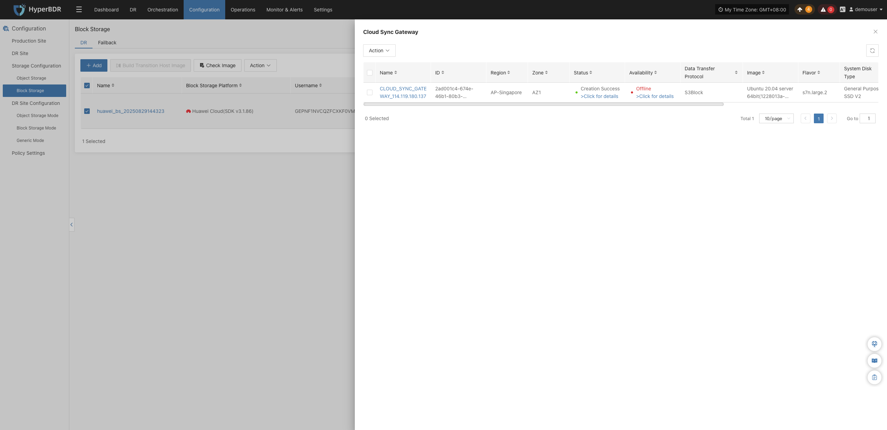

在对应主机的“状态”列中，点击“点击查看详情”，可查看任务创建过程中产生的详细日志，便于快速掌握执行状态和排查故障。

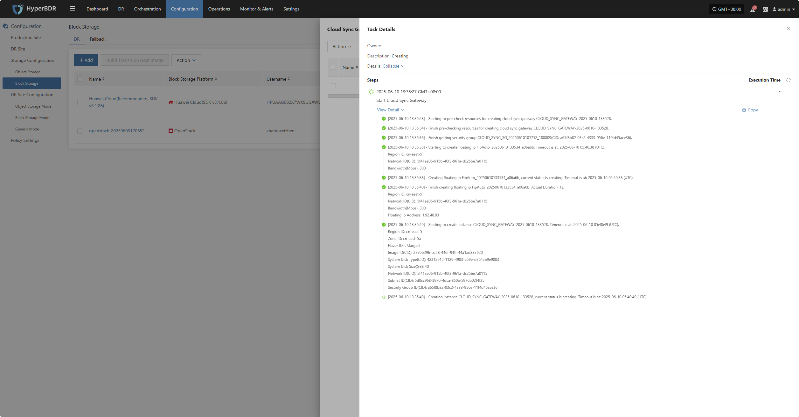

在对应主机的“健康状态”列中，点击“点击查看详情”，可查看当前网关的错误日志，便于快速掌握执行状态和排查故障。

> 当云同步网关运行正常时，不会显示“点击查看详情”按钮。

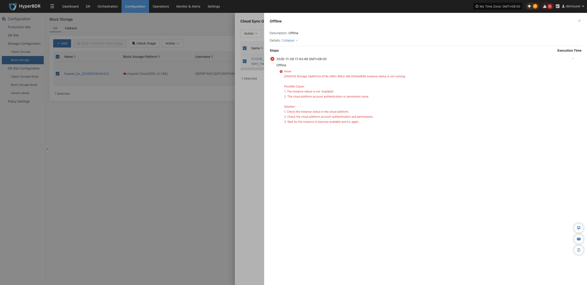

##### 更多操作

选中单台云同步网关后，点击“更多操作”按钮展开更多操作菜单，可对云同步网关进行配置调整：

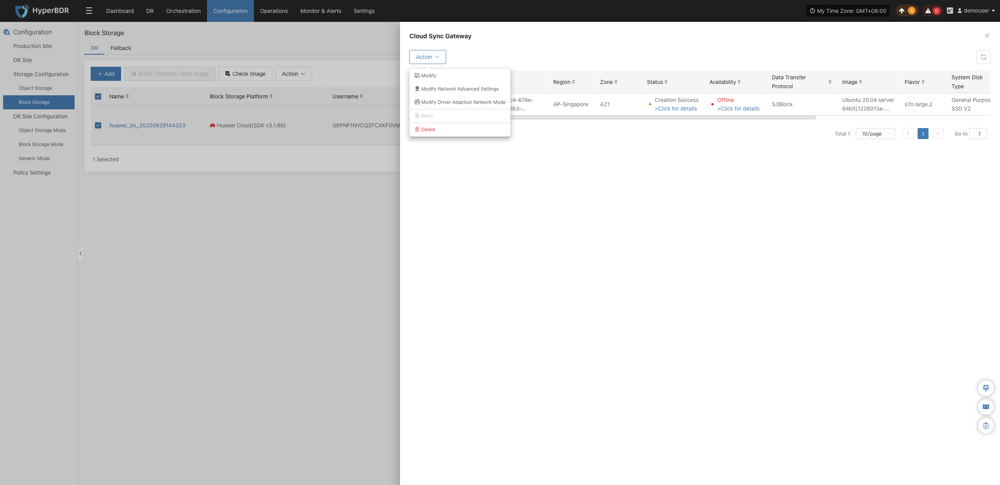

###### 修改

点击“修改”，可对该云同步网关关联的 Windows 过渡主机镜像进行重新选择与调整。

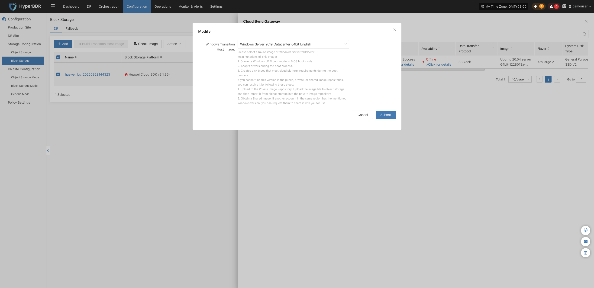

###### 修改网络高级设置

点击“修改网络高级设置”，可修改自定义控制网络与自定义数据传输网络的 IPv4/IPv6 地址或域名配置。

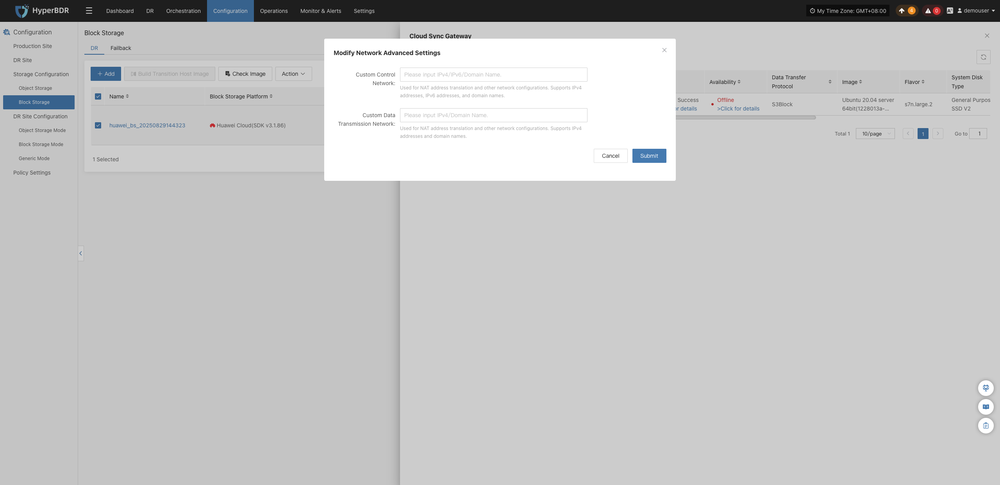

###### 修改驱动适配网络方式

点击“修改驱动适配网络方式”，可切换驱动适配主机的网络连接方式。

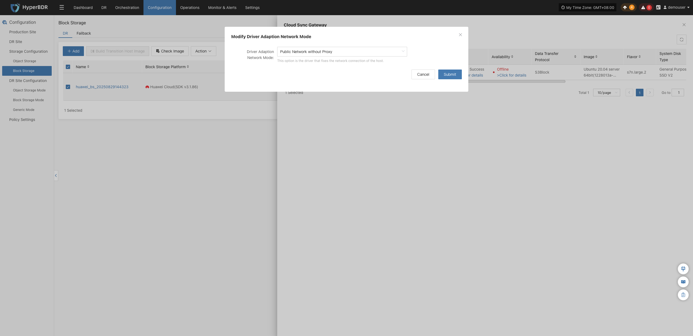

###### 重试

当云同步网关未能成功构建时，点击“重试”重新构建云同步网关。

###### 删除

点击“删除”，系统将弹出删除二次确认窗口。若云同步网关中存在备份卷，需勾选确认强制删除。

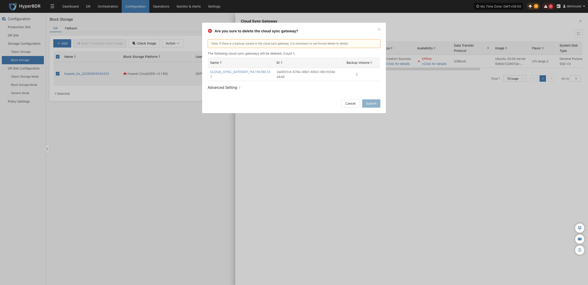

#### 过渡主机镜像

在“过渡主机镜像”列中，点击“查看”，即可查看过渡主机镜像构建过程中产生的详细日志，便于快速掌握执行状态和排查故障。

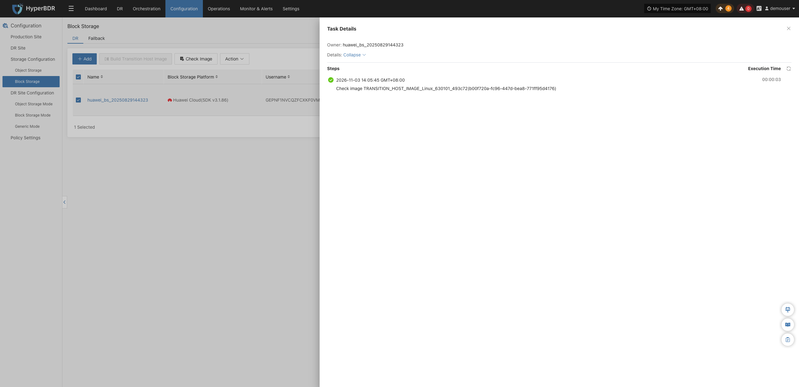

在“过渡主机镜像”列中，点击“点击查看列表”，即可查看过渡主机镜像详细列表。

## **制作过渡主机镜像**

当过渡主机镜像列提示“有新版本”时，勾选对应平台条目并点击顶部“制作过渡主机镜像”。

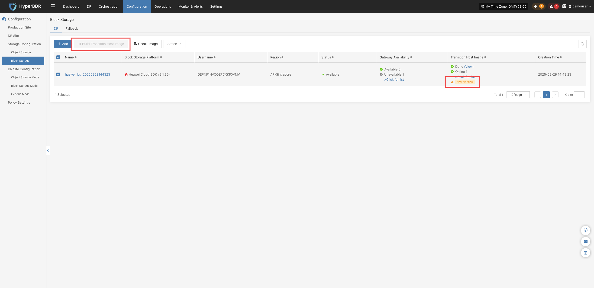

## **检查镜像**

勾选对应平台条目，点击顶部“检查镜像”以校验镜像状态。

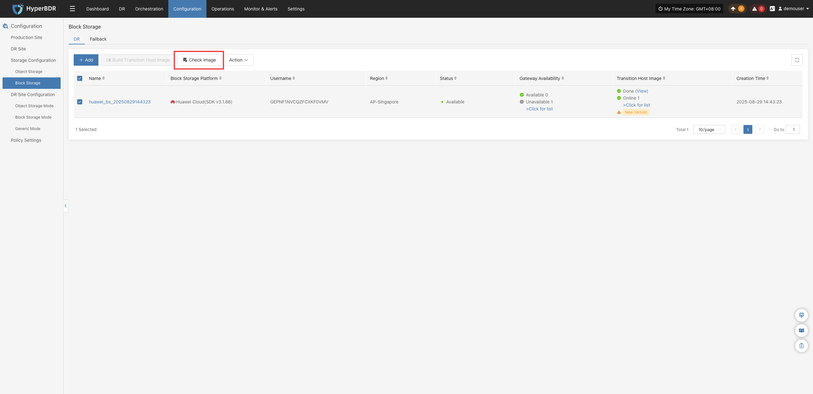

<!-- #region snippet -->

## **更多操作**

勾选目标平台后，点击“更多操作”下拉按钮展开管理操作菜单：

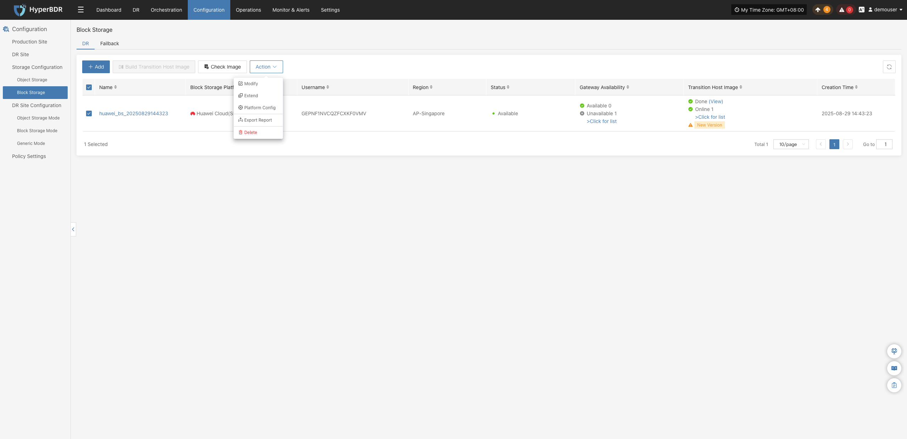

### **修改**

点击“修改”，可对鉴权信息进行编辑操作。

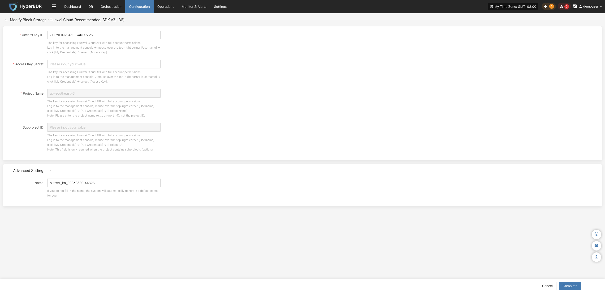

### **扩展**

点击“扩展”，可对资源配置、网络配置、目标启动设置进行修改编辑操作。

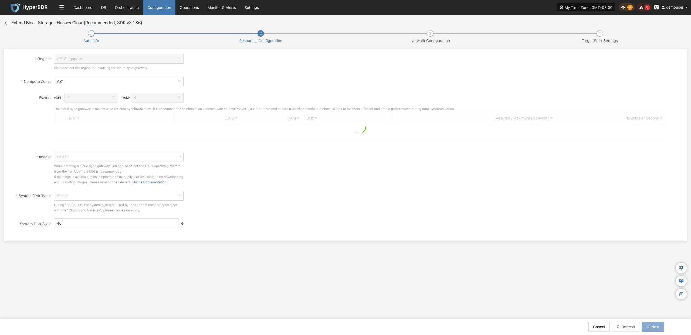

### **平台配置**

点击“平台配置”，可针对主机创建、磁盘创建、快照创建及镜像创建的超时时间进行自定义配置。

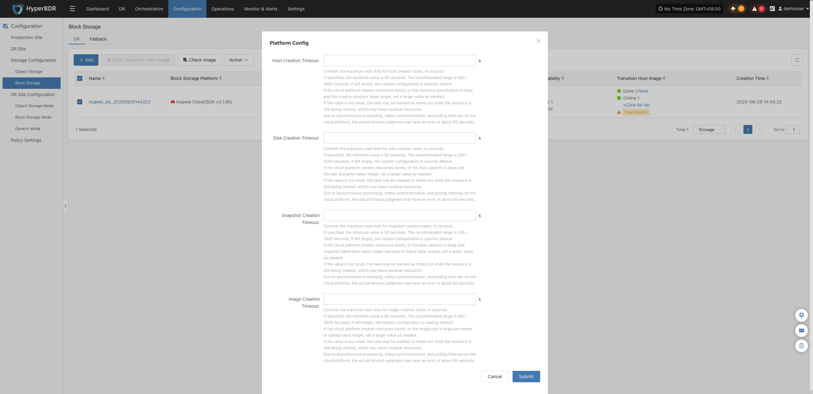

### **报告导出**

点击“报告导出”，可导出对应云同步网关报告信息。

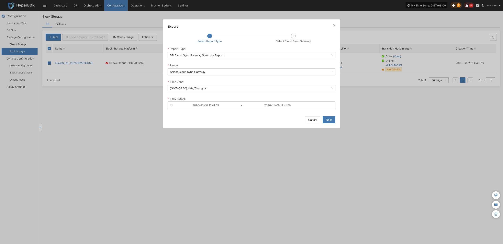

选择对应报告类型、采集范围、时区、时间范围后，点击“下一步”，选择需要导出报告的主机后点击“确认”。

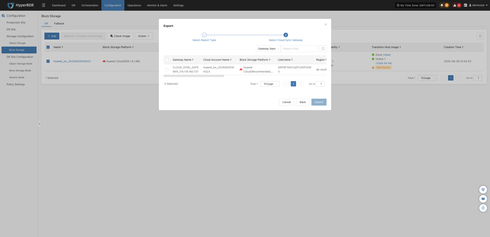

### **删除**

点击“删除”，系统将弹出删除确认提示框，核对删除风险提示后点击“确认”，即可完成删除。

> **注意：** 当存在云同步网关时，无法删除存储平台，需先删除云同步网关后再执行删除。

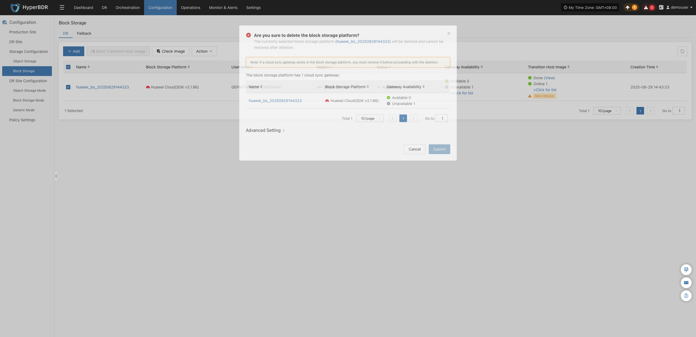

<!-- #endregion snippet -->