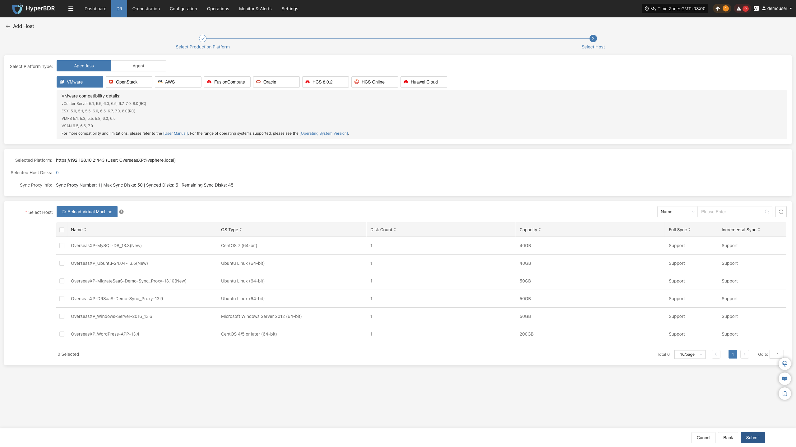
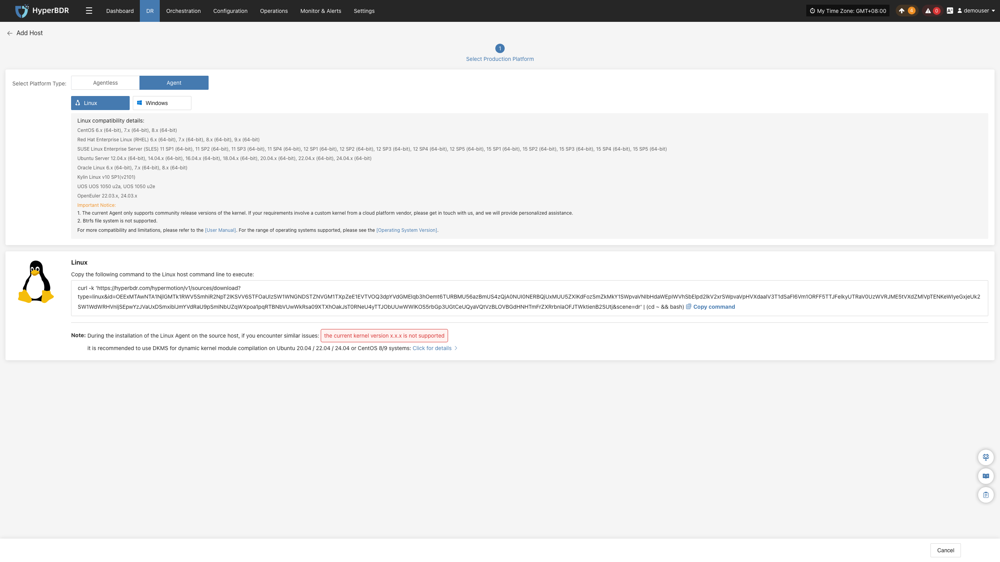
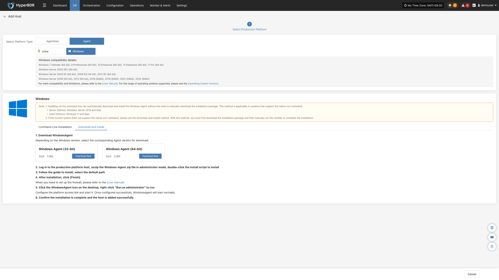
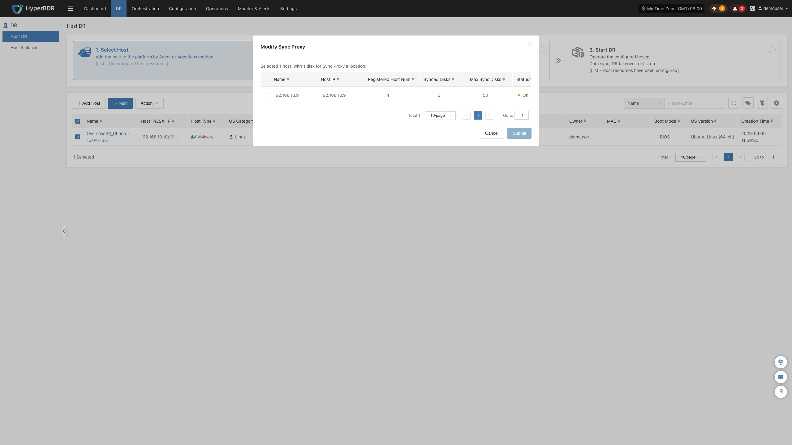
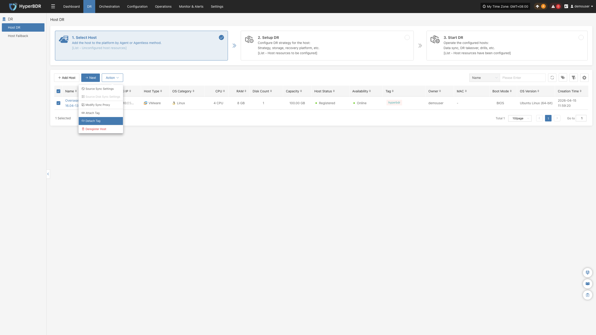
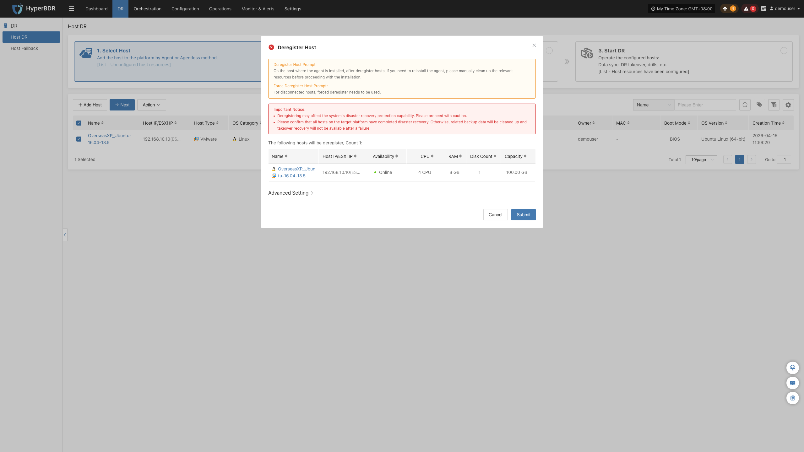

## **选择主机**

登录控制台，点击顶部 **"资源容灾"** 导航栏，点击左侧 **"主机容灾"**，进入 **"选择主机"** 页面。

**"选择主机"** 页面提供三个操作按钮：**"添加主机"**、**"下一步"**、**"更多操作"**。

在添加主机页面，你可以选择生产平台类型，源端无代理模式和源端代理程序。

| **生产平台类型** | **支持资源**                                   | **说明**                                                                                                                                                                                                                                                          |
|:---------------:|:--------------------------------------------:|:-----------------------------------------------------------------------------------------------------------------------------------------------------------------------------------------------------------------------------------------------------------------:|
|    源端无代理    | VMware、OpenStack、AWS、FusionCompute、Oracle、HCS 8.0.2、HCS Online 、华为云 | 生产源端为VMware、OpenStack、AWS、FusionCompute、Oracle、HCS 8.0.2、HCS Online 、华为云时，则可以进行无代理模式进行备份                                                                                                                                                                                        |
|   源端代理程序   | Linux Windows                             | 生产源端代理程序，适用于所有源端Linux、Windows主机，前提是操作系统需要在支持范围内。 操作系统支持矩阵（Agentless）：[点击查看](https://oneprocloud.feishu.cn/sheets/VRqksSPEPhRTPStp3kVcItXNnyh?sheet=0MJNYC) 操作系统支持矩阵（Agent）：[点击查看](https://oneprocloud.feishu.cn/sheets/VRqksSPEPhRTPStp3kVcItXNnyh?sheet=Y9fpqO) |

### **添加主机**

点击 **"添加主机"** 按钮来添加待容灾生产主机。在添加主机页面，选择生产平台类型：**源端无代理模式** 或 **源端代理程序**。

#### **源端无代理模式**

源端无代理模式支持源端生产平台为 VMware、OpenStack、AWS、FusionCompute、Oracle、HCS 8.0.2、HCS Online 及华为云。

无代理模式要求源端必须部署一台或多台Sync Proxy代理，由Sync Proxy代理来统一对接调用源端生产API接口进行数据的获取，需要提前进行网络规划配置。

* VMware平台创建Sync Proxy虚拟机

可以直接下载OVA模版导入VMware生产Sync Proxy虚拟机进行使用。

OVA下载链接：[点击下载](https://downloads.oneprocloud.com/proxy-agent_BaseOS.ova)

* 其他平台创建Sync Proxy虚拟机

其他平台可以自行进行Ubuntu 24.04操作系统的虚拟机创建，如果为OpenStack平台或者其他KVM虚拟化平台，可以下载标准的Ubuntu 24.04 QCOW镜像导入进行使用。

QCOW镜像下载链接：[点击下载](https://downloads.oneprocloud.com/docs_images/ubuntu-24.04-server-cloud-init-amd64.qcow2)

> 注意：此Ubuntu24.04的镜像是没有默认登录密码的，镜像内部包含cloud-init服务，要求你导入的云平台必须可以支持通过cloud-init服务进行密码的注入，否则无法使用此镜像。

* 前提准备

| 生产平台      | 基础条件                                              | 指导文档                                                                                                                   |
| :----------: | :--------------------------------------------------: | :-----------------------------------------------------------------------------------------------------------------------: |
| VMware       | 完成Sync Proxy同步代理的部署安装，完成源端VMware生产平台的添加        | [添加VMware生产平台](../../configuration/production-site.md#添加vmware平台)           |
| OpenStack    | 完成Sync Proxy同步代理的部署安装，完成源端OpenStack Ceph生产平台的添加 | [添加OpenStack生产平台](../../configuration/production-site.md#添加openstack平台) |
| AWS          | 完成Sync Proxy同步代理的部署安装，完成源端AWS生产平台的添加           | [添加AWS生产平台](../../configuration/production-site.md#添加aws平台)             |
| FusionCompute| 完成Sync Proxy同步代理的部署安装，完成源端FusionCompute生产平台的添加 | [添加FusionCompute生产平台](../../configuration/production-site.md#添加fusioncompute平台)                                                                                                  |
| Oracle       | 完成Sync Proxy同步代理的部署安装，完成源端Oracle生产平台的添加        | [添加Oracle生产平台](../../configuration/production-site.md#添加oracle平台)                                                                                                         |
| HCS 8.0.2    | 完成Sync Proxy同步代理的部署安装，完成源端HCS 8.0.2生产平台的添加     | [添加HCS 8.0.2生产平台](../../configuration/production-site.md#添加HCS 8.0.2平台)                                                                                                    |
| HCS Online   | 完成Sync Proxy同步代理的部署安装，完成源端HCS Online生产平台的添加    | [添加HCS Online生产平台](../../configuration/production-site.md#添加HCS Online平台)                                                                                                   |
| 华为云       | 完成Sync Proxy同步代理的部署安装，完成源端华为云生产平台的添加        | [添加华为云生产平台](../../configuration/production-site.md#添加华为云平台)                                                                                                           |

**添加主机流程示例**

- 点击 **"选择主机"** 菜单，点击 **"添加主机"** 按钮，在弹出的新页面选择 **"源端无代理模式"**，并选择您的目标平台。在生产平台中勾选已经添加完成的平台链接，点击 **"下一步"** 进入待容灾主机列表。

   >**注意：** 如果你还没有添加生产平台，可以先点击 **"添加生产平台"** 按钮来添加（参考上方前提准备表格）。

- 从当前平台中勾选需要容灾备份的虚拟机，可以翻页进行手动批量勾选，也可以使用搜索功能根据名称和系统类型进行搜索需要备份的主机。

   >**注意：** 在选择备份主机时，可以参考主机磁盘数量及源端同步代理信息（源端同步代理数量、最大挂载磁盘数量、已挂载磁盘数量及剩余可挂载磁盘数量），根据信息来随时扩展源端同步代理的规格及数量以支持大批量备份。列表中可以看到所有虚拟机的清单，包含操作系统、磁盘数量、磁盘总容量、支持同步及支持增量等内容。

> 如果您在平台上新建的主机未展示在列表中，请点击 **"重载虚拟机"** 按钮，将其重新加载至列表。

- 选择完成虚拟机后，点击 **"确定"** 按钮，将备份虚拟机加入到平台侧。添加完成后，主机即注册到平台。

#### **源端代理程序**

源端代理程序在源端操作系统内部安装Agent代理程序进行数据备份，适用于Linux、Windows主机，前提是操作系统需要在支持范围内。

##### **Linux**

点击 **"选择主机"** 菜单，点击 **"添加主机"** 按钮，选择生产平台类型，选择 **"源端代理程序"**，并选择 **"Linux"** 平台，根据Linux主机的兼容性详情来选择要容灾的主机是否可以支持。

点击下方的安装命令，在源端Linux主机终端中执行即可完成Linux备份主机的添加。

详细安装步骤操作参考：[点击查看](../../configuration/production-site.md#linux-agent)

等待安装完成后，源端主机自动注册到平台，可以查看注册主机的状态。

##### **Windows**

点击 **"选择主机"** 菜单，点击 **"添加主机"** 按钮，选择生产平台类型，选择 **"源端代理程序"**，并选择 **"Windows"** 平台，根据Windows主机的兼容性详情来选择要容灾的主机是否可以支持。

根据操作系统版本点击 **"立即下载"** 来下载Windows Agent安装包，并将安装包上传至Windows主机进行安装。

详细安装步骤操作参考：[点击查看](../../configuration/production-site.md#windows-agent)

等待安装完成后，源端主机自动注册到平台，可以查看注册主机的状态。

### **下一步**

完成源端主机添加后，在主机列表中勾选需要备份的主机，点击 “下一步”，进入第二步[**“容灾配置”**](../host-dr.html#容灾配置)，继续完成后续配置。

### **更多操作**

#### **源端同步设置**

用于配置备份主机的源端同步参数，以满足不同场景下的同步需求。

##### **通用设置**

> 该配置项适用于 Linux Agent、Windows Agent 和 Agentless 三种模式。不同模式下，界面布局或配置位置可能略有差异，请以实际界面显示为准。

| 参数                   | 配置 | 说明                                                         |
| ---------------------- | ---- | ------------------------------------------------------------ |
| CPU 最大使用率（%）    | 30   | 限制备份任务可使用的 CPU 最大比例。数值越大，备份速度越快，但对源端主机业务的影响也越大。建议根据业务负载合理设置，一般保持默认即可。 |
| 可用内存    | 1024   | 系统中剩余的可用内存大小，取值范围为 700～1024 的整数。 |
| 启用加密               | 是   | 开启后，传输的数据会进行加密，提高数据安全性，但会增加一定的 CPU 消耗，可能导致备份速度略有下降。 |
| 启用压缩               | 否   | 开启后，系统会在传输前对数据进行压缩，减少网络传输的数据量，适合网络带宽较低的场景。由于不同类型的数据压缩效果不同，实际节省的数据量会有所差异，系统会自动选择合适的压缩策略。 |
| 重复数据检查           | 自动 | 用于检测并跳过重复数据，减少数据传输量。 **自动**：系统根据实际情况自动决定是否执行重复数据检查（推荐）。 **启用**：每次同步均执行重复数据检查。 **禁用**：每次同步均不执行重复数据检查。 |
| 卷预留空间           | 3 | Windows Agent 卷剩余的可用空间比例，取值范围大于等于0，小于等于99。|
| 创建快照超时时间（秒） | 600  | 创建快照允许等待的最长时间，单位为秒。取值范围为 **600～86400**。如果超过该时间仍未完成快照创建，则本次任务会判定为失败。对于创建快照耗时较长的环境，可适当增大该值。 |

##### **同步线程设置**

> 该配置项适用于 Agentless 模式。不同模式下，界面布局或配置位置可能略有差异，请以实际界面显示为准。

| 参数            | 配置     | 说明                                                         |
| --------------- | -------- | ------------------------------------------------------------ |
| VMware 静默快照 | 否       | 仅适用于已安装 **VMware Tools** 的 VMware 虚拟机。开启后，创建快照时可尽可能保证文件系统一致性，建议根据业务需要开启。 |
| 读线程          | 自动适配 | 设置单个主机的数据读取线程数。默认采用**自动适配**模式，系统会根据源端同步代理的资源配置和待同步主机的磁盘数量自动调整线程数（1～10），无需手动配置。 仅在需要进一步优化同步性能时，可使用**自定义**模式（1～100），建议线程数不超过30。在万兆及以上网络环境中，可在提升源端同步代理资源配置（如 8 核 CPU、16 GB 内存及以上）后，适当增加线程数以提升同步性能。 |
| 写线程          | 自动适配 | 设置单个主机的数据写入线程数。默认采用**自动适配**模式，系统会根据源端同步代理的资源配置和待同步主机的磁盘数量自动调整线程数（1～10），无需手动配置。 仅在需要进一步优化同步性能时，可使用**自定义**模式（1～100），建议线程数不超过30。在万兆及以上网络环境中，可在提升源端同步代理资源配置（如 8 核 CPU、16 GB 内存及以上）后，适当增加线程数以提升同步性能。 |
| 多磁盘并发读写  | 是       | 控制同步时是否同时对多个磁盘进行数据读写。开启后，可并发同步多个磁盘，提高同步效率；关闭后，将按顺序同步各磁盘，适用于对系统资源占用要求较高的场景。 |

##### **同步重试设置**

> 该配置项适用于 Linux Agent、Windows Agent 和 Agentless 三种模式。不同模式下，界面布局或配置位置可能略有差异，请以实际界面显示为准。

| 参数     | 配置 | 说明                                                         |
| -------- | ---- | ------------------------------------------------------------ |
| 是否重试 | 是   | 开启后，当同步因网络异常等临时故障中断时，系统将自动尝试重新连接并继续同步；关闭后，同步失败将直接结束，不再自动重试。 |
| 重试次数 | 3    | 设置同步失败后的最大重试次数，取值范围为 **1～100**。达到最大重试次数后，如仍未恢复连接，则本次同步任务将判定为失败。 |
| 间隔时间 | 60   | 设置两次重试之间的等待时间，单位为**秒**，取值范围为 **1～3600**。适当增加间隔时间有助于等待网络恢复，避免频繁重试。 |

##### **同步线程设置**

> 该配置项适用于 Linux Agent、Windows Agent 模式。不同模式下，界面布局或配置位置可能略有差异，请以实际界面显示为准。

| 参数             | 配置 | 说明                                                         |
| ---------------- | ---- | ------------------------------------------------------------ |
| 同步线程数       | 2    | 设置同步任务使用的线程数量。适当增加线程数可提升同步性能，但会占用更多系统资源。取值范围为 **1～64**，建议根据主机资源配置合理调整。 |
| 同步占用内存大小 | 8    | 设置同步任务可使用的内存大小。适当增加该值有助于提升同步性能，但会增加内存占用。取值范围为 **1～1024**，建议根据主机可用内存合理设置。 |

##### **对象上传设置**

> 该配置项适用于 Linux Agent 模式。不同模式下，界面布局或配置位置可能略有差异，请以实际界面显示为准。

| 参数                 | 配置 | 说明                                                         |
| -------------------- | ---- | ------------------------------------------------------------ |
| 连接超时时间         | 120  | 设置上传对象时建立连接的最长等待时间，单位为**秒**。取值范围为 **1～1800**。超过该时间仍未建立连接，则本次连接将判定为超时。 |
| 是否发送 MD5 摘要    | 是   | 开启后，上传对象时将发送 MD5 摘要用于校验数据完整性，帮助发现传输过程中可能发生的数据损坏。 |
| 是否分段 SHA256 校验 | 否   | 开启后，系统将在分段上传过程中对每个数据分段进行 SHA256 校验，进一步提高数据传输的完整性校验能力，但可能会增加一定的计算开销。 |

##### **卷VSS存储设置**

> 该配置项适用于 Windows Agent 模式。不同模式下，界面布局或配置位置可能略有差异，请以实际界面显示为准。

| 参数              | 配置                  | 说明                                                         |
| ----------------- | --------------------- | ------------------------------------------------------------ |
| 卷通用占比        | 10                    | 设置 VSS 快照存储默认可占用磁盘空间的比例，单位为 **%**。取值范围为 **5～100**。当未为卷单独配置 VSS 存储空间时，将采用此配置。 |
| 卷特殊存储        | `VSS_SPEC_MAX_C=d:10` | 为指定卷单独设置 VSS 快照存储位置及容量。\<br\>**单卷配置示例：**`VSS_SPEC_MAX_C=d:10`，表示将 **C** 卷的 VSS 快照存储在 **D** 卷，并分配 **10 GB** 存储空间。\<br\>**多卷配置示例：**`VSS_SPEC_MAX_C=d:10;VSS_SPEC_MAX_E=f:10`，多个卷之间使用分号（`;`）分隔。**该配置若无特殊需求，默认留空** |
| 创建 VSS 快照超时 | 300                   | 设置创建 VSS 快照的最长等待时间，单位为**秒**。取值应大于或等于 **60**。超过该时间仍未完成快照创建，则本次操作将判定为失败。 |
| 裸数据同步卷      | F                     | 指定分区采用裸数据方式进行同步，不使用 VSS 快照。输入盘符即可，多个盘符使用英文逗号（`,`）分隔，例如：`F` 或 `E,F`。适用于无需 VSS 一致性快照的分区。**该配置若无特殊需求，默认留空** |

#### **源端磁盘同步设置**

用于配置源端磁盘的同步策略。源端包含多块磁盘时，可分别设置各磁盘是否参与同步。此功能仅适用于通过 Agent 模式添加的主机。

> 注意：该配置仅支持在首次同步数据前修改，同步开始后将无法修改。

选择无需同步的磁盘，将对应行最后一列的 **Yes** 修改为 **No** 并在弹出的窗口内选择确认，即可完成排除设置。设置完成后，后续同步任务将不再同步该磁盘。

#### **修改源端同步代理**

用于修改备份主机关联的源端同步代理，以调整数据同步所使用的代理节点。

#### **绑定标签**

用于为备份主机绑定一个或多个标签，便于根据业务、环境或用途进行分类管理。

#### **解绑标签**

用于解除备份主机与指定标签的关联，便于调整主机的标签分类。

#### **解除注册主机**

用于解除备份主机在容灾管理平台的注册关系，取消该主机与平台的注册关联。

