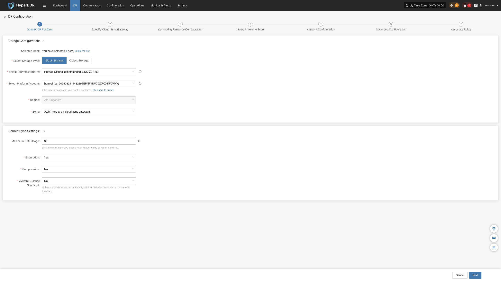
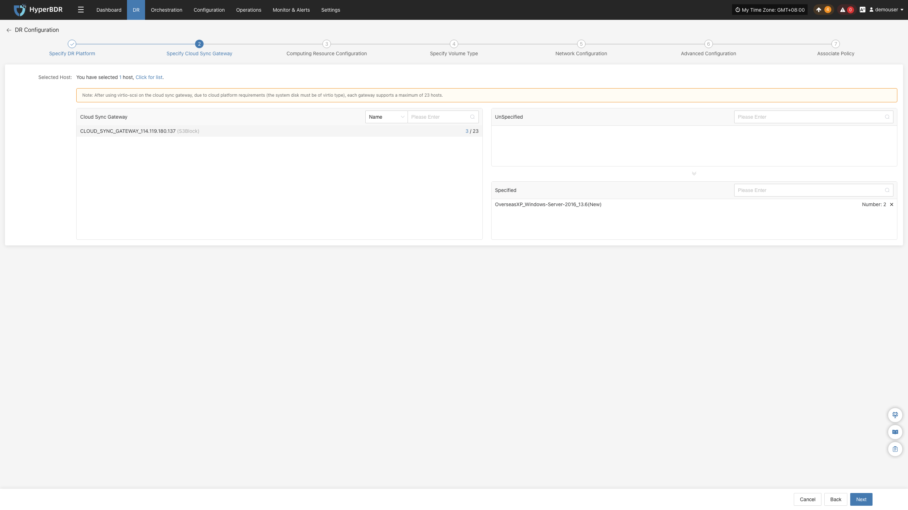
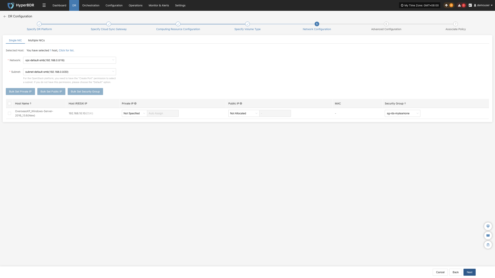
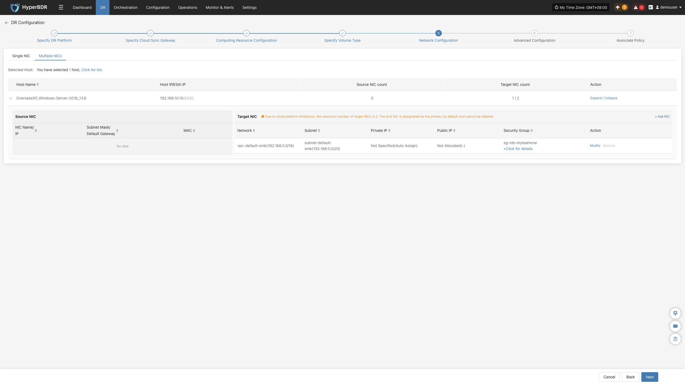
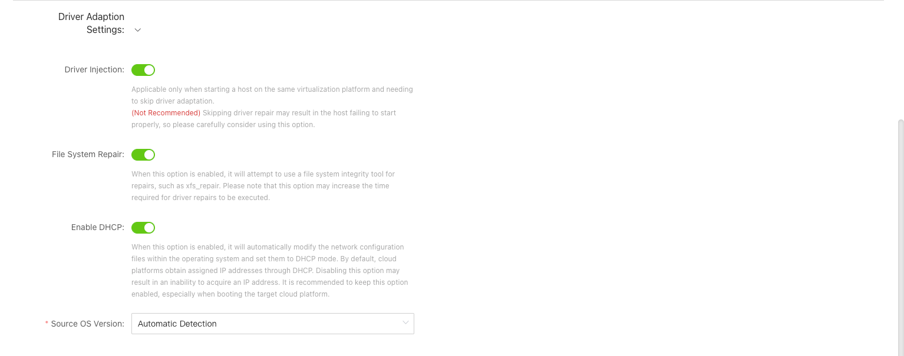
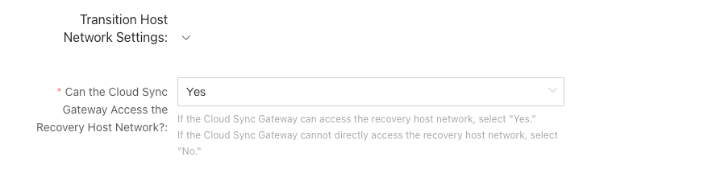
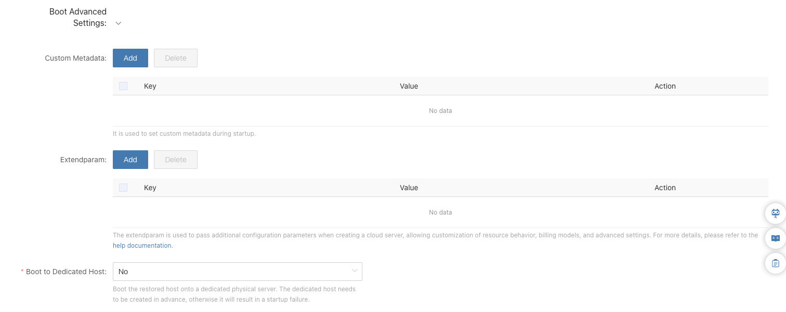
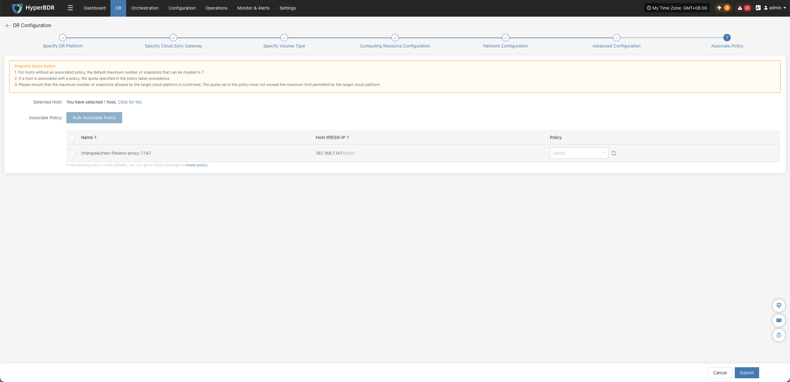

#### **块存储**

选择 **“块存储”** 后，按照本节的操作流程依次完成以下配置：指定容灾平台、指定云同步网关、配置计算资源、指定卷类型、配置网络、设置高级选项及关联策略。

> **注意：** 不同云平台提供的功能可能存在差异，因此配置选项可能有所不同，但整体操作流程基本一致。具体配置项请以实际页面展示为准。本节以华为云为例进行说明。

#### 指定容灾平台

**前置条件：**

- 已根据准备工作中，“完成容灾目标配置”完成块存储相关配置。
- 已完成云同步网关初始化（正确配置块存储配置后会自动初始化云同步网关）。

**操作步骤：**

1. 在 **“存储配置”** 中，将 **“选择存储类型”** 设置为 **“块存储”**。
2. 在 **“选择存储平台”** 下拉列表中，选择已添加的块存储平台。
3. 在 **“选择平台账号”** 下拉列表中，选择对应的云账号。
4. 根据实际需求，选择已配置云同步网关的地域和可用区。
5. 确认配置无误后，点击 **“下一步”**，进入 [**“指定云同步网关”**](../host-dr.html#指定云同步网关)。

###### **存储配置**

| 参数 | 配置 | 说明 |
| --- | --- | --- |
| 选择存储类型 | 块存储 | 选择块存储作为容灾存储类型。使用前需完成块存储的相关配置。 |
| 选择存储平台 | 已添加的块存储平台 | 选择已添加并完成配置的块存储平台。 |
| 选择平台账号 | 已配置的云账号 | 选择与所选存储平台对应的云账号。如果没有可用账号，可点击页面中的 **“请点击此处创建”**，跳转至块存储配置页面。 具体配置方法请参见：[块存储配置](../../configuration/storage-configuration.md#块存储)。|

###### **源端同步设置**

> **注意：** 此项为可选的高级配置。如无特殊需求，建议保留默认设置。

| 参数 | 配置 | 说明 |
| --- | --- | --- |
| CPU最大使用率 | 30 | 仅对安装了 VMware Tools 的 VMware 主机有效。 |
| 加密 | 是 / 否 | 仅对安装了 VMware Tools 的 VMware 主机有效。 |
| 压缩 | 是 / 否 | 仅对安装了 VMware Tools 的 VMware 主机有效。 |
| VMware静默快照 | 是 / 否 | 仅对安装了 VMware Tools 的 VMware 主机有效。 |

#### 指定云同步网关

**前置条件：** 已完成“指定容灾平台”配置。

**操作步骤：**

1. 在云同步网关列表中，选择需要使用的云同步网关。
2. 在“未指定主机”列表中，找到需要同步的主机，点击对应行中的 **“+”**，将该主机添加至已指定主机列表。

3. 在“已指定主机”列表中，可查看已指定的主机。如需取消指定，点击对应主机所在行的 **“x”**。
4. 确认云同步网关及主机指定无误后，点击 **“下一步”**，进入 [**“计算资源配置”**](../host-dr.html#计算资源配置)。

###### **配置参数说明：**

| 参数 | 配置 | 说明 |
| --- | --- | --- |
| 云同步网关 | 可用的云同步网关列表 | 用于选择执行数据同步任务的云同步网关。 |
| 未指定主机 | 待指定的主机列表 | 展示尚未指定云同步网关的主机，可通过 **“+”** 将主机添加至已指定主机列表。 |
| 已指定主机 | 已指定的主机列表 | 展示已指定云同步网关的主机，可通过 **“x”** 取消指定。 |

##### **计算资源配置**

为待恢复主机配置 CPU、内存、操作系统类型等参数，并设置目标启动方式。

**操作步骤：**

1. 在主机列表中勾选需要配置的虚拟机。
2. 系统默认自动匹配与源主机一致的目标启动规格。如自动匹配结果不符合需求，或需要调整目标实例规格，可点击 **“修改规格”**，在弹出的列表中为所选虚拟机配置 CPU、内存规格。
> **规格匹配说明：** 存在与资源类型一致的预设模板时，系统会自动匹配；否则需要手动选择相应配置。
3. 系统默认自动匹配与源主机一致的目标启动方式。如自动匹配结果不正确或未能识别，可点击 **“修改”** 按钮手动调整。
> **注意：** 源端主机采用 UEFI 启动方式时，目标启动方式可选择 BIOS 或 UEFI。若系统盘容量大于 2 TB，则不能选择 BIOS 启动方式。并非所有目标平台均支持配置目标启动方式，具体请以实际页面展示为准。
4. 系统默认自动匹配与源主机一致的操作系统类型。如自动识别结果不正确或未识别，可通过下拉列表手动设置目标启动方式。
5. 完成计算资源配置后，点击 **“下一步”**，进入 [**“指定卷类型”**](../host-dr.html#指定卷类型)。

###### **批量配置说明**

支持批量设置规格、目标启动方式、系统类型。

**操作步骤：**

1. 在主机列表中勾选需要批量配置的主机。
2. 根据需要配置的参数，点击对应的批量操作按钮：
    - 批量设置规格： 可为所选虚拟机批量配置目标实例规格。
    - 批量自动匹配规格： 可为所选虚拟机批量自动匹配目标实例规格。
    - 批量设置目标启动方式： 可为所选虚拟机批量设置目标启动方式。
    - 批量设置系统类型： 可为所选虚拟机批量设置操作系统类型。
3. 在弹出的对话框中完成选择相应配置，并按照页面提示确认提交。

##### **指定卷类型**

为待恢复主机的磁盘指定目标云平台上的卷类型。

**操作步骤：**

1. 在主机列表中，为系统盘、数据盘和新增磁盘设置目标卷类型。可通过上方列表批量设置，也可在主机列表中逐台配置。
2. 当主机包含多个磁盘时，在 **“设置启动盘”** 列中为每台主机单独选择启动盘。

   > **注意：** 主机包含多个磁盘时，必须为每台主机单独选择启动盘，以确保系统能够正确引导。

3. 完成卷类型设置后，点击 **“下一步”**，进入 [**“网络配置”**](../host-dr.html#网络配置)。

**参数说明：**

| 配置项 | 示例值 | 说明 |
| --- | --- | --- |
| 系统卷类型 | Ultra-high / IO | 设置系统盘恢复到目标云平台后使用的云硬盘类型。系统盘通常也是启动盘，需确保卷类型配置正确，否则可能影响主机启动。块存储同步开始后，不支持修改该配置。 |
| 数据卷类型 | Ultra-high / IO | 设置已有数据盘恢复到目标云平台后使用的云硬盘类型。可通过上方列表批量设置，也可在主机列表中逐台配置。 |
| 新增磁盘目标卷类型 | Ultra-high / IO | 设置完成容灾配置后，源端主机新增磁盘的默认目标卷类型。该配置仅对后续新增的磁盘生效，不影响当前已有磁盘。 |

##### **网络配置**

为待恢复主机配置目标网络，以及内网 IP、公网 IP、安全组和 MAC 地址等参数，以满足主机在目标平台的网络连接需求。

###### **单网卡**

**操作步骤：**

> 主机有多块网卡且需要分别配置时，按“多网卡”小节操作。

1. 根据容灾主机的部署需求选择网络和子网。
2. 默认内网ip为不指定，可根据自身需求，设置指定主机使用的内网 IP或保留原ip。
3. 默认公网ip为不分配，可根据自身需求，设置分配公网ip、申请公网ip、或共享带宽。
4. 根据云平台支持情况设置 MAC 地址。
5. 根据目标网络选择安全组，默认为default。
6. **网络配置**完成后，点击 **“下一步”**，进入 [**“高级配置”**](../host-dr.html#高级配置)。

###### **批量配置说明**

支持批量设置内网 IP、公网 IP、指定 MAC 地址和安全组。

**操作步骤：**

1. 在主机列表中勾选需要批量配置的主机。
2. 根据需要配置的参数，点击对应的批量操作按钮：
    - **批量设置内网 IP**：设置内网 IP 分配类型。
    - **批量设置公网 IP**：设置公网 IP 分配类型。
    - **批量设置指定 MAC**：设置 MAC 地址分配类型。
    - **批量设置安全组**：选择需要配置的安全组。
3. 在弹出的对话框中完成相应配置，并按照页面提示确认提交。

###### **多网卡**

**操作步骤：**

1. **添加网卡：**

> **说明：** 添加网卡为可选操作。如无需新增网卡，可直接配置源主机已有网卡，并跳过此步骤。

- 在主机列表中找到需要添加网卡的主机，点击 **“添加网卡”**，为所选主机新增网卡。

   

2. **修改或移除网卡：**

- 在网卡列表中找到需要操作的网卡。
   
   - 如需修改网卡配置，点击 **“修改”**，根据实际需求配置该网卡的网络、子网、内网 IP、公网 IP、MAC 地址和安全组等参数
   
   - 如需删除网卡，点击 **“移除”**。

   

3. 完成网络配置后，点击 **“下一步”**，进入 [**“高级配置”**](../host-dr.html#高级配置)。

###### **IP 设置规则**

> 不同云平台下列功能支持略有不同，具体以实际为准。

| 参数 | 配置选项 | 说明 |
| --- | --- | --- |
| 网络 | 容灾目标网络名称 | 指定容灾主机接入的目标网络。 |
| 子网 | 容灾目标子网名称 | 指定目标网络中的子网。 |
| 内网 IP | 原有 IP | 保留源主机的 IP 地址。要求目标子网与源主机原网络一致，并确保 IP 地址分配后不发生冲突。系统通过 DHCP 服务分配 IP 地址。 |
|  | 指定 IP | 手动指定内网 IP。指定的 IP 地址网段须与目标子网一致。系统通过 DHCP 服务分配指定的 IP 地址。 |
|  | 不指定 | 不手动指定内网 IP，由 DHCP 服务根据目标网络自动分配 IP 地址。若 DHCP 服务不可用，系统将无法自动配置 IP。 |
| 公网 IP | 不分配 | 不为主机分配弹性公网 IP。主机无法通过弹性公网 IP 直接与互联网互通。 |
|  | 分配 IP | 通过下拉列表选择已有的弹性公网 IP，并将其分配给主机。 |
|  | 申请 IP | 自动为每台主机申请弹性公网 IP，并分配独享带宽。 |
|  | 共享带宽 | 通过下拉列表选择已有的共享带宽弹性公网 IP，并将其分配给主机。 |
| MAC 地址 | 原有 MAC | 保留源主机的 MAC 地址。该能力并非所有云平台都支持，具体以实际为准。 |
|  | 指定 MAC | 手动指定目标主机的 MAC 地址。 该能力并非所有云平台都支持，具体以实际为准。|
|  | 不分配 | 不指定 MAC 地址，目标云平台会为该主机自动创建相应的MAC地址，具体以云平台为准。 |
| 安全组 | 根据目标网络配置 | 根据目标网络选择安全组，具体可选项以实际页面展示为准。 |

##### **高级配置**

为待恢复主机配置自定义脚本、驱动适配、网络恢复及启动高级设置等参数，以满足主机在目标平台上的恢复和启动需求。

**操作步骤：**

> 高级配置操作为可选项，通常无需修改配置，可直接进行下一步。如有特殊需求，请谨慎调整。

1. 在主机列表中，点击待配置主机所在行右侧的 **“配置”**。

2. 根据实际需求及界面提示，配置自定义前后脚本、驱动适配、恢复主机网络和启动高级设置等参数。
3. 完成高级配置后，点击 **“下一步”**，进入 [**“关联策略”**](../host-dr.html#关联策略-1)。

>**注意：** 此时页面会提示：“开始配置策略前，已经配置好的主机将自动进入第三步 **“开始容灾”** 中。” 请确认提示信息后，点击确认继续。

> **说明：** 主机进入“开始容灾”状态并不代表首次同步已启动。首次全量同步任需在第三步 **“开始容灾”** 步骤中点击 **“立即同步”**，具体操作请参见[“立即同步”操作说明](../host-dr.html#立即同步)。

###### **自定义前后脚本**

自定义前后脚本用于在主机恢复过程中执行指定操作，包括修改配置文件、启动或停止服务等。

| 配置项 | 功能说明 |
| --- | --- |
| 自定义前脚本 | 在主机启动前执行，可用于修改系统盘中的配置文件。修改其他磁盘中的数据时，建议使用后脚本。Linux 使用 Bash 语法，Windows 使用 bat 格式。 |
| 自定义后脚本 | 在系统启动后执行，可用于启动或停止服务、修改配置文件及写入 Windows 注册表等。Linux 使用 Bash 语法，Windows 使用 bat 格式。 |

具体使用方式请参考：[自定义前后脚本最佳实践](/zh/userguide/technical-practices/script-best-practices.md)。

###### **驱动适配设置**

驱动适配用于配置主机启动前的驱动处理及网络适配选项，以提高主机在目标平台上的启动成功率。

| 配置项 | 功能说明 |
| --- | --- |
| 驱动程序注入 | 适用于需要跳过驱动适配的场景，仅建议在相同虚拟化平台上启动主机时使用。跳过驱动适配可能导致主机无法正常启动，请谨慎操作。 |
| 修复文件系统 | 开启后，尝试使用文件系统完整性检查与修复工具修复文件系统，例如 `xfs_repair`。此选项可能增加驱动适配的执行时间。 |
| 启用 DHCP | 开启后，自动修改操作系统的网络配置文件，将网络配置调整为 DHCP 方式。目标云平台通常通过 DHCP 分配 IP 地址，建议在目标为云平台时开启，否则可能导致主机无法获取 IP 地址。 |
| 源端操作系统版本 | 支持自动检测源端操作系统版本。 |

###### **过渡主机网络设置**

用于配置云同步网关是否能够访问恢复主机的网络，以便系统根据实际网络连通情况进行灵活配置。

| 配置项 | 功能说明 |
| --- | --- |
| 云同步网关是否可以访问恢复主机网络 | 根据云同步网关与恢复主机网络之间的连通情况进行选择。若云同步网关能够访问恢复主机网络，选择“是”；若无法直接访问，选择“否”。 |

###### **启动高级设置**

用于配置恢复主机启动时的自定义元数据、扩展参数及专属主机选项，以满足特定的云服务器创建和启动需求。

##### **关联策略**

为待恢复主机关联容灾策略，以配置数据同步的执行时间、同步速度及快照保留数量等参数，满足不同的容灾管理需求。

**前置条件：** 

关联前需创建相应策略。若系统中尚无策略则无法为主机绑定策略或现有策略无法满足时，可点击页面创建策略按钮。创建方法参见[策略设置](../../configuration/policy-settings.md)。

**操作步骤：**

> **说明：** 您可以选择在当前步骤关联策略，也可以暂不关联忽略该步骤直接点击确定，直接进入第三步 [**“开始容灾”**](../host-dr.html#开始容灾)，后续再根据实际需求进行关联。

1. 在主机列表中，找到需要关联策略的主机。
2. 在对应行右侧的下拉列表中选择要关联的策略。如已创建的策略未显示，可点击下拉列表旁的刷新按钮，刷新策略列表。
3. 选择完成后，点击 **“确定”**，完成策略关联并进入第三步 [**“开始容灾”**](../host-dr.html#开始容灾)。

###### **批量关联策略**

1. 在主机列表中，勾选需要关联策略的主机。
2. 点击 **“批量关联策略”**。
3. 在弹出的对话框中选择要关联的策略。
4. 点击 **“确认”**，完成批量关联。
5. 选择完成后，点击 **“确定”**，完成策略关联并进入第三步 [**“开始容灾”**](../host-dr.html#开始容灾)。

