## **开始容灾**

登录控制台，依次点击顶部 **“资源容灾”** 导航栏，点击左侧 **“主机容灾”** ，点击 **“开始容灾”** 菜单。选择单台或多选主机，点击 **“立即同步”**，启动首次数据同步。

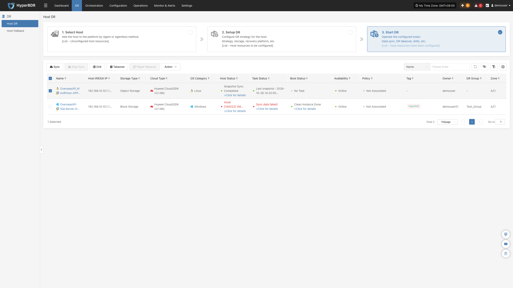

> 注意：必须先完成数据同步，才能执行后续操作。

### **立即同步**

在主机列表中，选择需要进行容灾的主机，点击“立即同步”。

在确认弹出的提示框中仔细阅读注意事项，点击“确认”，即可开始首次全量数据同步。

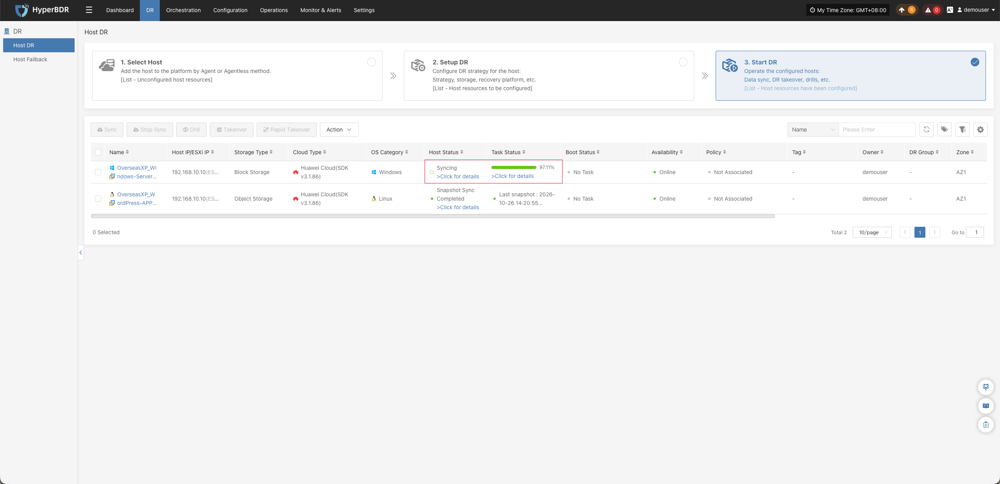

等待数据同步完成后，即可执行后续操作。同步过程中，可根据页面提示点击“点击查看详情”，查看主机状态及同步进度。

| 查看入口 | 说明 |
| --- | --- |
| 主机状态 | 点击“点击查看详情”，查看主机运行状态及数据同步情况。 |
| 任务状态 | 点击“点击查看详情”，查看任务执行情况及数据同步进度。 |
| 启动状态 | 点击“点击查看详情”，查看主机启动状态及启动进度。 |

### **停止同步**

同步过程中，待卷准备完毕后，如需取消同步，可点击页面上的“停止同步”按钮。

主机未处于同步状态或已完成同步时，不支持停止同步。

### **容灾演练**

选择需要演练的容灾主机，点击“容灾演练”并选择恢复时间点，即可将容灾主机恢复到目标环境。

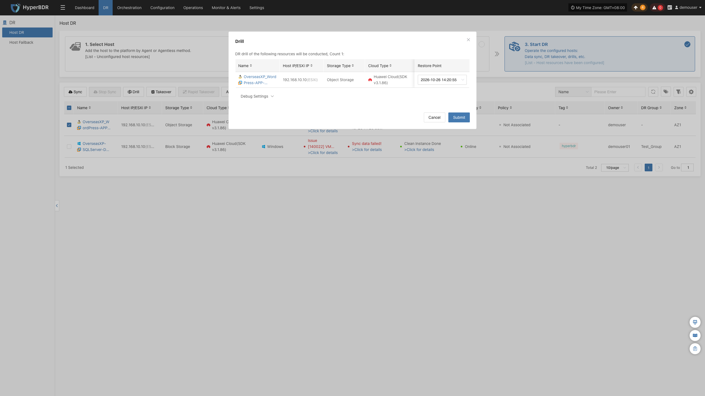

系统会根据预先配置的资源编排（计算、存储、网络等），自动创建或启动目标端实例。实例启动后，可登录目标平台进行配置验证和业务演练。

恢复完成后，检查应用服务、数据库、负载均衡等是否正常工作。

### **容灾接管**

选择需要接管的业务主机，点击 **“容灾接管”**，根据需求选择恢复快照时间点，再点击 **“确定”**。

系统会根据预先配置的资源编排（计算、存储、网络等），自动创建或启动目标端实例。实例启动后，可登录目标平台进行配置验证和业务接管。

业务启动后，请检查数据库版本、应用服务配置及依赖服务（如缓存、消息队列）是否正常。

### **快速接管**

快速接管功能可直接使用云同步网关上的目标盘进行业务接管。接管完成后，该主机将不再支持继续同步，且仅支持块存储模式。

1. 选中一台或多台主机后，在主机容灾页面，点击“快速接管”。

2. 在弹出的窗口中，根据页面提示点击“解除策略关联”。待策略状态显示为“无策略”后，点击“下一步”。

3. 勾选需要进行快速接管的主机，并勾选“我已知晓快速接管的影响，并确认继续执行。”确认已了解相关影响后，点击“确认快速接管”，开始执行快速接管。

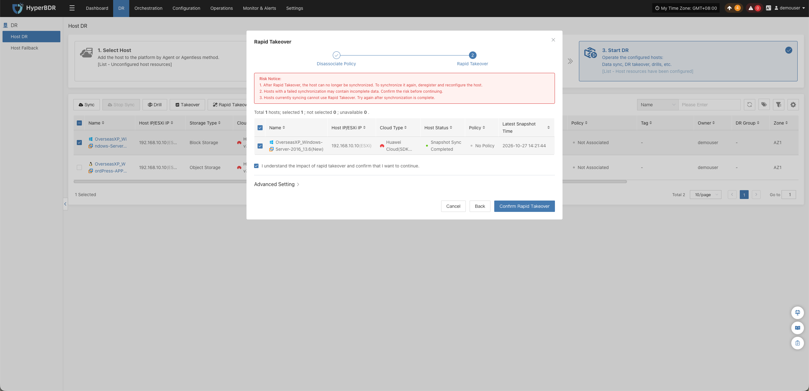

### **更多操作**

点击“更多操作”，可对已配置的主机执行配置调整及其他管理操作。

#### **指定容灾平台**

> 注意：已完成数据同步主机不支持更改

点击 **“指定容灾平台”**，可修改该主机使用的容灾目标平台，具体操作可参考：

块存储：[点击查看](#指定容灾平台)

对象存储：[点击查看](#指定容灾平台-1)

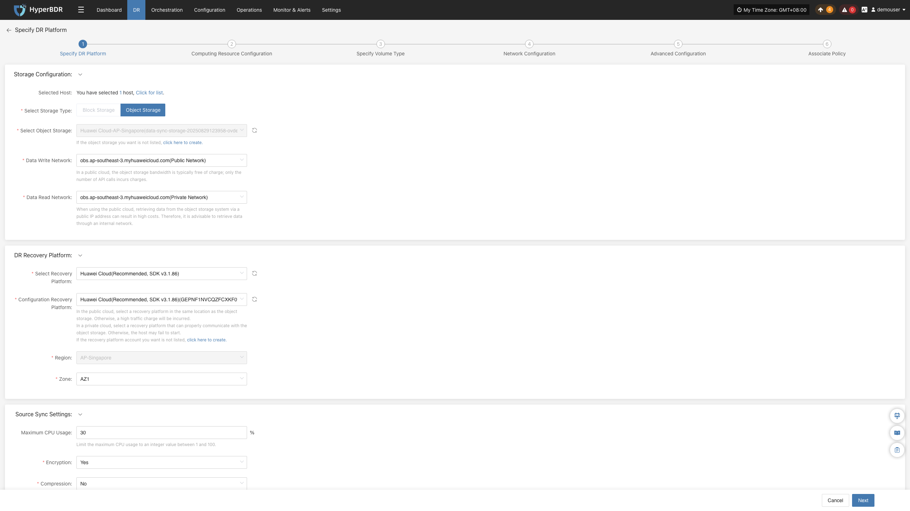

#### **指定云同步网关**

> 注意：已完成数据同步主机不支持更改

点击 **“指定云同步网关”**，可修改该主机使用的云同步网关，具体操作可参考：

块存储：[点击查看](#指定云同步网关)

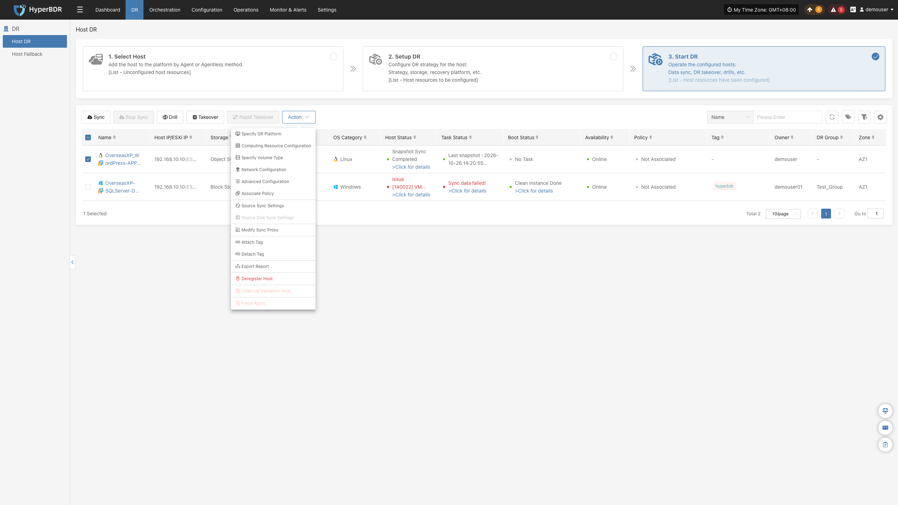

#### **指定卷类型**

> 注意：已完成数据同步主机不支持更改

点击 **“指定卷类型”**，可修改目标端卷类型，具体操作可参考：

块存储：[点击查看](#指定卷类型)

对象存储：[点击查看](#指定卷类型-1)

#### **计算资源配置**

> 注意：已完成数据同步主机不支持更改

点击 **“计算资源配置”**，可调整目标端的计算资源配置，具体操作可参考：

块存储：[点击查看](#计算资源配置)

对象存储：[点击查看](#计算资源配置-1)

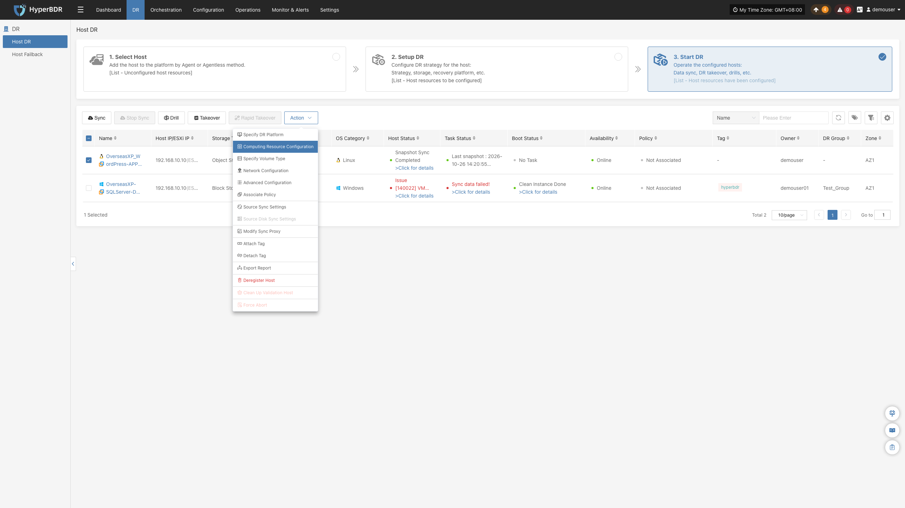

#### **网络配置**

> 注意：已完成数据同步主机不支持更改

点击 **“网络配置”**，可调整目标端的网络配置，具体操作可参考：

块存储：[点击查看](#网络配置)

对象存储：[点击查看](#网络配置-1)

#### **高级配置**

点击 **“高级配置”**，可调整目标端的高级配置项，具体操作可参考：

块存储：[点击查看](#高级配置)

对象存储：[点击查看](#高级配置-1)

#### **关联策略**

点击 **“关联策略”**，可调整该主机关联的容灾策略，具体操作可参考：

块存储：[点击查看](#关联策略)

对象存储：[点击查看](#关联策略-1)

#### **源端同步设置**

用于配置备份主机的源端同步参数，以满足不同场景下的同步需求。

##### **通用设置**

> 该配置项适用于 Linux Agent、Windows Agent 和 Agentless 三种模式。不同模式下，界面布局或配置位置可能略有差异，请以实际界面显示为准。

| 参数                   | 配置 | 说明                                                         |
| ---------------------- | ---- | ------------------------------------------------------------ |
| CPU 最大使用率（%）    | 30   | 限制备份任务可使用的 CPU 最大比例。数值越大，备份速度越快，但对源端主机业务的影响也越大。建议根据业务负载合理设置，一般保持默认即可。 |
| 可用内存    | 1024   | 系统中剩余的可用内存大小，取值范围为 700～1024 的整数。 |
| 启用加密               | 是   | 开启后，传输的数据会进行加密，提高数据安全性，但会增加一定的 CPU 消耗，可能导致备份速度略有下降。 |
| 启用压缩               | 否   | 开启后，系统会在传输前对数据进行压缩，减少网络传输的数据量，适合网络带宽较低的场景。由于不同类型的数据压缩效果不同，实际节省的数据量会有所差异，系统会自动选择合适的压缩策略。 |
| 重复数据检查           | 自动 | 用于检测并跳过重复数据，减少数据传输量。 **自动**：系统根据实际情况自动决定是否执行重复数据检查（推荐）。 **启用**：每次同步均执行重复数据检查。 **禁用**：每次同步均不执行重复数据检查。 |
| 卷预留空间           | 3 | Windows Agent 卷剩余的可用空间比例，取值范围大于等于0，小于等于99。|
| 创建快照超时时间（秒） | 600  | 创建快照允许等待的最长时间，单位为秒。取值范围为 **600～86400**。如果超过该时间仍未完成快照创建，则本次任务会判定为失败。对于创建快照耗时较长的环境，可适当增大该值。 |

##### **同步线程设置**

> 该配置项适用于 Agentless 模式。不同模式下，界面布局或配置位置可能略有差异，请以实际界面显示为准。

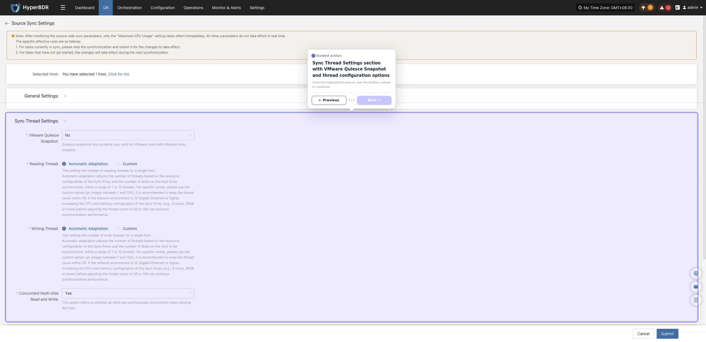

| 参数            | 配置     | 说明                                                         |
| --------------- | -------- | ------------------------------------------------------------ |
| VMware 静默快照 | 否       | 仅适用于已安装 **VMware Tools** 的 VMware 虚拟机。开启后，创建快照时可尽可能保证文件系统一致性，建议根据业务需要开启。 |
| 读线程          | 自动适配 | 设置单个主机的数据读取线程数。默认采用**自动适配**模式，系统会根据源端同步代理的资源配置和待同步主机的磁盘数量自动调整线程数（1～10），无需手动配置。 仅在需要进一步优化同步性能时，可使用**自定义**模式（1～100），建议线程数不超过30。在万兆及以上网络环境中，可在提升源端同步代理资源配置（如 8 核 CPU、16 GB 内存及以上）后，适当增加线程数以提升同步性能。 |
| 写线程          | 自动适配 | 设置单个主机的数据写入线程数。默认采用**自动适配**模式，系统会根据源端同步代理的资源配置和待同步主机的磁盘数量自动调整线程数（1～10），无需手动配置。 仅在需要进一步优化同步性能时，可使用**自定义**模式（1～100），建议线程数不超过30。在万兆及以上网络环境中，可在提升源端同步代理资源配置（如 8 核 CPU、16 GB 内存及以上）后，适当增加线程数以提升同步性能。 |
| 多磁盘并发读写  | 是       | 控制同步时是否同时对多个磁盘进行数据读写。开启后，可并发同步多个磁盘，提高同步效率；关闭后，将按顺序同步各磁盘，适用于对系统资源占用要求较高的场景。 |

##### **同步重试设置**

> 该配置项适用于 Linux Agent、Windows Agent 和 Agentless 三种模式。不同模式下，界面布局或配置位置可能略有差异，请以实际界面显示为准。

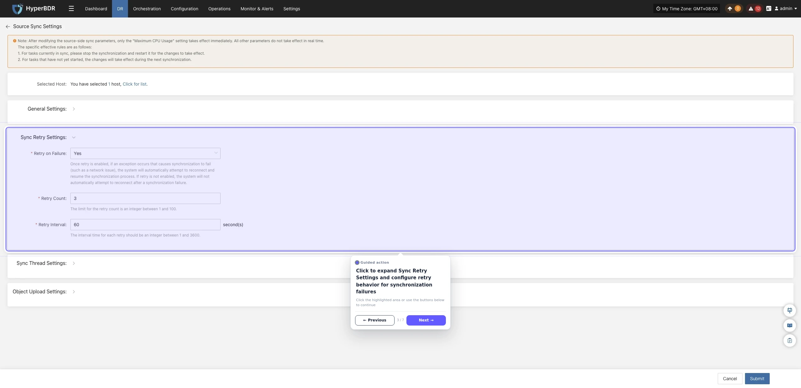

| 参数     | 配置 | 说明                                                         |
| -------- | ---- | ------------------------------------------------------------ |
| 是否重试 | 是   | 开启后，当同步因网络异常等临时故障中断时，系统将自动尝试重新连接并继续同步；关闭后，同步失败将直接结束，不再自动重试。 |
| 重试次数 | 3    | 设置同步失败后的最大重试次数，取值范围为 **1～100**。达到最大重试次数后，如仍未恢复连接，则本次同步任务将判定为失败。 |
| 间隔时间 | 60   | 设置两次重试之间的等待时间，单位为**秒**，取值范围为 **1～3600**。适当增加间隔时间有助于等待网络恢复，避免频繁重试。 |

##### **同步线程设置**

> 该配置项适用于 Linux Agent、Windows Agent 模式。不同模式下，界面布局或配置位置可能略有差异，请以实际界面显示为准。

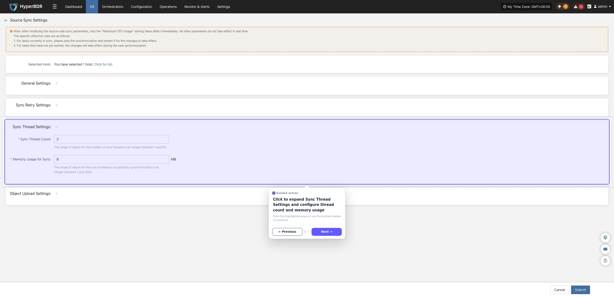

| 参数             | 配置 | 说明                                                         |
| ---------------- | ---- | ------------------------------------------------------------ |
| 同步线程数       | 2    | 设置同步任务使用的线程数量。适当增加线程数可提升同步性能，但会占用更多系统资源。取值范围为 **1～64**，建议根据主机资源配置合理调整。 |
| 同步占用内存大小 | 8    | 设置同步任务可使用的内存大小。适当增加该值有助于提升同步性能，但会增加内存占用。取值范围为 **1～1024**，建议根据主机可用内存合理设置。 |

##### **对象上传设置**

> 该配置项适用于 Linux Agent 模式。不同模式下，界面布局或配置位置可能略有差异，请以实际界面显示为准。

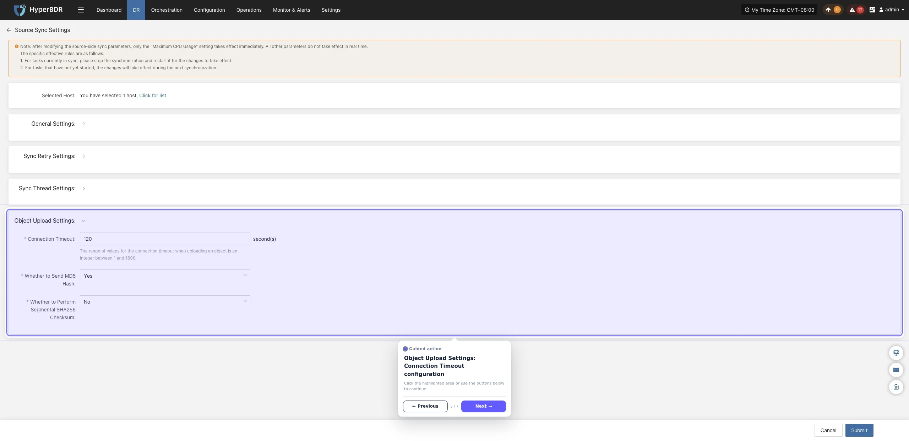

| 参数                 | 配置 | 说明                                                         |
| -------------------- | ---- | ------------------------------------------------------------ |
| 连接超时时间         | 120  | 设置上传对象时建立连接的最长等待时间，单位为**秒**。取值范围为 **1～1800**。超过该时间仍未建立连接，则本次连接将判定为超时。 |
| 是否发送 MD5 摘要    | 是   | 开启后，上传对象时将发送 MD5 摘要用于校验数据完整性，帮助发现传输过程中可能发生的数据损坏。 |
| 是否分段 SHA256 校验 | 否   | 开启后，系统将在分段上传过程中对每个数据分段进行 SHA256 校验，进一步提高数据传输的完整性校验能力，但可能会增加一定的计算开销。 |

##### **卷VSS存储设置**

> 该配置项适用于 Windows Agent 模式。不同模式下，界面布局或配置位置可能略有差异，请以实际界面显示为准。

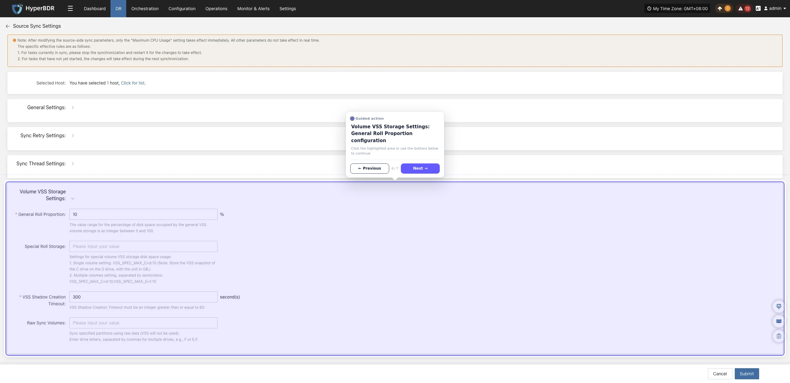

| 参数              | 配置                  | 说明                                                         |
| ----------------- | --------------------- | ------------------------------------------------------------ |
| 卷通用占比        | 10                    | 设置 VSS 快照存储默认可占用磁盘空间的比例，单位为 **%**。取值范围为 **5～100**。当未为卷单独配置 VSS 存储空间时，将采用此配置。 |
| 卷特殊存储        | `VSS_SPEC_MAX_C=d:10` | 为指定卷单独设置 VSS 快照存储位置及容量。\<br\>**单卷配置示例：**`VSS_SPEC_MAX_C=d:10`，表示将 **C** 卷的 VSS 快照存储在 **D** 卷，并分配 **10 GB** 存储空间。\<br\>**多卷配置示例：**`VSS_SPEC_MAX_C=d:10;VSS_SPEC_MAX_E=f:10`，多个卷之间使用分号（`;`）分隔。**该配置若无特殊需求，默认留空** |
| 创建 VSS 快照超时 | 300                   | 设置创建 VSS 快照的最长等待时间，单位为**秒**。取值应大于或等于 **60**。超过该时间仍未完成快照创建，则本次操作将判定为失败。 |
| 裸数据同步卷      | F                     | 指定分区采用裸数据方式进行同步，不使用 VSS 快照。输入盘符即可，多个盘符使用英文逗号（`,`）分隔，例如：`F` 或 `E,F`。适用于无需 VSS 一致性快照的分区。**该配置若无特殊需求，默认留空** |

#### **源端磁盘同步设置**

用于配置源端磁盘的同步策略。源端包含多块磁盘时，可分别设置各磁盘是否参与同步。此功能仅适用于通过 Agent 模式添加的主机。

> 注意：该配置仅支持在首次同步数据前修改，同步开始后将无法修改。

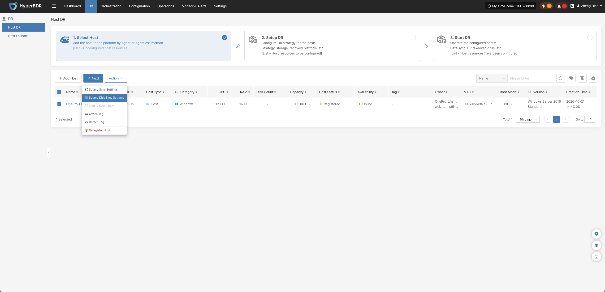

选择无需同步的磁盘，将对应行最后一列的 **Yes** 修改为 **No** 并在弹出的窗口内选择确认，即可完成排除设置。设置完成后，后续同步任务将不再同步该磁盘。

#### **修改源端同步代理**

> 注意：已完成数据同步主机不支持更改

用于修改备份主机关联的源端同步代理，以调整数据同步所使用的代理节点。

#### **绑定标签**

用于为备份主机绑定一个或多个标签，便于根据业务、环境或用途进行分类管理。

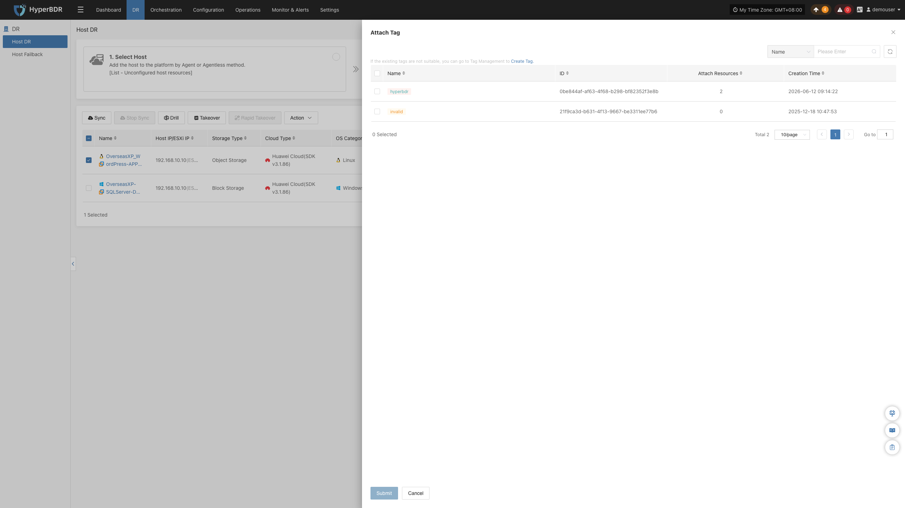

#### **解绑标签**

用于解除备份主机与指定标签的关联，便于调整主机的标签分类。

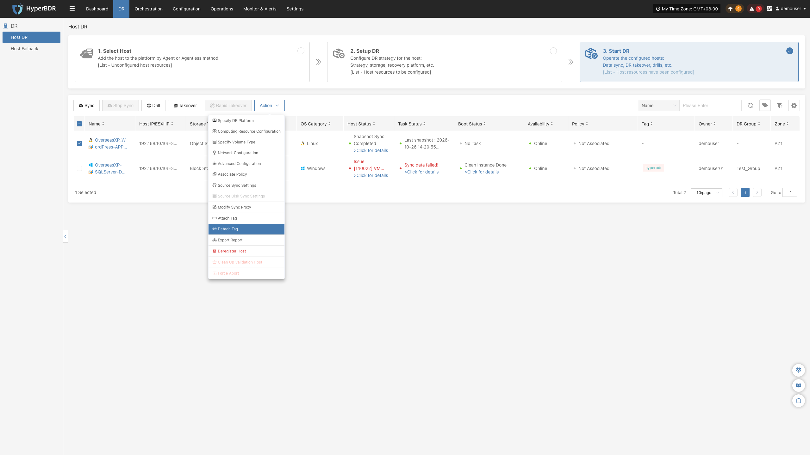

#### **报告导出**

用于导出所选主机的容灾报告，便于查看和留存。导出时可选择报告类型，具体说明请参见[报告导出](../../operations/reports.html#报告导出)。

#### **解除注册主机**

用于解除备份主机在容灾管理平台的注册关系，取消该主机与平台的注册关联。点击 **“解除注册主机”** 按钮，在弹出的对话框中仔细查看注意事项后点击确认，即可解除注册。

> **注意：** 解除注册后会自动注销服务。请根据接入模式重新加载主机或重启 Agent 服务：
>
> - **源端无代理模式：** 在“选择主机”步骤中选择对应的生产平台站点，再选择需要注册的主机。
> - **Agent 模式：** 登录源端主机，重启 Agent 服务。
>
> **高级功能：**
>
> - **清理资源（不解除注册）：** 适用于同步后需要重新配置容灾平台的主机。该操作会将主机恢复到容灾配置的初始状态，并清除所有已同步的数据。清理完成后，可在“容灾配置”步骤中重新配置。
> - **强制解除注册：** 适用于已失联的主机。勾选“我确认要强制解除注册主机，可能会导致有资源残留。”，再选择“强制解除注册”。

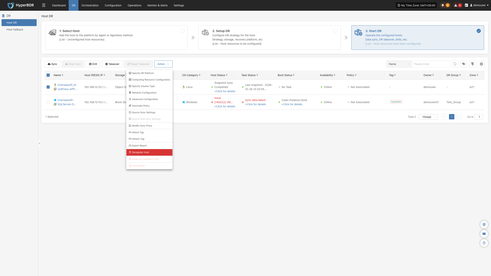

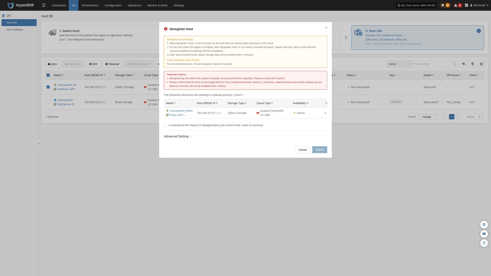

#### **清理验证主机**

用于清理当前主机在云端启动的验证主机。该操作仅清理云上已启动的主机。点击 **“清理验证主机”** 按钮，在弹出的对话框中输入“Yes”并确认即可。

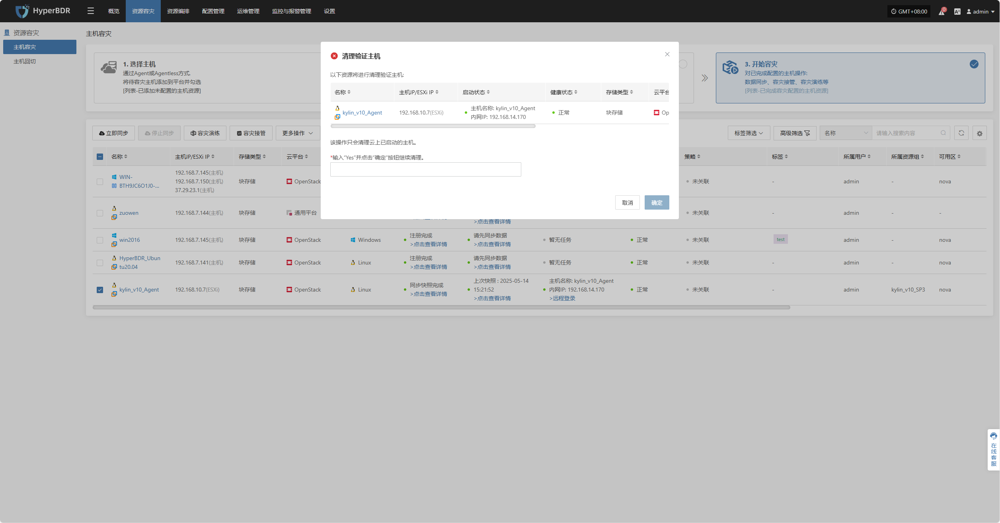

#### **强制终止**

> 注意：当同步或演练等操作长时间卡顿或遇到不可控异常时，可使用该功能强制终止任务。

点击 **“强制终止”** 按钮，立即停止当前任务的执行。

