# **告警规则**

为保障系统运行的安全性、稳定性以及关键事件的可观测性，系统内置告警规则功能，用于实时监控容灾主机的运行状态与资源使用情况，并在检测到异常时触发告警通知，帮助运维人员及时发现并处理问题，降低对业务系统的潜在影响。

::: tip
最佳告警规则配置实践可参考 [【运维指南】>【监控与报警管理】>【报警配置最佳实践】](../../om-guide/monitor-alerts/alarm-best-practice.md) 章节，以获取详细的配置建议和操作指导。
:::

## **资源规则**

在系统菜单中依次进入：**【监控与报警管理】>【告警规则】>【资源规则】**。

进入资源告警规则页面后，支持统一查看、创建与管理相关资源监控规则。

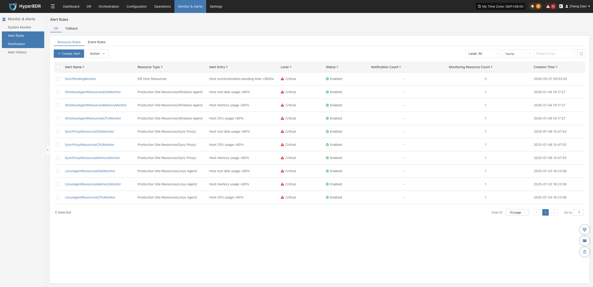

### **创建告警规则**

点击列表左上方 **【+ 创建告警规则】** 按钮，进入资源告警规则创建页面：

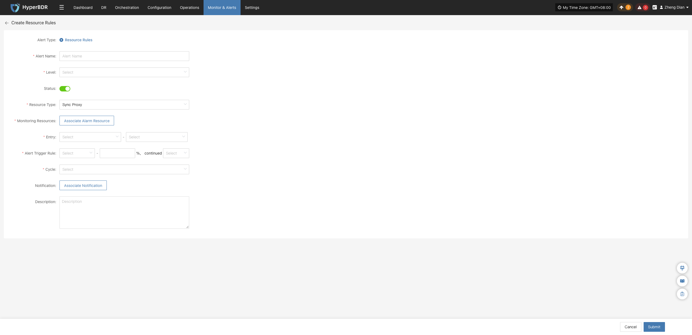

#### **告警规则配置字段说明**

| **字段名称** | **示例** | **说明** |
| :--- | :--- | :--- |
| **规则类型** | 资源告警规则 | 选择告警规则所属的分类或用途类型，用于区分不同类型的监控策略。 |
| **规则名称** | test | 自定义告警规则名称，用于识别和管理告警规则。 |
| **告警级别** | 严重 | 指定告警的严重程度，例如：提示、严重、紧急。 |
| **启用状态** | 已启用 | 设置告警规则是否启用，启用后系统将按照配置进行监控和告警。 |
| **资源类型** | 源端同步代理 | 表示告警规则监控的资源种类。常见资源类型包括： • 源端同步代理 • 云同步网关 • Linux Agent • Windows Agent • 对象存储资源 |
| **监控资源** | ubuntu-ova | 选择需要监控的资源对象（可添加多个），系统将根据配置对这些资源进行持续监控。 |
| **监控指标** | CPU | 设置要监控的具体指标项。支持项包括： • CPU • 磁盘 • 内存 • 进程 |
| **告警触发规则** | ≥ 80%，持续 5 分钟 | 设置告警触发的条件，例如当某指标超过设定阈值且持续一定时间后触发告警。 |
| **检测周期** | 5 分钟 | 配置系统进行告警检测的时间间隔，表示多久检测一次指标状态。 |
| **通知对象** | - | 设置告警触发后要通知的对象（可为用户或用户组）。 |
| **规则描述** | - | 可选填写，用于记录告警规则的用途或相关说明，方便管理与查看。 |

#### **监控资源类型说明**

| **资源类型** | **监控指标** | **说明** |
| :--- | :--- | :--- |
| **源端同步代理** | CPU、内存、磁盘、进程 | 监控源端同步代理资源使用情况及进程状态 |
| **云同步网关** | CPU、内存、磁盘、进程 | 监控云同步网关资源使用情况及进程状态 |
| **Linux Agent** | CPU、内存、磁盘、进程 | 监控 Linux Agent 资源使用情况及进程状态 |
| **Windows Agent** | CPU、内存、磁盘、进程 | 监控 Windows Agent 资源使用情况及进程状态 |
| **对象存储资源** | 对象存储容量 | 监控存储容量的使用情况 |

::: note
告警规则创建完成后，系统将在对应事件发生时自动触发告警，并依据已关联的通知对象通过指定渠道发送通知。同时，相关告警信息将同步展示在平台的“报警消息”页面中，便于统一查看与处置。
:::

### **更多操作**

选中需要管理的资源告警规则，点击 **【更多操作】** 按钮展开操作菜单。部分操作不支持批量执行，请以页面实际显示为准：

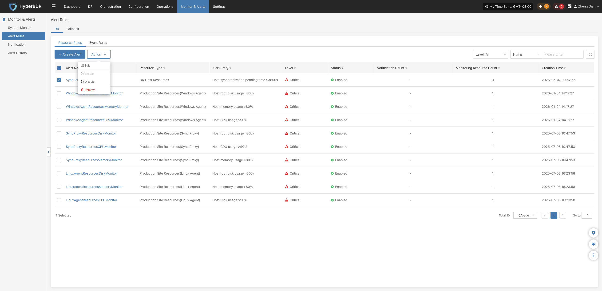

#### **修改**

点击 **【修改】** 后，系统将跳转页面，用户可在该页面对已创建的资源告警规则参数进行重新编辑与调整：

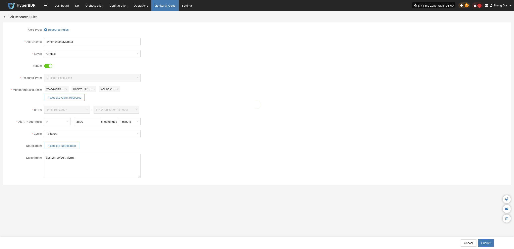

#### **启用**

点击 **【启用】** 后，告警规则状态变更为“已启用”：

#### **停用**

点击 **【停用】** 后，告警规则状态变更为“已停用”。已停用的规则将停止监控指标：

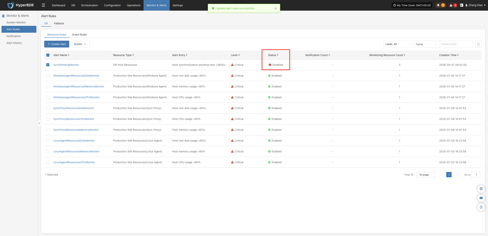

#### **移除**

点击 **【移除】** 后，系统将弹出二次确认对话框，确认后删除该告警规则：

::: warning
移除操作将删除当前告警策略配置，操作不可逆，请确认无在用业务依赖后再执行移除。
:::

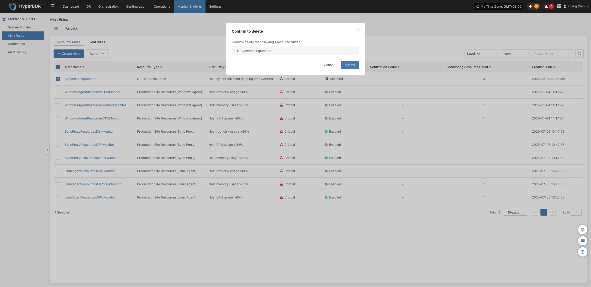

## **事件规则**

在系统菜单中依次进入：**【监控与报警管理】>【告警规则】>【事件告警规则】**。

进入事件告警规则页面后，支持统一查看、创建与管理各类事件监控规则。

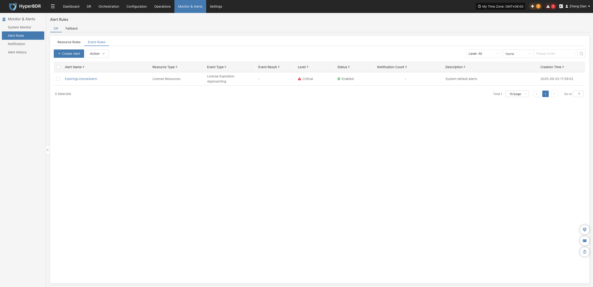

### **创建告警规则**

点击列表左上方 **【+ 创建告警规则】** 按钮，进入事件告警规则创建页面：

#### **告警规则配置字段说明**

| **字段名称** | **示例** | **说明** |
| :--- | :--- | :--- |
| **规则类型** | 事件告警规则 | 设置告警规则的类型。事件告警规则用于监控关键操作行为与异常状态，触发事件时进行告警通知。 |
| **规则名称** | test | 用户自定义的告警规则名称，用于识别和管理该告警规则配置。 |
| **告警级别** | 严重 | 告警事件的严重程度等级，例如：提示、严重、紧急等。 |
| **启用状态** | 已启用 | 当前告警规则是否处于启用状态，启用后系统将根据配置规则进行监控与告警。 |
| **事件类型** | 用户资源 / 登录 | 告警规则监控的事件类型。支持类型包括： • 用户资源 • 容灾主机资源 • License 资源 • 生产平台资源 • 容灾平台资源 • 监控报警资源组 • 对象存储 • 容灾策略 |
| **事件结果** | 成功 | 指定事件的执行结果触发条件。例如： • 成功 • 失败 |
| **通知对象** | 关联通知对象 | 告警触发后将通知的对象（人员或通知组），用于快速告知相关责任人。 |
| **规则描述** | — | 对告警规则的功能、配置目的等进行简要说明，便于识别与后续维护。 |

#### **事件类型说明**

| **事件类型** | **告警条件（部分示例）** | **说明** |
| :--- | :--- | :--- |
| **用户资源** | 登录、退出登录、修改手机号、修改密码、找回密码 | 涉及用户账户登录、身份认证、关键信息修改等行为事件。 |
| **容灾主机资源** | 添加主机容灾配置、启动主机、清理资源、强制中止任务、主机失联/恢复、快照完整性检查、同步主机、接管主机容灾、资源限制配置相关操作等 | 与容灾主机的任务执行、状态监控、资源操作相关。 |
| **License 资源** | 添加 License | 与系统授权状态、有效期、授权异常等相关的关键事件。 |
| **生产平台资源** | 添加/删除 Linux 或 Windows 代理、添加/删除/绑定源端同步代理及连接、虚拟机代理重载、连接状态变更等 | 涉及生产环境中代理程序的部署管理及其连接状态变化。 |
| **容灾平台资源** | 添加/删除/修改云平台、创建/删除云同步网关及过程事件 | 与容灾平台架构组件的创建、修改、部署状态等相关操作。 |
| **监控报警** | 创建/修改/删除告警规则与通知对象 | 与监控告警配置及告警发送机制相关的操作类事件。 |
| **资源组** | 创建/删除资源组、清理验证资源、演练/接管容灾、同步数据、修改资源组 | 多资源逻辑分组的创建与容灾流程管理相关的关键行为事件。 |
| **对象存储** | 添加/删除/更新对象存储、开始添加/删除操作 | 存储接入、配置变更、容量变化、访问异常等相关事件。 |
| **容灾策略** | 创建/删除/修改策略、关联/分离策略 | 涉及容灾计划策略配置的生命周期管理。 |

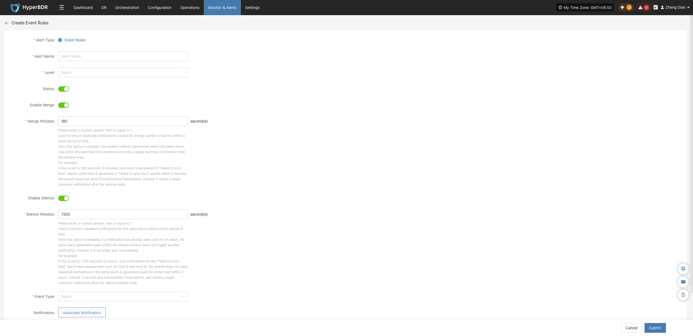

::: note
告警规则创建完成后，系统将在对应事件发生时自动触发告警，并依据已关联的通知对象通过指定渠道发送通知。同时，相关告警信息将同步展示在平台的“报警消息”页面中，便于统一查看与处置。
:::

### **更多操作**

选中需要管理的事件告警规则，点击 **【更多操作】** 按钮展开操作菜单：

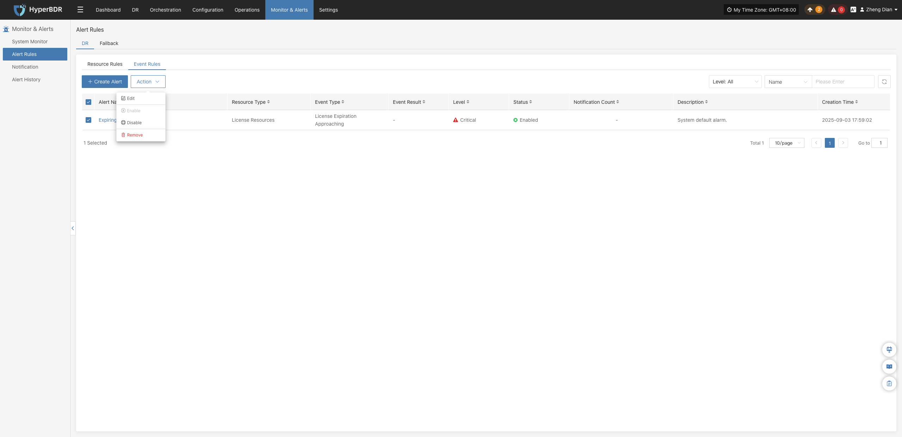

#### **修改**

点击 **【修改】** 后，系统将跳转页面，用户可在该页面对已创建的事件告警规则配置进行重新编辑与调整：

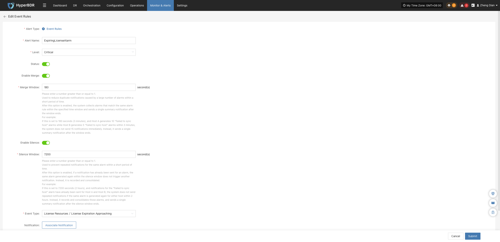

#### **启用**

点击 **【启用】** 后，告警规则状态变更为“已启用”：

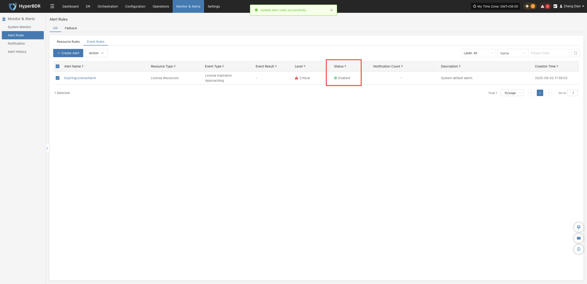

#### **停用**

点击 **【停用】** 后，告警规则状态变更为“已停用”：

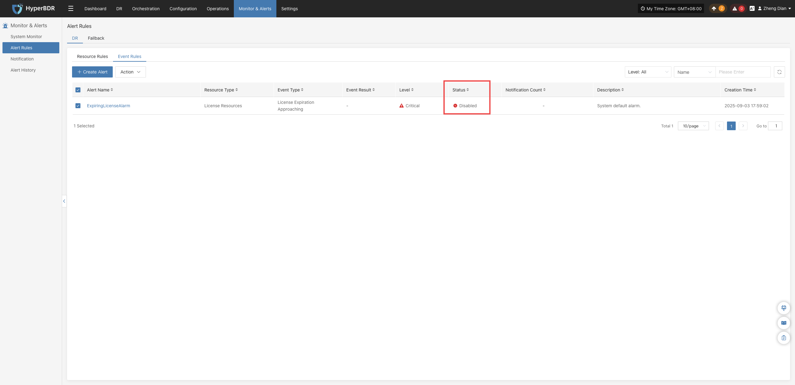

#### **移除**

点击 **【移除】** 后，系统将弹出二次确认对话框，确认后删除该告警规则：

::: warning
移除操作将删除当前事件告警策略，操作不可逆，请确认无在用业务依赖后再执行移除。
:::

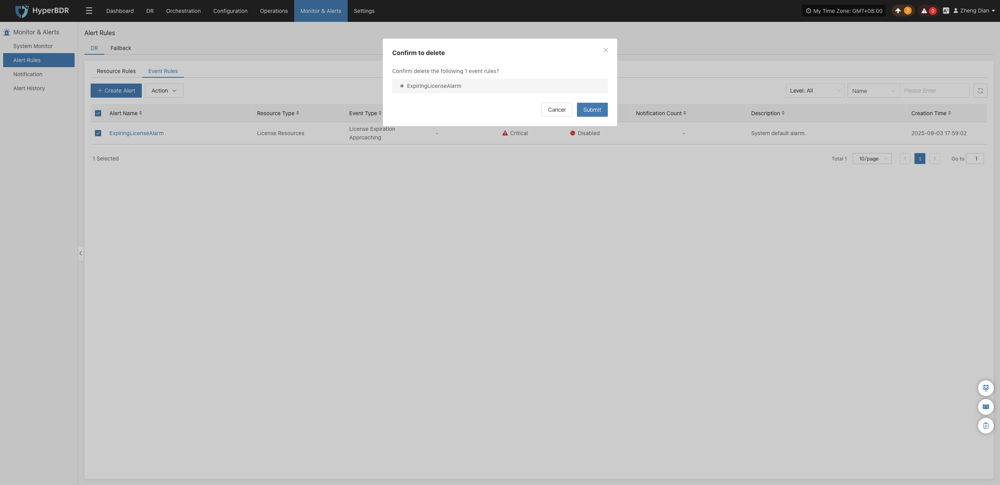
