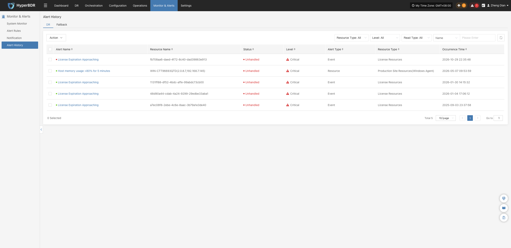
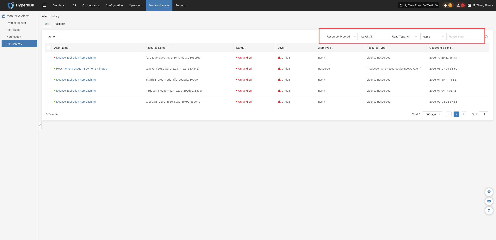
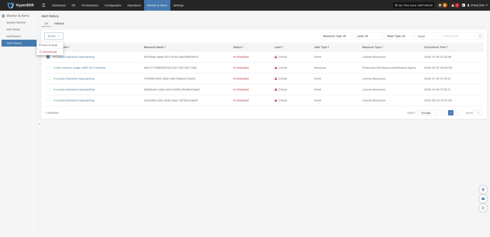
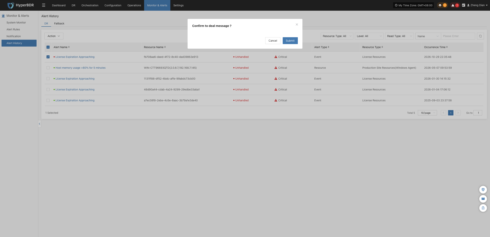
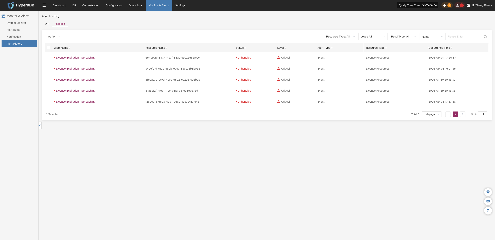
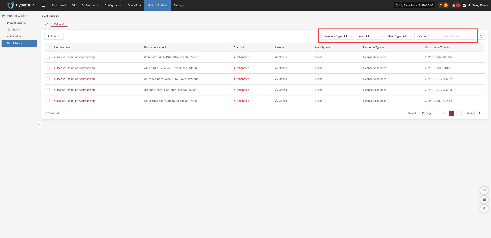
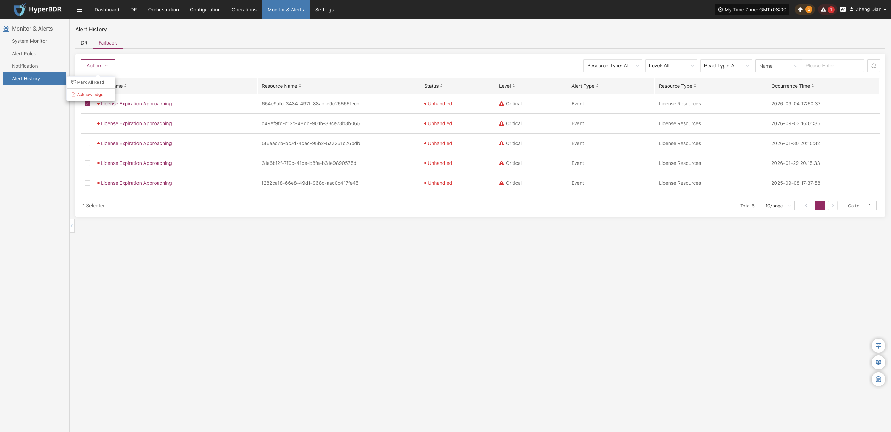
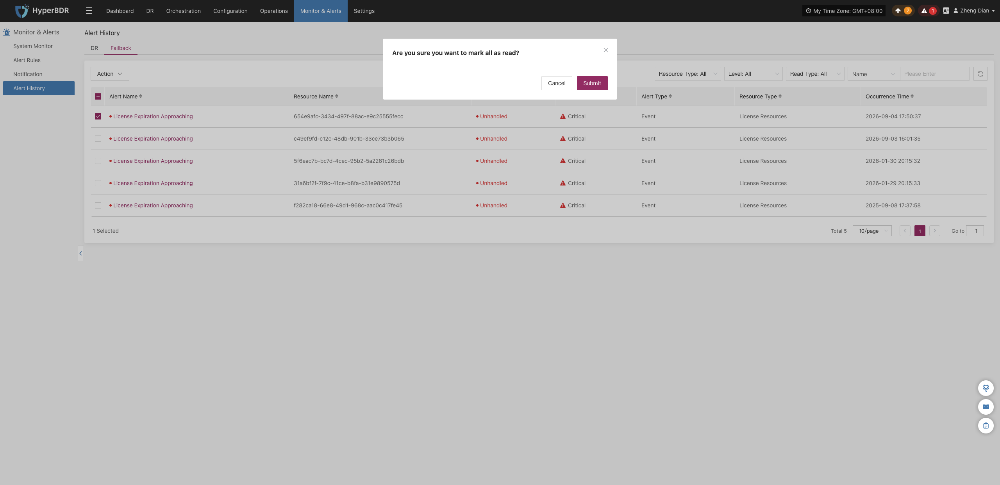

# **报警消息**

系统在运行过程中，会根据报警器添加规则监控各类资源状态与关键事件。当检测到异常指标或触发预设告警条件时，平台将自动生成报警消息。

::: note
如果创建报警器时绑定相关通知人，则会根据相应情况以邮件、短信或其他方式通知相关人员。
:::

## **容灾**

### **报警消息字段说明**

系统在检测到资源异常或事件触发后，会生成报警消息，具体字段说明如下：

| **字段名称** | **说明** |
| :--- | :--- |
| **报警消息名称** | 报警器触发时的事件类型，用于快速识别问题根因。 |
| **资源名称** | 触发报警的具体资源名称，例如主机名、服务名等。 |
| **处理状态** | 当前报警的处理进度或状态，如“未处理”、“已处理”等。 |
| **报警级别** | 报警事件的严重程度，常见等级包括“提示”、“严重”、“紧急”等。 |
| **报警类型** | 报警的具体类别，如“事件报警”、“资源报警”等。 |
| **资源类型** | 涉及的资源范围，包括： · 对象存储 · 容灾策略用户资源 · 容灾主机资源 · License 资源 · 生产平台资源 · 容灾平台资源 · 监控报警 · 资源组 |
| **发生时间** | 系统首次检测到该报警事件的时间点，用于问题溯源与响应时效分析。 |

### **筛选报警消息**

在报警消息列表右上角，支持按 **资源类型**（全部、对象存储、容灾主机等）、**报警级别**（全部、提示、严重、紧急等）、**读取状态**（全部、已读、未读）以及输入 **资源名称** 对报警记录进行多维度组合检索与精准筛选：

### **更多操作**

在报警消息页面，用户可对报警事件进行批量处理操作。勾选需要处理的一条或多条记录后，点击 **【更多操作】** 按钮，展开操作菜单：

支持以下两种批量处理操作：

1. **标记全部已读**：点击该选项后，系统弹出确认对话框提示“Are you sure you want to mark all as read?”，确认后即可将当前所有选中的报警消息批量标记为已读状态。

2. **处理**：点击该选项后，系统弹出确认对话框提示“Confirm to deal message ?”，确认后将当前报警事件的处理状态更新为已处理。

## **回切**

### **报警消息字段说明**

系统在检测到资源异常或事件触发后，会生成报警消息，具体字段说明如下：

| **字段名称** | **说明** |
| :--- | :--- |
| **报警消息名称** | 报警器触发时的事件类型，用于快速识别问题根因。 |
| **资源名称** | 触发报警的具体资源名称，例如主机名、服务名等。 |
| **处理状态** | 当前报警的处理进度或状态，如“未处理”、“已处理”等。 |
| **报警级别** | 报警事件的严重程度，常见等级包括“提示”、“严重”、“紧急”等。 |
| **报警类型** | 报警的具体类别，如“事件报警”、“资源报警”等。 |
| **资源类型** | 涉及的资源范围，包括： · 对象存储 · 容灾策略用户资源 · 容灾主机资源 · License 资源 · 生产平台资源 · 容灾平台资源 · 监控报警 · 资源组 |
| **发生时间** | 系统首次检测到该报警事件的时间点，用于问题溯源与响应时效分析。 |

### **筛选报警消息**

在回切报警消息列表右上角，同样支持按资源类型、报警级别、读取状态及名称对回切报警记录进行筛选与过滤：

### **更多操作**

在回切报警消息页面，勾选一个或多个回切报警记录后点击 **【更多操作】** 按钮，展开操作菜单：

支持以下两种批量处理操作：

1. **标记全部已读**：点击后弹出“Are you sure you want to mark all as read?”确认框，确认后批量标记为已读。

2. **处理**：点击后弹出“Confirm to deal message ?”确认框，确认后将选中的回切报警更新为已处理。

