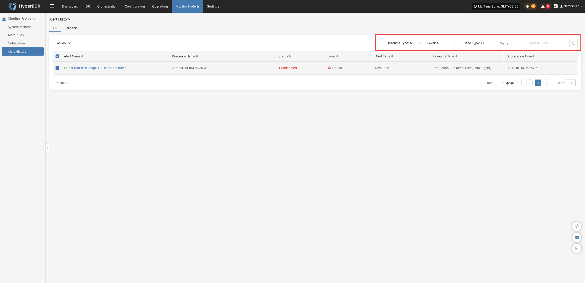
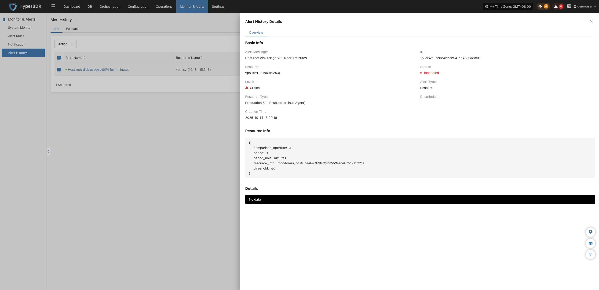
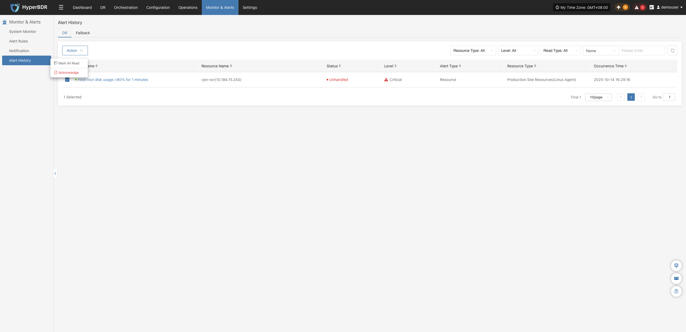
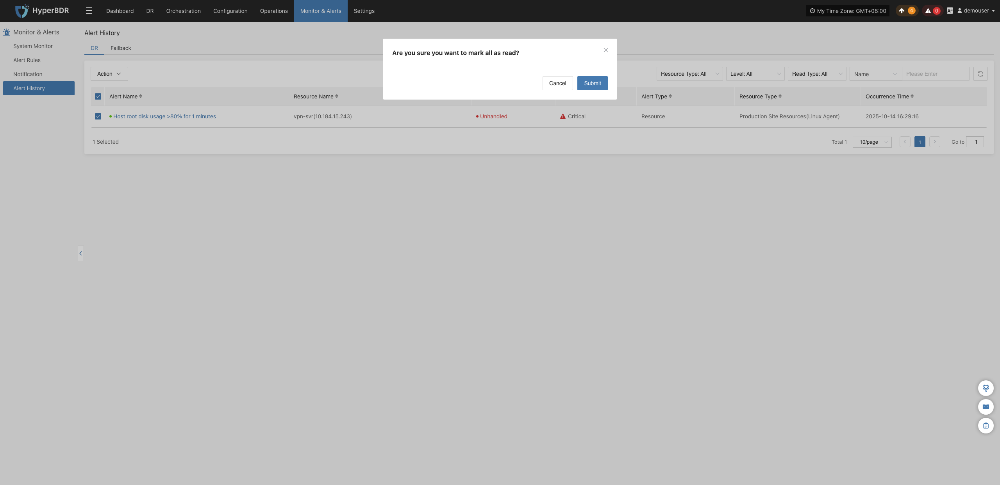
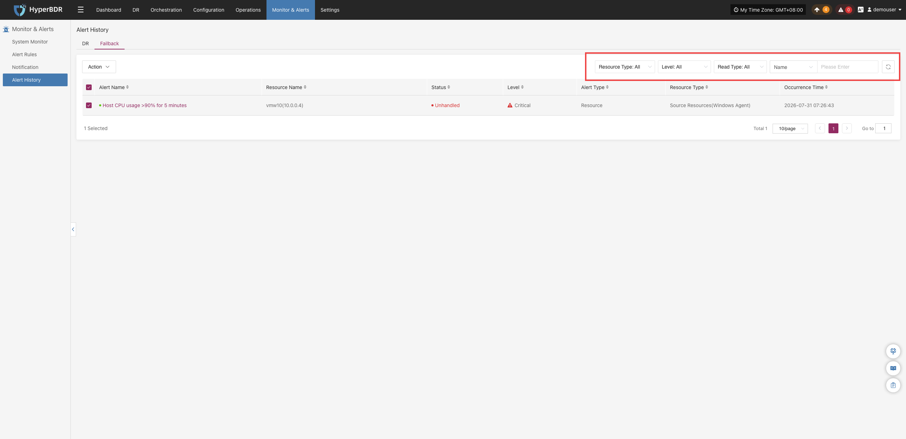
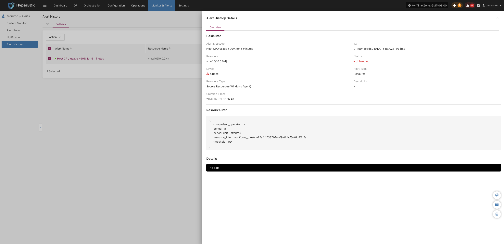
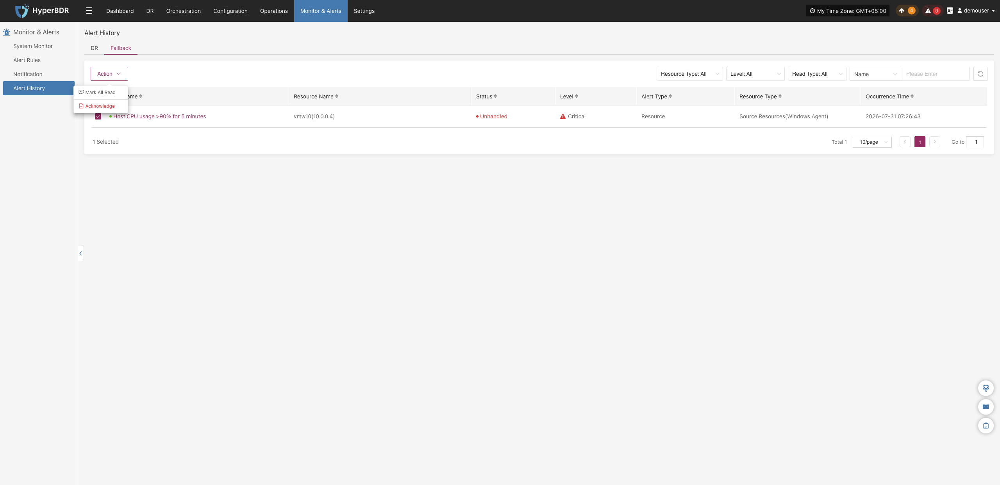
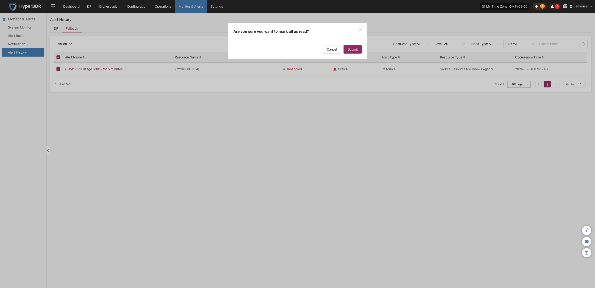

# **报警消息**

系统在运行过程中，会根据已配置的报警规则监控各类资源状态与关键事件。当检测到异常指标或触发预设告警条件时，平台将自动生成报警消息。

::: note
如果创建报警器时绑定了通知对象，系统会根据报警情况以邮件、短信或其他方式通知相关人员。
:::

## **报警消息字段说明**

系统在检测到资源异常或事件触发后，会生成报警消息，字段说明如下：

| **字段名称** | **说明** |
| :--- | :--- |
| **报警消息名称** | 触发报警的事件或指标类型，用于快速识别问题根因。 |
| **资源名称** | 触发报警的具体资源名称，例如主机名、服务名等。 |
| **处理状态** | 当前报警的处理进度，如“未处理”、“已处理”等。 |
| **报警级别** | 报警事件的严重程度，包括“提示”、“严重”、“紧急”等。 |
| **报警类型** | 报警的具体类别，如“事件报警”、“资源报警”等。 |
| **资源类型** | 触发报警的资源所属类型，具体取值见下文。 |
| **发生时间** | 系统首次检测到该报警事件的时间点，用于问题溯源与响应时效分析。 |

资源类型包括：

- 对象存储
- 容灾策略用户资源
- 容灾主机资源
- License 资源
- 生产平台资源
- 容灾平台资源
- 监控报警
- 资源组

## **容灾**

容灾报警消息列表如下图所示。

### **筛选报警消息**

在报警消息列表右上角，支持按 **资源类型**（全部、对象存储、容灾主机等）、**报警级别**（全部、提示、严重、紧急等）、**读取状态**（全部、已读、未读）筛选，也可输入 **资源名称** 进行检索，多个条件可组合使用。

### **查看报警详情**

在报警消息列表中，点击目标报警记录的名称，系统将在右侧弹出报警详情抽屉，展示该报警事件的触发规则、严重级别、关联监控指标及处置建议等详细信息。

### **更多操作**

在报警消息页面，勾选一条或多条记录后，点击【更多操作】按钮展开操作菜单，可对所选报警消息进行批量处理。

支持以下两种批量操作：

1. **【标记全部已读】（Mark All Read）**：点击后弹出确认对话框，提示“Are you sure you want to mark all as read?”（是否将所选报警标记为已读），确认后将所选报警消息批量标记为已读。该操作仅对勾选的记录生效，不影响未勾选记录。

   

2. **【确认处理】（Acknowledge）**：点击后弹出确认对话框，提示“Confirm to deal message ?”（是否确认处理该消息），确认后将所选报警消息的处理状态更新为“已处理”。

   

## **回切**

回切报警消息列表如下图所示。

### **筛选报警消息**

在回切报警消息列表右上角，同样支持按 **资源类型**、**报警级别**、**读取状态** 筛选，并可输入 **资源名称** 进行检索，多个条件可组合使用。

### **查看报警详情**

在回切报警消息列表中，点击目标报警记录的名称，系统将在右侧弹出报警详情抽屉，展示该报警事件的触发规则、严重级别、关联监控指标及处置建议等详细信息。

### **更多操作**

在回切报警消息页面，勾选一条或多条记录后，点击【更多操作】按钮展开操作菜单，可对所选回切报警消息进行批量处理。

支持以下两种批量操作：

1. **【标记全部已读】（Mark All Read）**：点击后弹出确认对话框，提示“Are you sure you want to mark all as read?”（是否将所选报警标记为已读），确认后将所选回切报警消息批量标记为已读。该操作仅对勾选的记录生效，不影响未勾选记录。

   

2. **【确认处理】（Acknowledge）**：点击后弹出确认对话框，提示“Confirm to deal message ?”（是否确认处理该消息），确认后将所选回切报警消息的处理状态更新为“已处理”。

   
