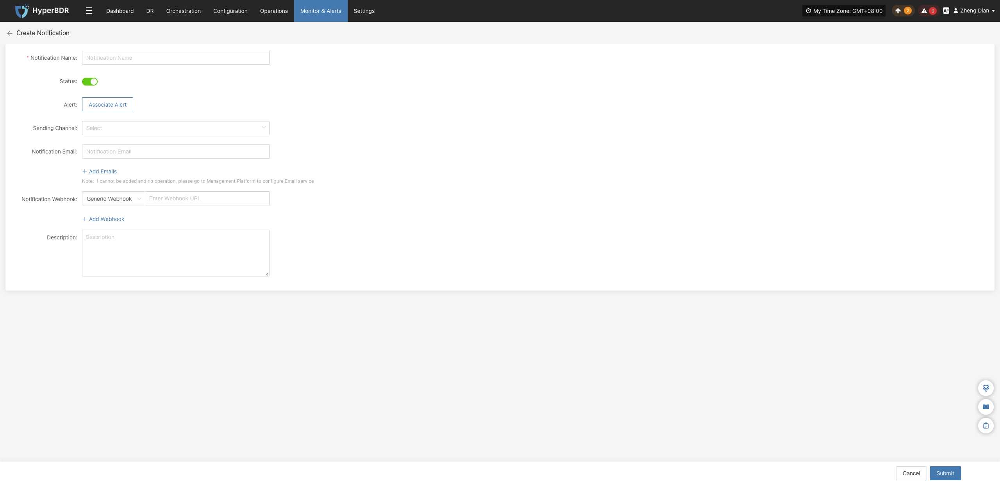
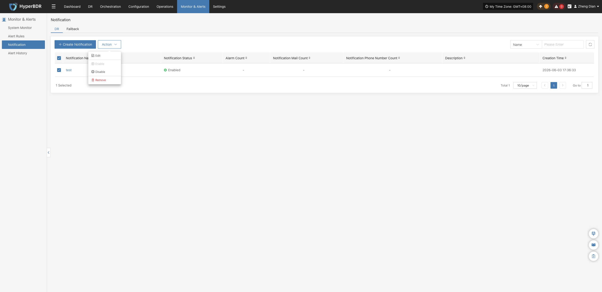
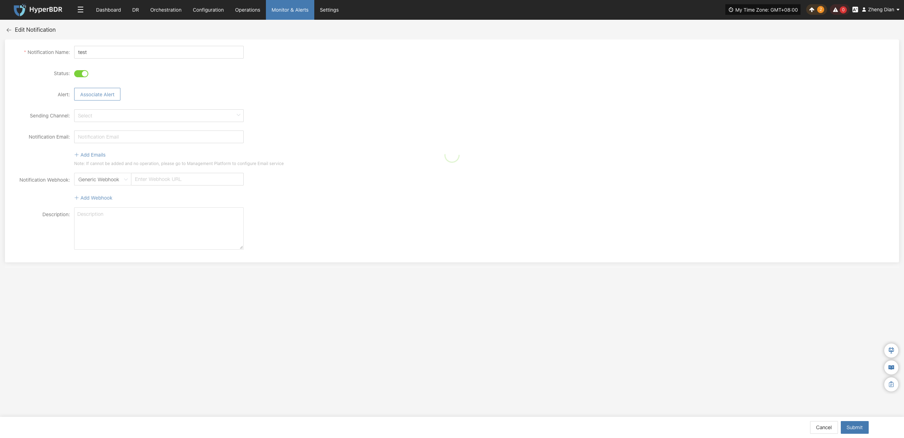
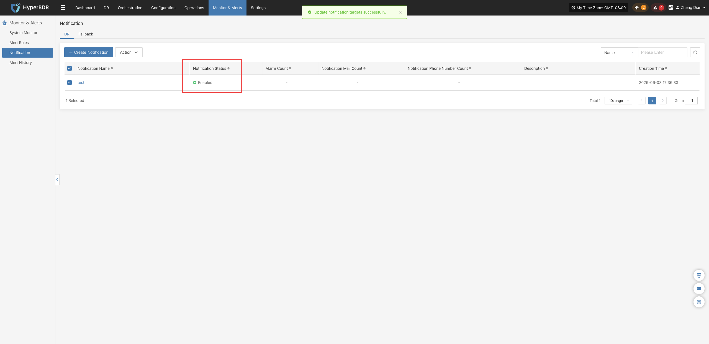
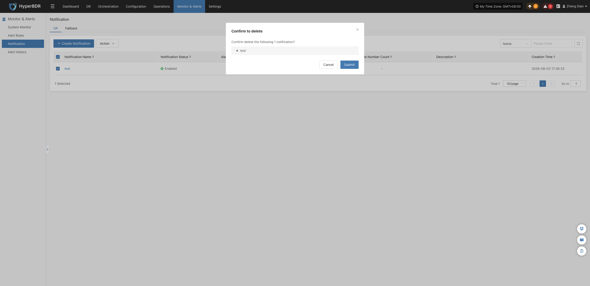
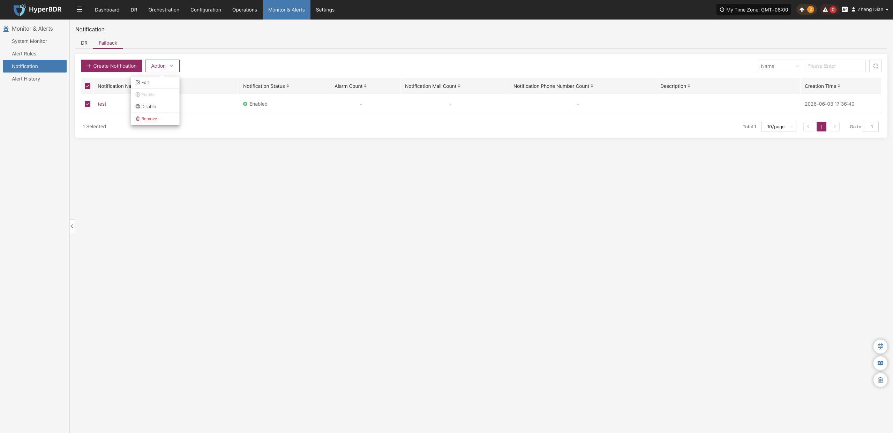
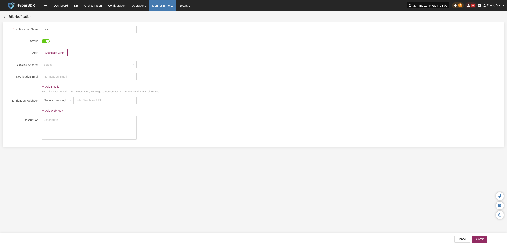
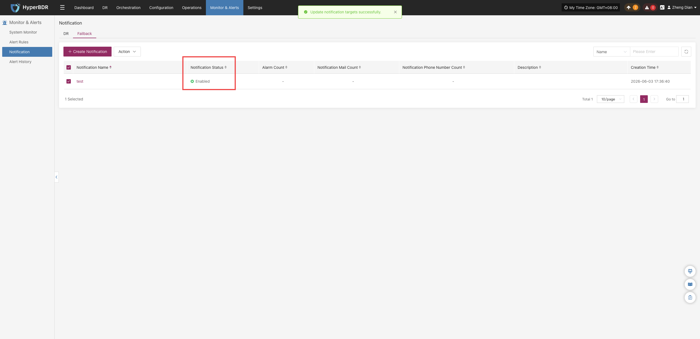
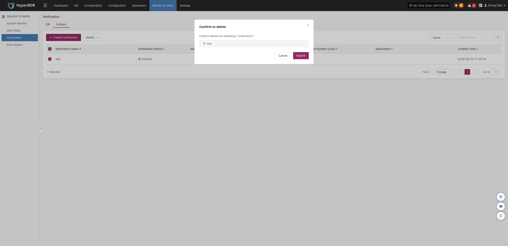

# **通知对象**

报警事件发生时，系统将接收告警信息并进行响应的人员或群组。通知对象可以通过邮件、短信、电话或其他方式接收通知，确保相关人员及时了解并处理异常情况。

::: note
通知对象中尚未配置邮箱和短信接收服务时，无法创建通知用户，请前往 [【运维管理平台】>【通知配置】](../../admin-portal/notification/email.md) 中配置。
:::

## **容灾**

### **创建通知对象**

进入 **【监控与报警管理】>【通知对象】**，默认处于 **【容灾】** 标签页，点击 **【创建通知对象】**。根据提示填写相关参数并保存，确保报警事件发生时相关人员能够及时收到通知。

| **字段名称** | **示例** | **说明** |
| :--- | :--- | :--- |
| **通知对象名称** | test | 自定义通知对象的名称，用于区分不同的通知配置。 |
| **启用状态** | 已启用 | 设置通知对象是否启用。启用后，满足关联告警规则的通知条件时，系统将发送告警通知。 |
| **告警规则** | 关联告警规则 | 点击 **【关联告警规则】**，在弹出的选择窗口中选择需要关联的告警规则。通知对象将根据关联的告警规则接收并发送告警通知。 |
| **发送通道** | xxx@qq.com | 从下拉列表中选择已配置的通知发送通道，作为告警通知的发送渠道。若列表中没有可选的邮箱通道，请根据平台部署方式配置相关服务：私有化部署平台请前往管理平台配置邮箱服务；SaaS 平台用户请联系技术支持 [获取支持](https://support.oneprocloud.com/target/opc)。 |
| **通知邮箱** | XXX@qq.com | 配置接收告警通知的目标邮箱。点击页面中的 **【+ 添加邮箱】**，可添加多个邮箱地址用于接收告警通知。 |
| **通知 Webhook** | https://example.com/webhook | 配置接收告警通知的 Webhook URL，可通过点击页面 **【+ 添加 Webhook】** 添加多个 Webhook URL 用于接收告警通知。 |
| **描述** | - | 填写通知对象的备注信息或其他补充说明。 |

### **更多操作**

选中相应的通知对象后，点击 **【更多操作】** 按钮展开操作菜单，可执行包括修改、启用、停用及移除在内的管理操作：

#### **修改**

点击 **【修改】** 后，系统将跳转页面，用户可在该页面对已创建的通知对象配置进行重新编辑与调整。

#### **启用**

点击 **【启用】** 后，通知对象的状态将更新为“已启用”，恢复对关联报警事件的消息推送。

#### **停用**

点击 **【停用】** 后，通知对象状态变更为“已停用”。已停用的通知对象在停用状态下将不进行任何消息推送。

#### **移除**

点击 **【移除】** 后，系统将弹出二次确认提示框。确认后，系统将删除该通知对象，并取消其与相关报警器的关联。

::: warning
移除操作将彻底解除与报警器的绑定关系，请确认无在用告警依赖后再执行移除。
:::

## **回切**

### **创建通知对象**

在 **【监控与报警管理】>【通知对象】** 页面，切换至 **【回切】** 标签页，点击 **【创建通知对象】**，填写回切场景下的通知对象配置。

| **字段名称** | **示例** | **说明** |
| :--- | :--- | :--- |
| **通知对象名称** | test | 自定义回切通知对象的名称，用于区分不同的通知配置。 |
| **启用状态** | 已启用 | 设置通知对象是否启用。启用后，满足关联告警规则的通知条件时，系统将发送告警通知。 |
| **告警规则** | 关联告警规则 | 点击 **【关联告警规则】**，在弹出的选择窗口中选择需要关联的告警规则。通知对象将根据关联的告警规则接收并发送告警通知。 |
| **发送通道** | xxx@qq.com | 从下拉列表中选择已配置的通知发送通道，作为告警通知的发送渠道。若列表中没有可选的邮箱通道，请根据平台部署方式配置相关服务：私有化部署平台请前往管理平台配置邮箱服务；SaaS 平台用户请联系技术支持 [获取支持](https://support.oneprocloud.com/target/opc)。 |
| **通知邮箱** | XXX@qq.com | 配置接收告警通知的目标邮箱。点击页面中的 **【+ 添加邮箱】**，可添加多个邮箱地址用于接收告警通知。 |
| **通知 Webhook** | https://example.com/webhook | 配置接收告警通知的 Webhook URL，可通过点击页面 **【+ 添加 Webhook】** 添加多个 Webhook URL 用于接收告警通知。 |
| **描述** | - | 填写通知对象的备注信息或其他补充说明。 |

### **更多操作**

选中相应的回切通知对象后，点击 **【更多操作】** 按钮展开操作菜单，可执行包括修改、启用、停用及移除在内的管理操作：

#### **修改**

点击 **【修改】** 后，系统将跳转页面，用户可在该页面对已创建的回切通知对象配置进行重新编辑与调整。

#### **启用**

点击 **【启用】** 后，回切通知对象的状态将更新为“已启用”。

#### **停用**

点击 **【停用】** 后，回切通知对象状态变更为“已停用”，停用状态下将不进行任何消息推送。

#### **移除**

点击 **【移除】** 后，系统将弹出二次确认提示框。确认后系统将删除该通知对象，并取消其与相关报警器的关联。

::: warning
移除操作将彻底解除与报警器的绑定关系，请确认无在用告警依赖后再执行移除。
:::

