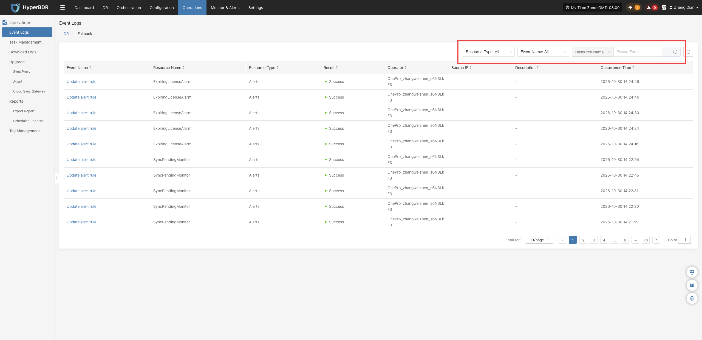
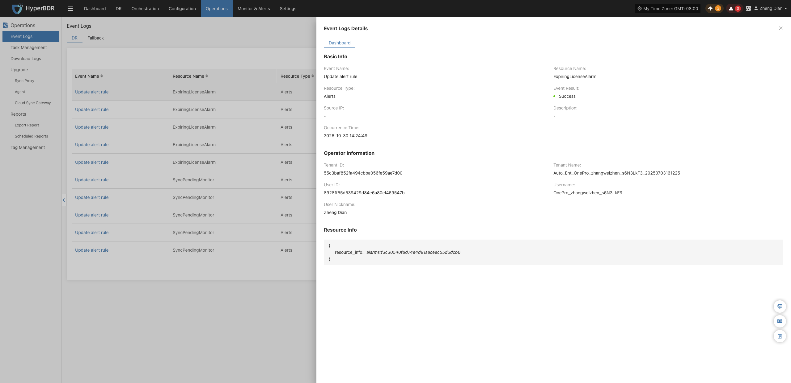

# **事件日志**

事件日志用于记录平台在日常运行、容灾保护、演练接管及业务回切等全生命周期中的各类用户操作行为与系统关键事件，便于运维人员进行操作追踪、安全合规审计与故障问题排查。系统提供 **【容灾】** 与 **【回切】** 两个维度的日志视图，两者在功能与操作上保持一致。

登录 HyperBDR 控制台，在顶部导航栏进入 **【运维管理】>【事件日志】** 页面，默认处于 **【容灾】** 标签页，也可按需切换至 **【回切】** 标签页查验反向回切相关的操作记录。

## **日志检索与筛选**

事件日志列表支持多维度的精准组合检索，管理员可通过列表顶部的筛选栏快速过滤并定位目标日志记录：

* **资源类型**：按操作涉及的资源分类进行筛选（如用户资源、容灾主机资源、生产平台资源等）。
* **消息名称**：输入关键字检索特定的操作行为（如登录、同步主机、创建策略等）。
* **资源名称**：输入目标资源名称进行精准匹配。

## **字段与类型说明**

### **事件日志字段说明**

事件日志列表中每条记录包含的字段信息如下：

| **字段名称** | **示例** | **说明** |
| :--- | :--- | :--- |
| **消息名称** | 登录 | 触发审计事件的具体行为类型（支持点击查看事件详情）。 |
| **资源名称** | admin | 触发该事件的操作主体或关联资源名称。 |
| **资源类型** | 用户资源 | 审计事件所涉及的系统资源分类。 |
| **事件结果** | 成功 | 操作执行的最终状态，包括“成功”或“失败”。 |
| **来源 IP** | 172.30.1.33 | 发起该操作的客户端 IP 地址，便于安全追溯。 |
| **描述** | 使用用户名和密码登录 | 对此次操作行为的简要上下文描述。 |
| **发生时间** | 2025-05-23 09:54:10 | 系统记录该操作事件的精确时间戳。 |

::: tip 查看日志详情
在列表中点击具体的 **消息名称**，系统将弹出操作详情窗口，展示该事件的完整执行细节与扩展信息。
:::

### **资源类型说明**

系统中涉及的资源类型分类定义如下：

| **资源类型** | **说明** |
| :--- | :--- |
| **用户资源** | 与用户账户及认证相关的操作行为，如登录、登出、密码修改、权限变更等。 |
| **容灾主机资源** | 参与容灾保护的主机资源，包括配置变更、数据同步、状态监控等操作。 |
| **License 资源** | 平台授权许可相关的管理操作与配额状态记录。 |
| **生产平台资源** | 生产环境中的代理程序部署、节点纳管及云平台连接状态变更。 |
| **容灾平台资源** | 目标端容灾备份环境中的云账号、云同步网关及架构组件资源。 |
| **监控报警** | 告警规则、通知对象等监控告警机制的创建与维护操作。 |
| **资源组** | 按业务逻辑划分的主机资源组及编排管理操作。 |
| **对象存储** | 灾备底层对象存储存储桶的接入、配置更新与容量事件。 |
| **容灾策略** | 容灾策略规则的创建、关联、解绑及执行计划修改。 |

::: note
事件日志为系统行为的不可篡改审计留痕，不支持手动编辑或删除。页面支持分页浏览（默认每页 10 条），可结合右上角搜索框实现关键字快速检索。
:::
