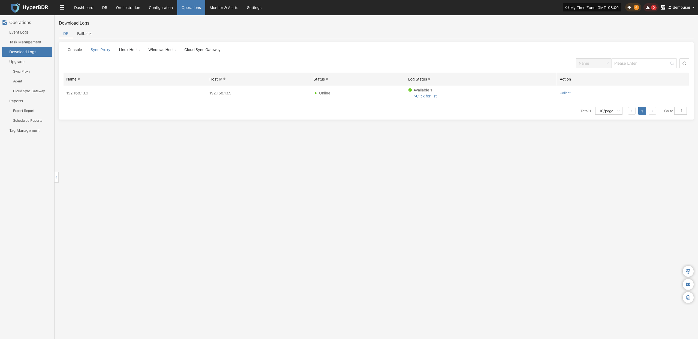
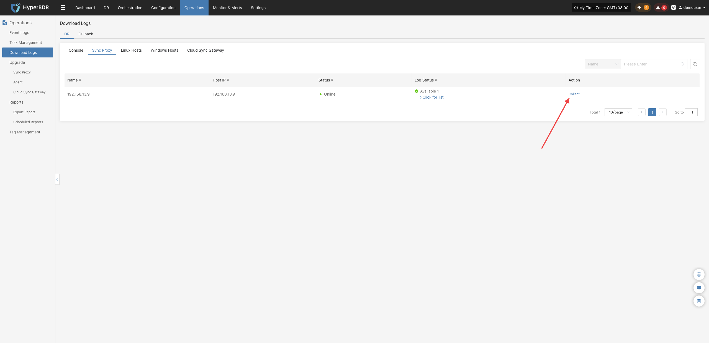
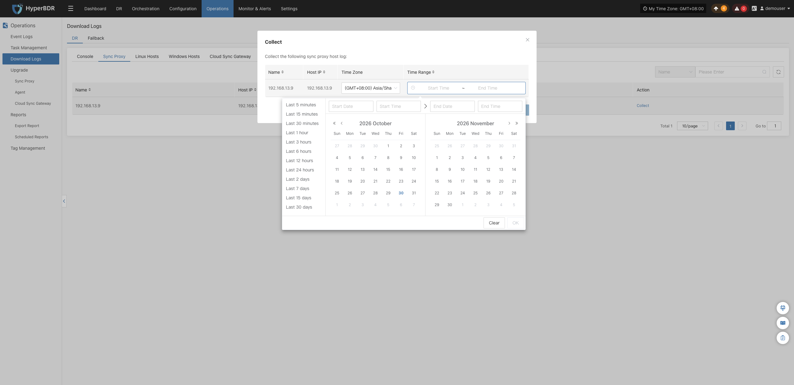
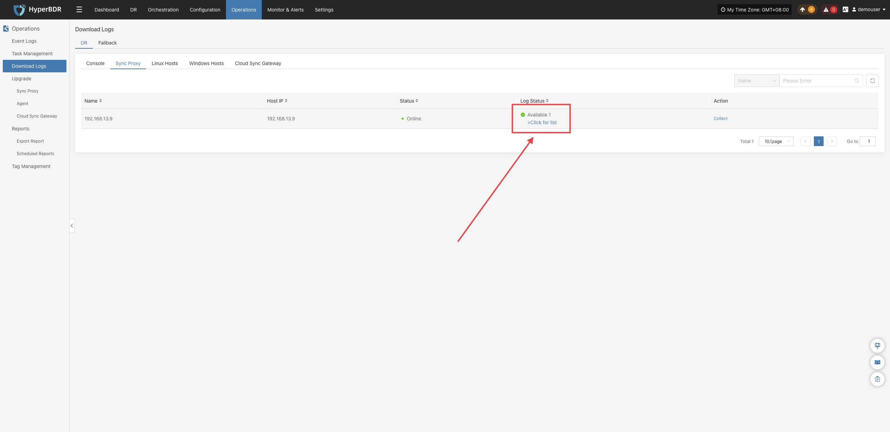
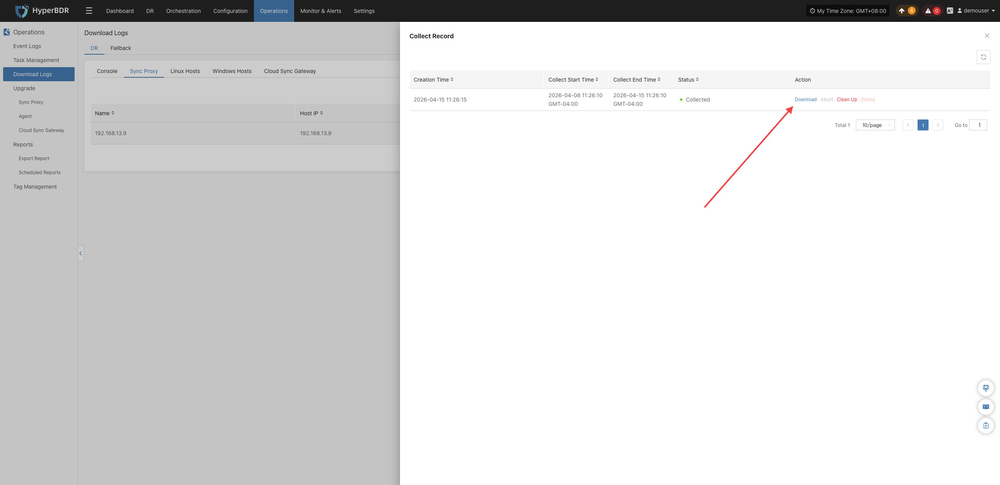
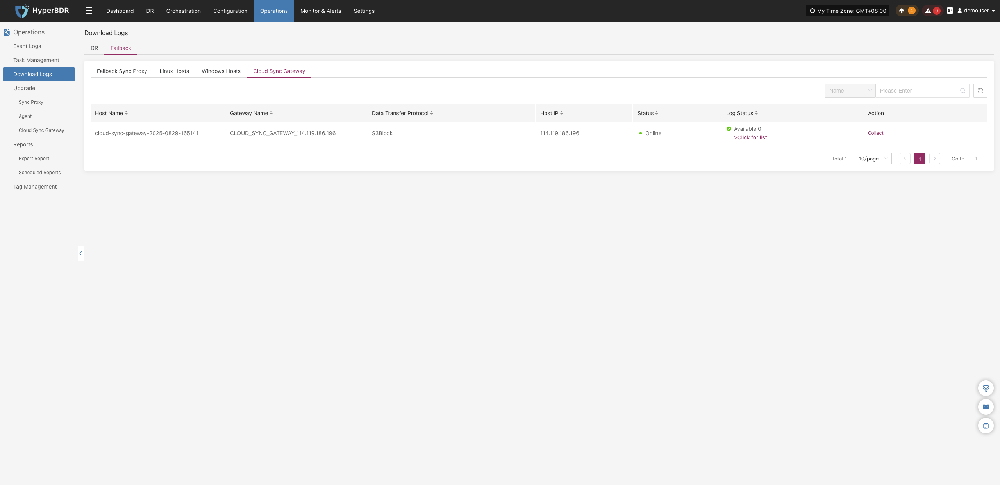
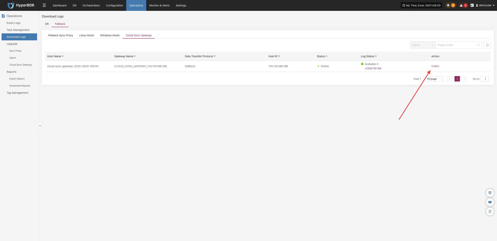
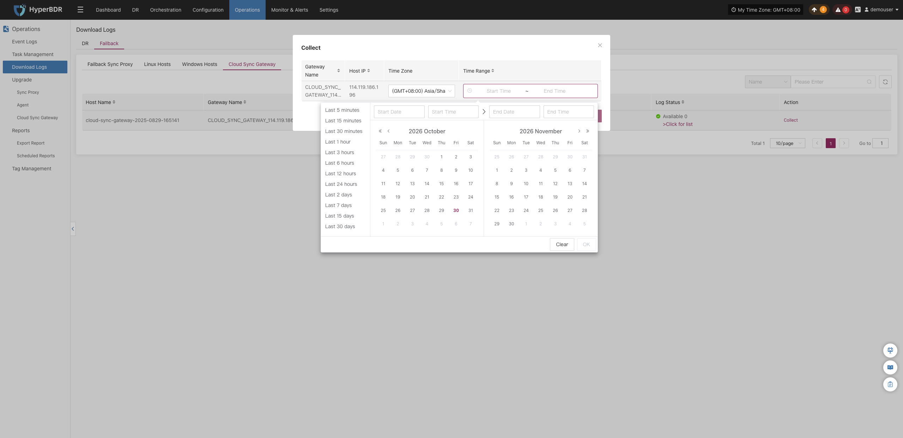
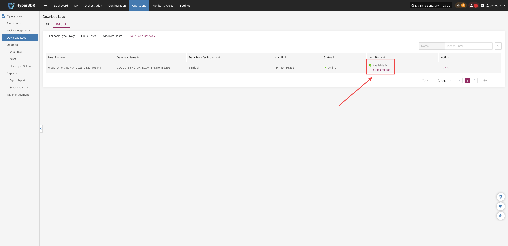
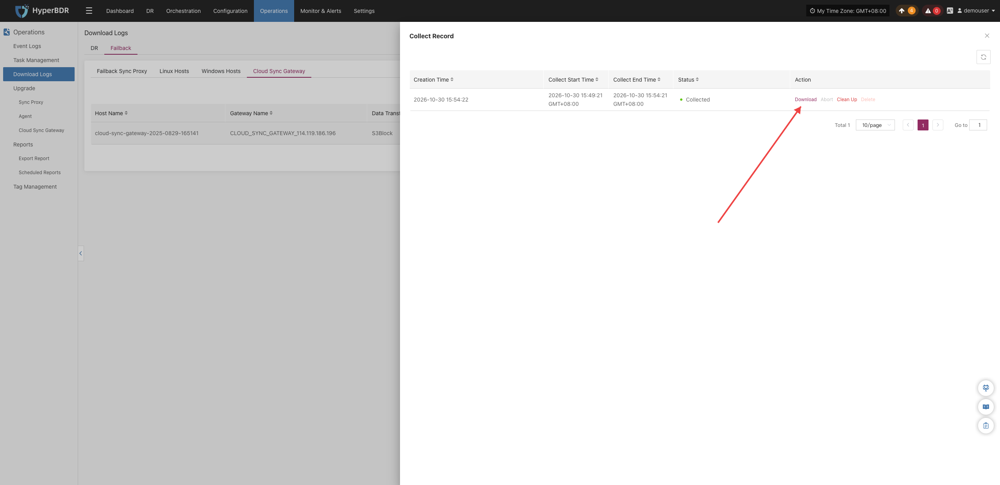

# **日志管理**

在 HyperBDR 系统中，用户可通过顶部导航栏进入 **【运维管理】>【日志管理】** 模块，该功能支持按需集中采集与下载关键容灾组件的运行日志，帮助运维人员进行深度问题排查、健康巡检与故障分析。

## **容灾**

### **支持资源类型**

| **资源类型** | **说明** |
| :--- | :--- |
| **控制台** | 管理节点日志采集，包括平台运行核心服务日志。 |
| **源端同步代理** | 通过 OVA 模板部署的无代理模式同步代理主机。 |
| **Linux 主机** | 安装了 Agent 代理程序的 Linux 操作系统主机日志。 |
| **Windows 主机** | 安装了 Agent 代理程序的 Windows 操作系统主机日志。 |
| **云同步网关** | 启动容灾时在目标端云平台自动创建的同步网关主机。 |

### **页面字段说明**

| **字段名称** | **示例** | **说明** |
| :--- | :--- | :--- |
| **主机名称** | onepro | 目标主机的标识名称。 |
| **主机 IP** | 192.168.7.141 | 目标主机的通信 IP 地址。 |
| **状态** | 在线 | 主机当前的运行连通状态（离线状态下无法执行日志采集）。 |
| **日志状态** | 可下载 | 主机当前的日志就绪状态（支持点击展开查看历史采集记录列表）。 |
| **操作** | 采集 | 发起日志采集任务的操作入口。 |

### **采集示例：源端同步代理**

在 **【运维管理】>【日志管理】** 中切换至 **【容灾】>【源端同步代理】** 页面，即可针对指定的同步代理主机进行日志采集与导出下载：

#### **日志采集**

选择需要收集的目标主机，点击对应行的 **【采集】** 操作按钮：

#### **选择时间段**

在弹出的对话框中设定需要收集的日志时间范围。系统支持快捷时间选项（如最近 15 分钟、最近 1 小时、最近 30 天等）及日历自定义起止时间：

#### **开始采集**

确认选择的时间段后提交，系统将自动发起日志收集任务，日志状态转换为“采集中”：

#### **日志下载**

日志采集完成后，状态更新为 **“可下载”**。点击“点击查看列表”展开采集记录抽屉，选择对应的日志文件并点击 **【下载】** 完成下载：

## **回切**

### **支持资源类型**

| **资源类型** | **说明** |
| :--- | :--- |
| **回切源端同步代理** | 通过 OVA 模板部署的无代理模式回切同步代理主机。 |
| **Linux 主机** | 安装了 Agent 代理程序的 Linux 操作系统回切主机日志。 |
| **Windows 主机** | 安装了 Agent 代理程序的 Windows 操作系统回切主机日志。 |
| **云同步网关** | 启动反向回切时在目标端云平台自动创建的同步网关主机。 |

### **页面字段说明**

| **字段名称** | **示例** | **说明** |
| :--- | :--- | :--- |
| **主机名称** | ubuntu-ova | 目标主机的标识名称。 |
| **主机 IP** | 192.168.7.202 | 目标主机的通信 IP 地址。 |
| **状态** | 在线 | 主机当前的运行连通状态（离线状态下无法执行日志采集）。 |
| **日志状态** | 可下载 | 主机当前的日志就绪状态（支持点击展开查看历史采集记录列表）。 |
| **操作** | 采集 | 发起日志采集任务的操作入口。 |

### **采集示例：云同步网关**

在 **【运维管理】>【日志管理】** 中切换至 **【回切】>【云同步网关】** 页面，针对目标网关主机进行日志采集与导出下载：

#### **日志采集**

选择需要收集的目标网关主机，点击对应行的 **【采集】** 操作按钮：

#### **选择时间段**

在弹出的对话框中设定需要收集的日志时间范围。系统支持快捷时间选项（如最近 15 分钟、最近 1 小时、最近 30 天等）及日历自定义起止时间：

#### **开始采集**

确认选择的时间段后提交，系统将自动发起日志收集任务，日志状态转换为“采集中”：

#### **日志下载**

日志采集完成后，状态更新为 **“可下载”**。点击“点击查看列表”展开采集记录抽屉，选择对应的日志文件并点击 **【下载】** 完成下载：

