# **报告管理**

目前，用户可通过 HyperBDR 控制台导出**容灾**与**回切**过程中的各类系统运行与管理报告。该功能有助于用户对平台运行状态进行**定期分析、归档留存**，满足运维审计、问题追踪与管理评估等多种使用场景。

## **支持的报告类型与说明**

| **报告类型** | **说明** |
| :--- | :--- |
| **主机容灾汇总报告** | 统计当前租户下已注册和已解除注册的所有主机的基本信息，包括同步次数、演练次数、接管次数、系统类型等。 |
| **主机同步数据详细报告** | 统计当前租户下已注册和已解除注册的所有主机的同步任务详情。 |
| **主机容灾演练详细报告** | 统计当前租户下已注册和已解除注册的所有主机的演练任务详情。 |
| **主机容灾接管详细报告** | 统计当前租户下已注册和已解除注册的所有主机的接管任务详情。 |
| **主机容灾周期汇总报告(天)** | 按天统计当前租户下已注册与已解除注册主机的容灾周期数据，展示同步、演练、接管频次与容量趋势。 |
| **容灾云同步网关汇总报告** | 统计当前租户下所有云同步网关的基本信息。 |
| **容灾云同步网关详细报告** | 统计当前租户下所有云同步网关的详细信息，精确到每块磁盘。 |

## **导出报告说明**

### **主机容灾汇总报告**

| **字段名称** | **说明** |
| :--- | :--- |
| **Host Name** | 主机名称，标识该容灾主机的名称。 |
| **Host IP** | 主机的 IP 地址，用于网络识别与通信。 |
| **Step** | 容灾注册流程当前所处的步骤编号。 |
| **Status** | 当前任务或操作的状态，如已注册。 |
| **Host Status** | 主机状态，表示主机是否已成功注册到系统中。 |
| **Storage Type** | 存储类型，如块存储（Block Storage）或对象存储等。 |
| **Cloud Type** | 所属云平台类型与版本，如 OpenStack Community（Juno+）。 |
| **OS Type** | 操作系统类型，如 Windows 或 Linux。 |
| **Sync Count (Succeeded)** | 成功完成的数据同步任务次数。 |
| **Sync Count (Failed)** | 失败的数据同步任务次数。 |
| **Drill Count (Succeeded)** | 成功完成的容灾演练次数。 |
| **Drill Count (Failed)** | 失败的容灾演练次数。 |
| **Takeover Count (Succeeded)** | 成功完成的容灾接管任务次数。 |
| **Takeover Count (Failed)** | 失败的容灾接管任务次数。 |
| **Sync Size (GB)** | 累计同步数据的总量，单位为 GB。 |
| **Region** | 云平台中的区域标识。 |
| **Zone** | 所属的可用区标识（若有）。 |
| **Flavors** | 主机的计算规格（vCPU/内存/磁盘），如 8核 16GB 内存 50GB磁盘。 |
| **Disk Count** | 主机上磁盘的数量。 |
| **Capacity (GB)** | 主机磁盘的总容量（单位：GB）。 |
| **Subnet** | 主机所属的子网名称。 |
| **Network** | 主机所连接的网络名称。 |
| **Security Group** | 应用于该主机的安全组策略名称。 |
| **Fixed IP** | 主机的固定内网 IP 地址（未分配）。 |
| **Public IP** | 主机的公网 IP 地址（未分配）。 |

### **容灾云同步网关详细报告**

| **字段名称** | **说明** |
| :--- | :--- |
| **Created Time** | 云同步网关资源的创建时间。 |
| **Cloud Sync Gateway Name** | 云同步网关的名称，用于标识该同步组件。 |
| **Cloud Account Name** | 云账户名称，表明该网关绑定的是哪个云平台账户。 |
| **Block Storage Platform** | 云平台类型，如 OpenStack、VMware 等。 |
| **User Name** | 创建该网关资源的租户或用户名称。 |
| **Status** | 当前云同步网关的工作状态（如“已启用”、“已停用”等）。 |
| **Health Status** | 网关运行状态是否健康，如“正常”、“异常”等。 |
| **Data Transfer Protocol** | 用于传输数据的协议，如 TCP、iSCSI 等。 |
| **Region** | 所在的云平台区域（Region）。 |
| **Zone** | 所在的云平台可用区（Zone）。 |
| **Image** | 云网关所用的镜像名称。 |
| **Flavor** | 云网关所用的资源配置模板（如 CPU/内存/磁盘规格）。 |
| **System Disk Type** | 系统盘类型，如 SSD、SATA 等。 |
| **System Disk Size** | 系统盘容量，单位为 GB。 |
| **Backup Volume** | 当前已挂载或使用的备份卷名称。 |
| **Max Backup Volume** | 云同步网关支持的最大备份卷数量或容量。 |
| **Volume Name** | 当前正在使用的卷名称。 |
| **Pool Uuid** | 卷所挂载存储池的唯一标识。 |
| **Pool Name** | 卷所挂载存储池的名称。 |
| **Total Volume Capacity (GB)** | 当前卷的总容量，单位为 GB。 |
| **Usage Status** | 资源使用状态，例如“使用中”或“空闲”。 |
| **Allocation Status** | 分配状态，指该网关是否已被主机关联。 |
| **Allocation Host** | 若已分配，表示网关当前挂载或绑定的主机名称。 |

### **容灾云同步网关汇总报告**

| **字段名称** | **说明** |
| :--- | :--- |
| **Created Time** | 记录创建的时间，格式为“年/月/日 时:分:秒”。 |
| **Cloud Sync Gateway Name** | 云同步网关名称，通常为网关的 IP 地址或唯一标识。 |
| **Cloud Account Name** | 云账户名称，用于标识具体的云服务账号。 |
| **Block Storage Platform** | 使用的块存储平台类型，如 OpenStack、AWS 等。 |
| **User Name** | 操作该同步网关的用户名。 |
| **Status** | 当前状态，如“Creation Success”表示创建成功。 |
| **Health Status** | 健康状态，如“Online”表示网关在线。 |
| **Data Transfer Protocol** | 数据传输协议，如“S3Block”表示基于 S3 协议的块存储传输。 |
| **Region** | 云平台的区域名称，用于标识地理或逻辑区域。 |
| **Zone** | 云平台的可用区，具体的分区信息，如果无则为“-”。 |
| **Image** | 使用的镜像名称及唯一标识，通常是操作系统镜像。 |
| **Flavor** | 虚拟机规格，如 CPU、内存和磁盘大小的组合。 |
| **System Disk Type** | 系统盘类型，如默认卷类型“DEFAULT_VOLUME_TYPE”。 |
| **System Disk Size** | 系统盘大小，单位为 GB。 |
| **Backup Volume** | 当前备份卷数量。 |
| **Max Backup Volume** | 最大允许的备份卷数量。 |
| **Total Volume Capacity (GB)** | 所有卷的总容量，单位为 GB。 |
| **Hosts Count** | 关联的主机数量。 |

### **主机容灾周期汇总报告(天)**

| **字段名称** | **说明** |
| :--- | :--- |
| **Serial Number** | 序号，记录条目的唯一编号。 |
| **Period** | 时间周期，表示统计的起止时间段。 |
| **Host Name** | 主机名称。 |
| **Host IP** | 主机 IP 地址。 |
| **Step** | 当前步骤或阶段编号。 |
| **Status** | 状态，如“Registered”表示已注册。 |
| **Host Status** | 主机状态，如“Registered”表示主机已注册。 |
| **Storage Type** | 存储类型，如“Block Storage”表示块存储。 |
| **Cloud Type** | 云平台类型，如“OpenStackCommunity(Juno+)”。 |
| **OS Type** | 操作系统类型，如 Windows、Linux 等。 |
| **Sync Count (Succeeded)** | 同步成功次数。 |
| **Sync Count (Failed)** | 同步失败次数。 |
| **Drill Count (Succeeded)** | 演练成功次数。 |
| **Drill Count (Failed)** | 演练失败次数。 |
| **Takeover Count (Succeeded)** | 接管成功次数。 |
| **Takeover Count (Failed)** | 接管失败次数。 |
| **Sync Size (GB)** | 同步数据大小，单位为 GB。 |
| **Region** | 云平台区域名称。 |
| **Zone** | 可用区，如无则为“-”。 |
| **Flavors** | 虚拟机规格，如 CPU 核数、内存和磁盘组合。 |
| **Disk Count** | 磁盘数量。 |
| **Capacity (GB)** | 存储容量，单位为 GB。 |
| **Subnet** | 子网名称。 |
| **Network** | 网络名称。 |
| **Security Group** | 安全组名称。 |
| **Fixed IP** | 固定 IP 地址，如果无则为“-”。 |
| **Public IP** | 公网 IP 地址，如果无则为“-”。 |

### **主机容灾接管详细报告**

| **字段名称** | **说明** |
| :--- | :--- |
| **Host Name** | 主机名称。 |
| **Host IP** | 主机 IP 地址。 |
| **Status** | 当前状态，例如任务是否完成、异常等。 |
| **Task Status** | 任务状态，具体反映接管任务的进展情况。 |
| **Start Time** | 任务开始时间。 |
| **End Time** | 任务结束时间。 |
| **Execution Time** | 任务执行耗时。 |
| **Storage Type** | 存储类型，如块存储（Block Storage）。 |
| **Cloud Type** | 云平台类型，如 OpenStackCommunity(Juno+)。 |
| **Region** | 云平台区域名称。 |
| **Zone** | 可用区名称，如无则用“-”表示。 |
| **Flavors** | 虚拟机规格描述，如 CPU、内存和磁盘组合。 |
| **Disk Count** | 磁盘数量。 |
| **Capacity (GB)** | 存储容量，单位为 GB。 |
| **Network** | 网络名称。 |
| **Subnet** | 子网名称。 |
| **Security Group** | 安全组名称。 |
| **Fixed IP** | 固定 IP 地址，如无则用“-”表示。 |
| **Public IP** | 公网 IP 地址，如无则用“-”表示。 |
| **Task Details** | 任务详情，描述任务执行的具体信息和结果。 |

### **主机容灾演练详细报告**

| **字段名称** | **说明** |
| :--- | :--- |
| **Host Name** | 主机名称。 |
| **Host IP** | 主机 IP 地址。 |
| **Status** | 当前状态，例如任务是否完成、异常等。 |
| **Task Status** | 任务状态，具体反映演练任务的进展情况。 |
| **Start Time** | 任务开始时间。 |
| **End Time** | 任务结束时间。 |
| **Execution Time** | 任务执行耗时。 |
| **Storage Type** | 存储类型，如块存储（Block Storage）。 |
| **Cloud Type** | 云平台类型，如 OpenStackCommunity(Juno+)。 |
| **Region** | 云平台区域名称。 |
| **Zone** | 可用区名称，如无则用“-”表示。 |
| **Flavors** | 虚拟机规格描述，如 CPU、内存和磁盘组合。 |
| **Disk Count** | 磁盘数量。 |
| **Capacity (GB)** | 存储容量，单位为 GB。 |
| **Network** | 网络名称。 |
| **Subnet** | 子网名称。 |
| **Security Group** | 安全组名称。 |
| **Fixed IP** | 固定 IP 地址，如无则用“-”表示。 |
| **Public IP** | 公网 IP 地址，如无则用“-”表示。 |
| **Task Details** | 任务详情，描述任务执行的具体信息和结果。 |

### **主机同步数据详细报告**

| **字段名称** | **说明** |
| :--- | :--- |
| **Host Name** | 主机名称。 |
| **Host IP** | 主机 IP 地址。 |
| **Status** | 当前状态，例如任务是否完成、异常等。 |
| **Task Status** | 任务状态，具体反映同步任务的进展情况。 |
| **Start Time** | 任务开始时间。 |
| **End Time** | 任务结束时间。 |
| **Execution Time** | 任务执行耗时。 |
| **Capacity Size (GB)** | 同步容量大小，单位为 GB。 |
| **Sync Mode** | 同步模式，如全量同步、增量同步等。 |
| **Average Sync Rate (Mbps/s)** | 平均同步速率，单位为兆比特每秒。 |
| **Synced Size (GB)** | 已同步的数据大小，单位为 GB。 |
| **Task Details** | 任务详情，描述任务执行的具体信息和结果。 |

## **报告导出**

报告导出模块用于采集、导出平台各类业务统计报表，支持自定义报表类型、统计时间、主机范围等筛选条件，可将备份、主机、运维相关数据导出为本地文件，用于线下审计、业务归档、数据对账。

::: note 租户数据隔离
不同租户数据相互隔离，仅当前登录租户账号可导出本租户范围内的报表数据。若需下载不同租户的主机信息报表，需由对应租户所属的用户登录控制台进行操作。
:::

### **报告导出示例** 

#### **收集报表**

* 进入 **【运维管理】>【报告导出】**，进入报表管理页面：

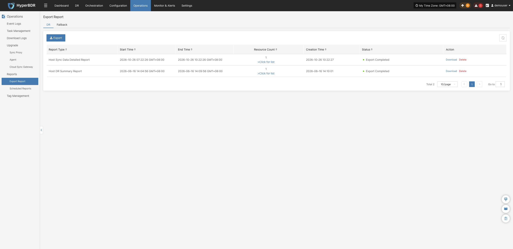

* 点击 **【导出】** 按钮，根据需要选择报表类型、范围（Range）、时区、时间范围等信息：

::: tip 统计范围（Range）说明
* **All Host（全部主机）**：将当前租户下的全部主机纳入报表统计。选择该项后无需进入下一步勾选主机，直接点击 **【提交】** 即可发起报告收集。
* **Select Host（指定主机）**：仅统计部分目标主机。选择该项后需点击 **【下一步】** 进入主机选择界面，勾选需要统计的主机后再点击 **【提交】**。
:::

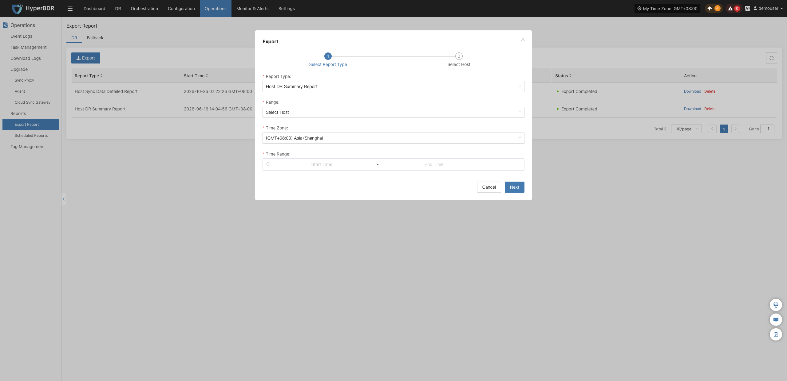

* 若范围选择了 **Select Host**，系统将进入主机选择界面，勾选目标主机后点击 **【提交】** 发起报告收集：

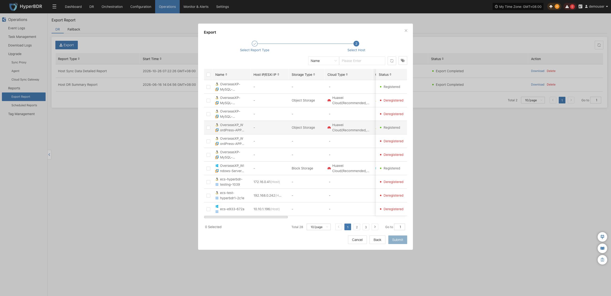

#### **下载报告**

待报表导出完成后，在列表中找到目标报表记录，点击操作列的 **【下载】**，即可下载生成的报表文件：

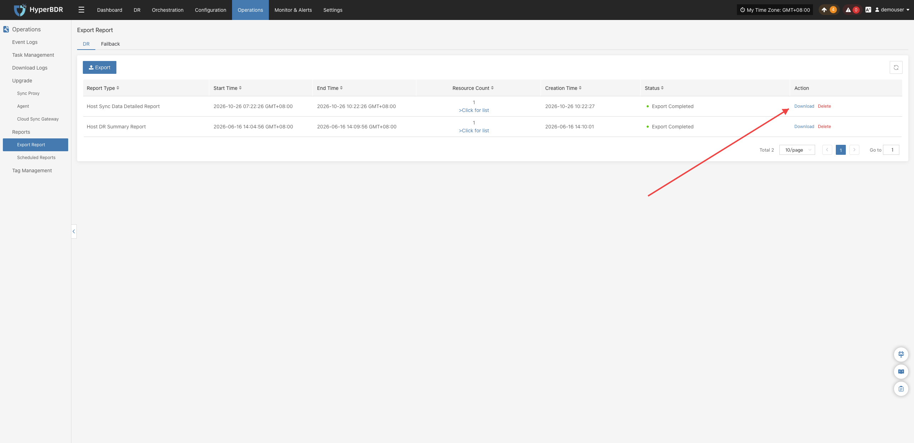

## **定时报告** 

定时报告模块支持配置周期性自动报表任务，系统将按照预设周期自动采集指定范围的业务数据，生成报表并支持本地下载或邮件推送，实现运维数据定期归档、自动审计，无需人工重复手动采集报表。

::: note 租户数据隔离
不同租户数据相互隔离，仅当前登录租户账号可配置、查看本租户的定时报告任务。若需操作不同租户的定时报表，需由对应租户所属的用户登录控制台进行操作。
:::

### **定时报告示例**

#### **创建定时报告**

* 进入 **【运维管理】>【定时报告】**，进入定时报表管理页面：

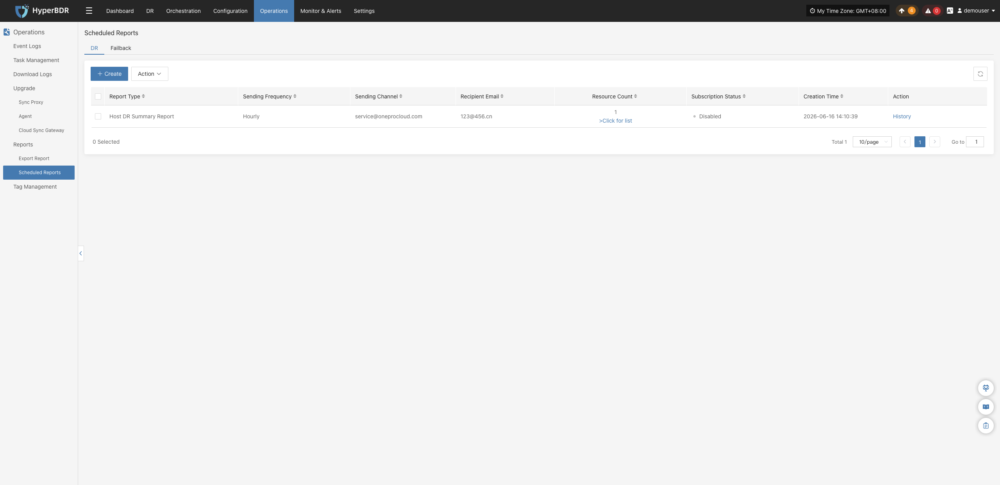

* 点击 **【+ 创建】** 按钮，在创建弹窗中按需选择报表类型、范围（All Host / Select Host）、发送渠道、接收邮箱、发送频率及数据时区：

::: tip 统计范围（Range）说明
* **All Host（全部主机）**：将当前租户下的全部主机纳入该定时报表任务。选择该项后无需进入下一步勾选主机，直接点击 **【提交】** 即可完成创建。
* **Select Host（指定主机）**：仅定时统计指定的主机。选择该项后需点击 **【下一步】** 进入主机选择界面，勾选目标主机后再点击 **【提交】**。
:::

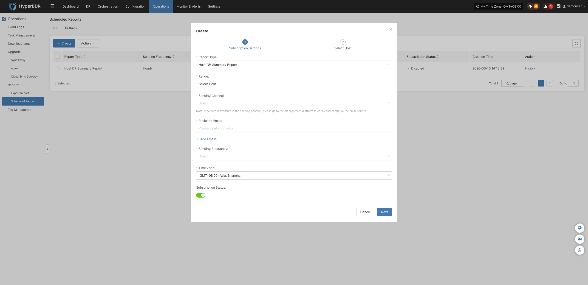

* 若范围选择了 **Select Host**，系统将进入主机选择界面，勾选需要纳入报表统计的目标主机，确认全部参数无误后点击 **【提交】**，即可完成定时报告任务创建：

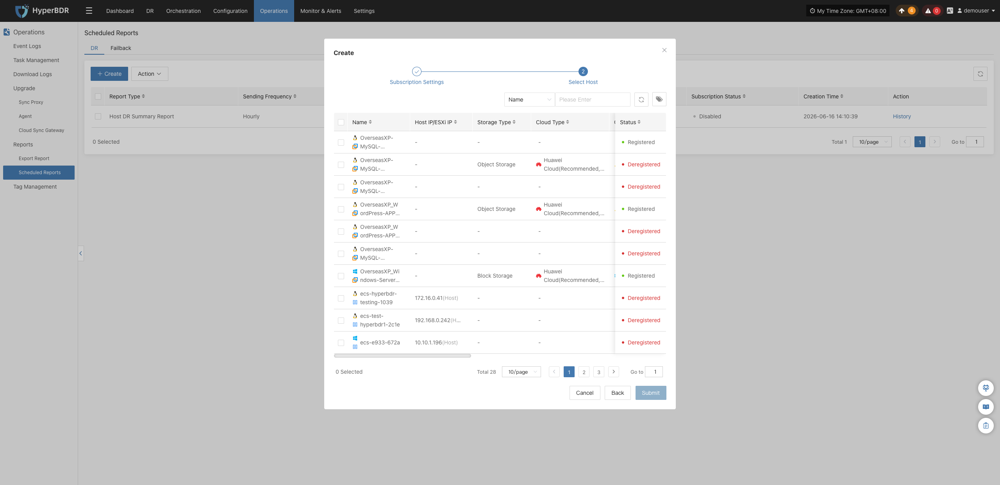

#### **查看历史记录**

在定时报告任务列表中，用户可随时查看各定时任务的历史生成记录与报表文件：

* 点击目标任务行操作列的 **【历史记录】** 按钮，页面右侧滑出历史记录抽屉：

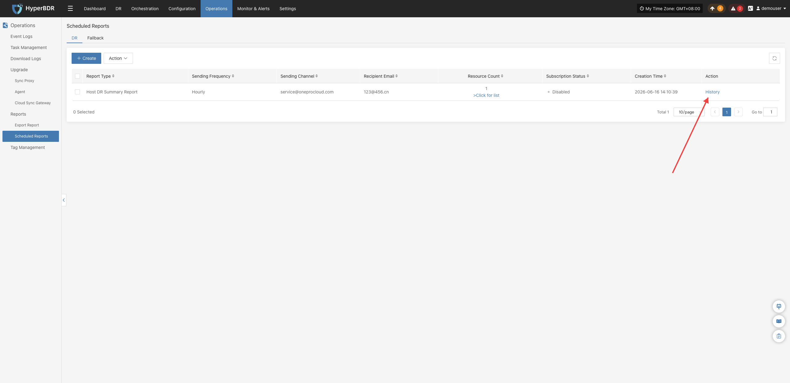

* 在历史记录抽屉中，可查看历次自动采集的报表类型、任务 ID、统计起止时间、执行状态，并支持直接点击 **【下载】** 历史报表文件：

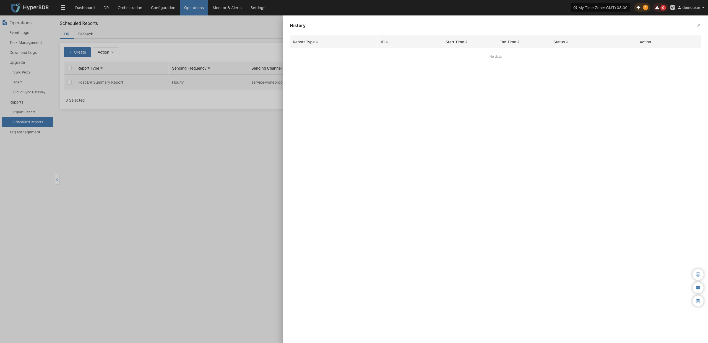

#### **更多操作**

列表勾选目标定时报告任务后，点击上方的 **【更多操作】** 下拉按钮，可执行以下管理操作：

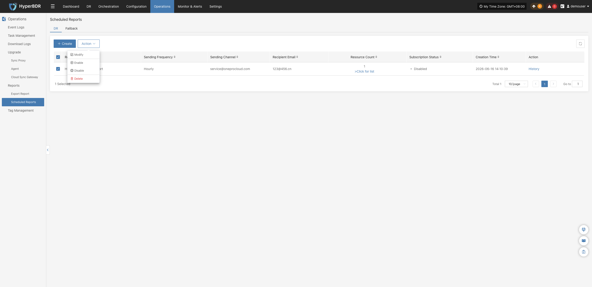

##### **修改**

选中目标定时报告任务，点击 **【修改】** 后系统弹出编辑弹窗，可重新调整报表类型、统计范围、时区、推送渠道、接收邮箱、统计主机、执行周期等全部配置参数，修改完成提交后，新配置将在下一轮定时周期生效：

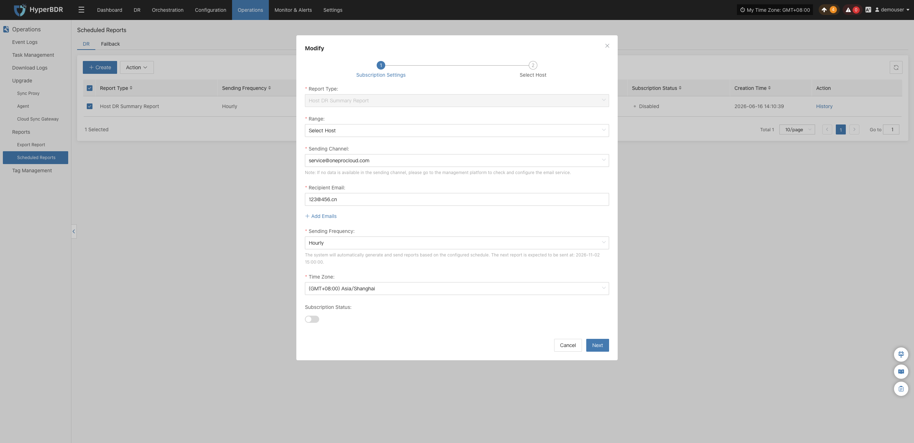

##### **启用**

针对已停用的定时任务，在列表勾选后点击 **【更多操作】>【启用】**，即可恢复该定时报表任务的自动执行能力，订阅状态变更为“已启用”：

##### **停用**

选中正在运行的定时报告任务，在列表勾选后点击 **【更多操作】>【停用】**，将暂停该任务的周期执行，订阅状态变更为“已停用”；任务配置信息会完整保留，待后续启用后可恢复运行：

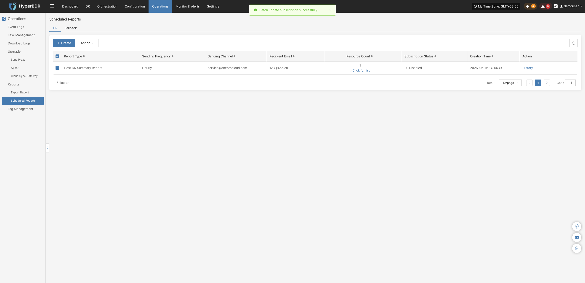

##### **删除**

选中无需再使用的定时报告任务，点击 **【更多操作】>【删除】** 后系统将弹出二次确认对话框，确认后该定时任务将被永久清除：

::: warning
删除操作不可逆，执行后系统不再按周期生成对应报表。请确认无报表归档需求后再执行删除。
:::

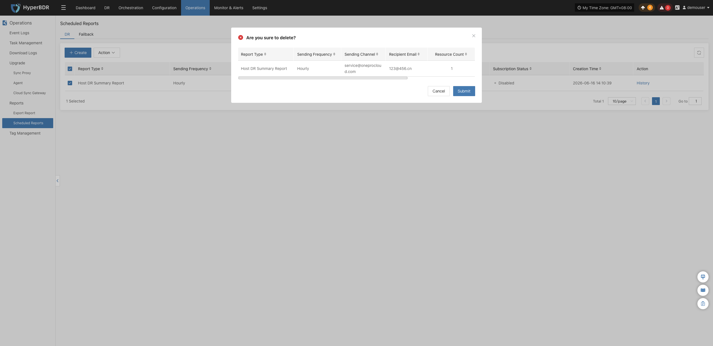
