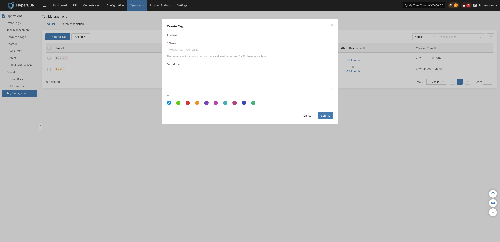
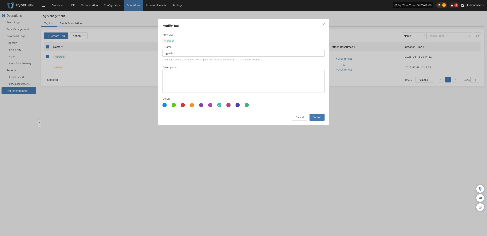
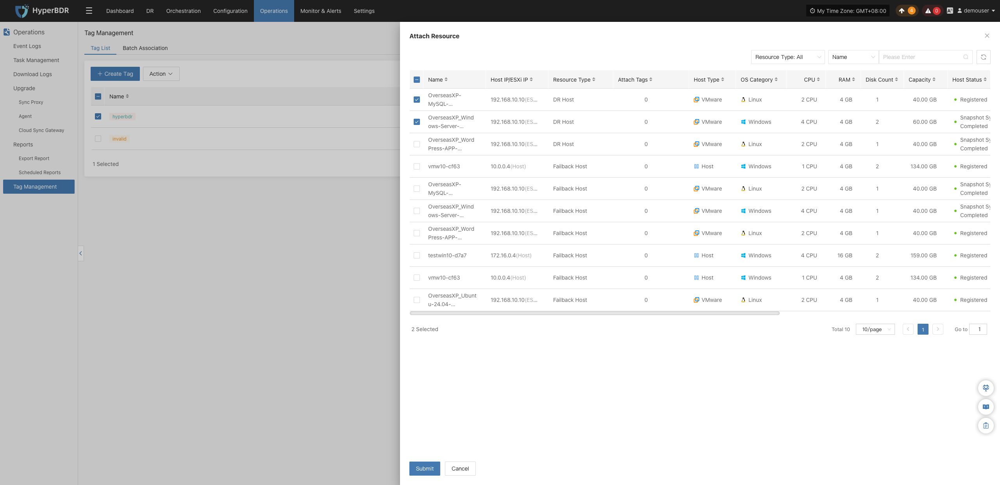
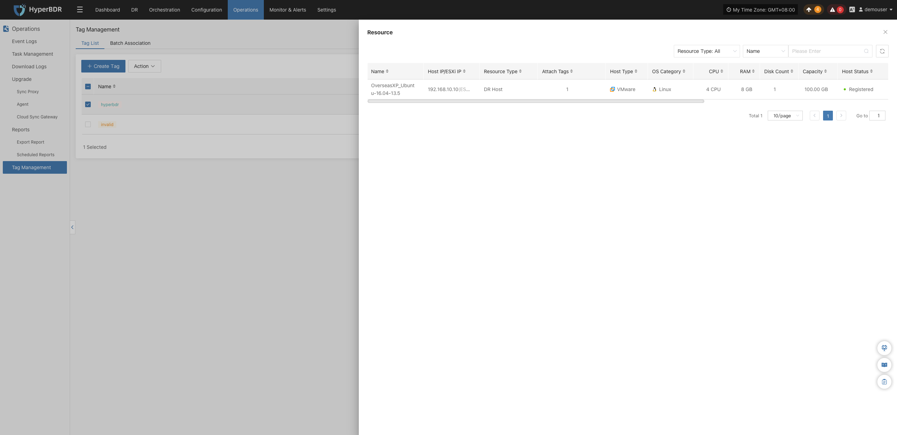
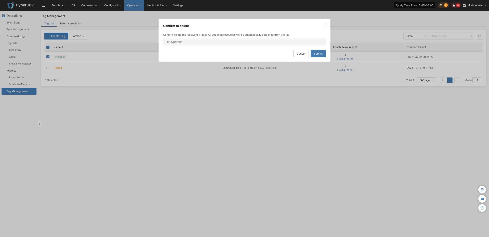
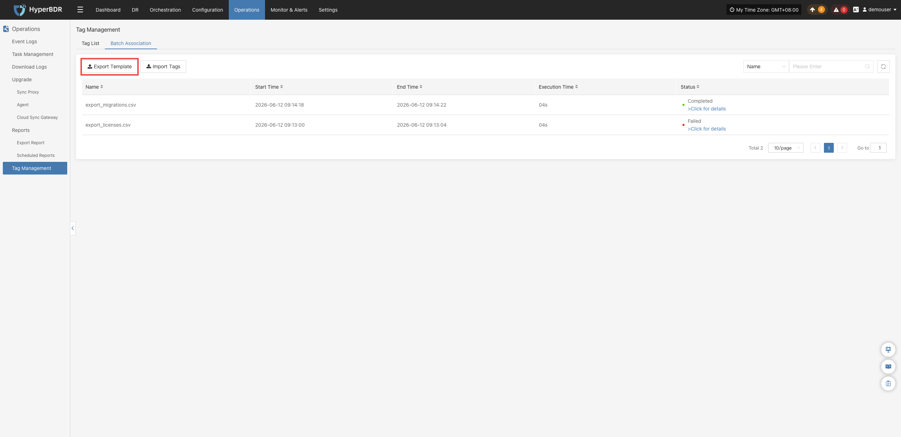
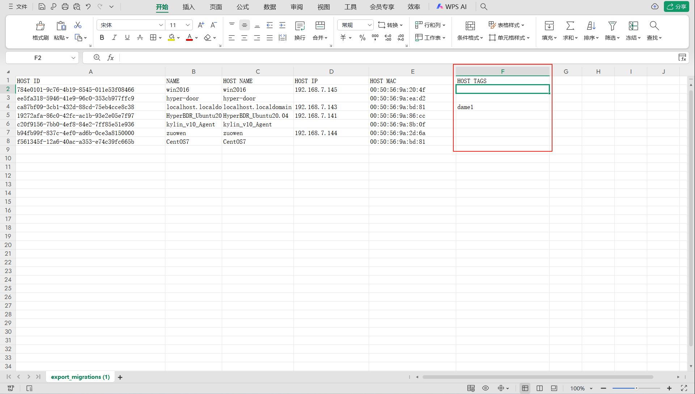
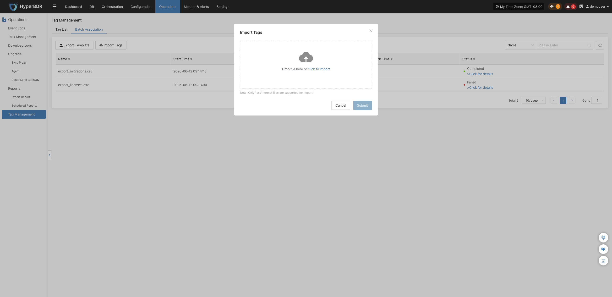
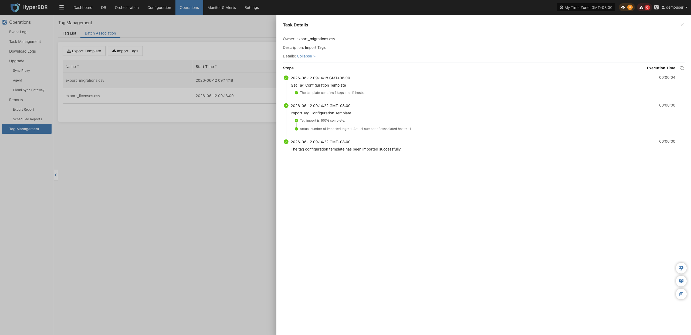

# **标签管理**

标签管理模块用于对系统中的主机资源进行分类和多维度标识，方便用户对海量资源进行快速检索、业务归类与编排管理，提升运维效率。

## **标签列表**

登录 HyperBDR 控制台，在顶部导航栏进入 **【运维管理】>【标签管理】>【标签列表】** 页面。

### **创建标签**

点击列表左上方的 **【+ 创建标签】** 按钮，在弹出的窗口中填写标签名称、描述并选择标签颜色，点击【确定】完成创建：

### **更多操作**

选中已创建的目标标签后，点击列表上方的 **【更多操作】** 下拉菜单，可执行以下管理操作：

#### **修改**

选中已创建的目标标签，点击 **【更多操作】>【修改】**，可重新编辑标签名称、描述及标签颜色，点击【确定】保存修改：

#### **绑定资源**

选中目标标签，点击 **【更多操作】>【绑定资源】**，在弹出的主机列表中勾选需要关联的主机资源，点击【确定】完成绑定：

绑定完成后，在标签列表中点击对应行的 **【点击查看列表】**，页面右侧将滑出抽屉，可集中查看该标签当前已绑定的所有主机资源明细：

#### **解绑资源**

选中目标标签，点击 **【更多操作】>【解绑资源】**，勾选需要解除关联的主机资源，点击【确定】确认解绑：

#### **删除**

选中无需继续使用的标签，点击 **【更多操作】>【删除】**，系统将弹出二次确认对话框，点击【确定】后彻底删除该标签：

::: warning
删除操作不可逆。删除标签后，所有已绑定该标签的主机资源将自动与该标签解绑。
:::

## **批量关联**

针对需要大规模批量分配标签的场景，可通过 CSV 模板导入实现批量关联。进入 **【运维管理】>【标签管理】>【批量关联】** 页面。

### **导出模板**

点击页面右上方的 **【导出模板】** 按钮，系统将下载主机标签配置模板文件（`.csv` 格式）：

#### **模板字段说明**

| **字段名称** | **说明** |
| :--- | :--- |
| **HOST ID** | 主机唯一标识符，通常为 UUID 格式。 |
| **NAME** | 主机名称，用户自定义或系统分配的名称。 |
| **HOST NAME** | 主机的网络主机名（Hostname）。 |
| **HOST IP** | 主机的 IP 地址。 |
| **HOST MAC** | 主机的 MAC 地址，唯一标识网络接口。 |
| **HOST TAGS** | 主机标签，用于分类、分组或标识主机的自定义信息（多个标签使用英文逗号分隔）。 |

#### **填写并保存模板**

打开导出的 CSV 模板文件，在对应主机的 **HOST TAGS** 字段中填入目标标签名称并保存文件：

### **导入标签**

点击页面右上方的 **【导入标签】** 按钮，在弹出的窗口中拖入或点击上传已填写好的 CSV 模板文件（仅支持 `.csv` 格式）：

文件上传提交后，系统将自动批量创建对应标签并将主机加入关联。可在任务列表抽屉中查看导入进度与执行结果：

