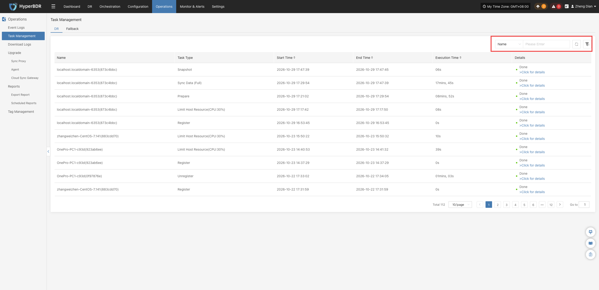
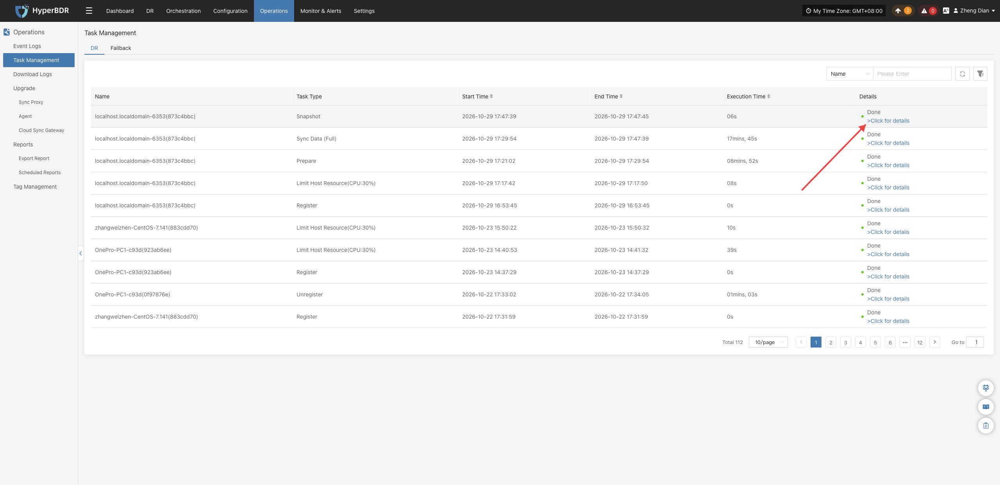
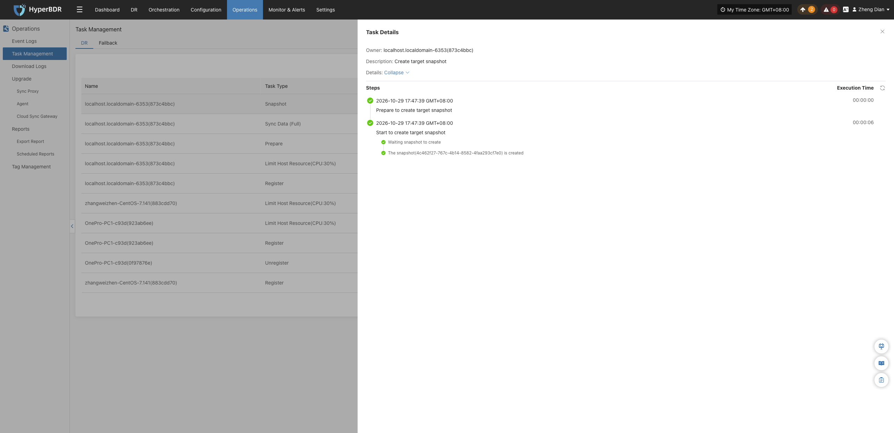

# **任务管理**

任务管理模块用于集中监控平台中日常容灾保护、数据快照、增量复制、应急接管及业务回切等所有后台异步任务的执行状态。系统支持任务状态的实时追踪、组合筛选与日志详情查看，帮助管理员全面掌握各类任务的执行进度与异常结果。

系统提供 **【容灾】** 与 **【回切】** 两个维度的任务视图，两者在功能与操作上保持一致。登录 HyperBDR 控制台，在顶部导航栏进入 **【运维管理】>【任务管理】** 页面，默认处于 **【容灾】** 标签页，也可按需切换至 **【回切】** 标签页查验反向回切相关的任务执行记录。

## **任务检索与筛选**

用户可通过列表顶部的下拉列表选择任务类型，并在搜索框中输入主机名称或其他筛选条件对应的关键字进行查询。也可使用高级筛选功能，设置更具体的筛选条件，以便精准定位目标任务。

* **名称**：输入关键字检索任务关联的主机或资源名称。
* **任务类型**：按任务具体类别进行筛选（如数据同步、创建快照、主机恢复、演练启动等）。
* **任务状态**：按执行状态快速过滤（如全部、执行中、成功、失败等）。
* **时间排序**：支持按任务起始时间或结束时间进行升序/降序排列。

## **任务列表字段说明**

任务列表中每条记录包含的字段信息如下：

| **字段名称** | **说明** |
| :--- | :--- |
| **名称** | 显示执行任务所关联的主机或资源名称。 |
| **任务类型** | 展示任务的具体类型，如注册、快照、同步、创建副本、故障恢复等。 |
| **起始时间** | 任务被系统调度并发起的实际启动时间。 |
| **结束时间** | 任务成功完成、手动中止或异常退出的时间。 |
| **执行时间** | 任务自开始至结束所消耗的总时长。 |
| **详情 / 状态** | 展示任务的最终执行状态（如成功、失败）。支持点击状态链接查看任务详情。 |

::: tip 查看任务详情
在列表的「详情」列中，点击【点击查看详情】，系统将弹出任务详情窗口，展示任务的完整执行流程、各步骤的执行进度及详细错误日志。
:::

::: note
任务管理支持分页浏览（默认每页显示 10 条记录），管理员可根据需要调整单页条目数或翻页定位历史任务记录。任务日志均由系统自动记录留痕，用于全流程审计追踪与异常排障。
:::
