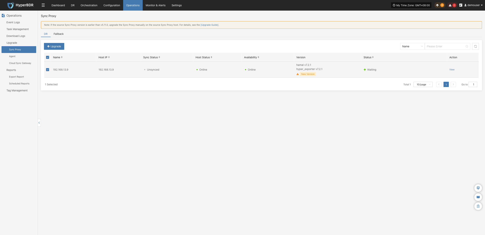
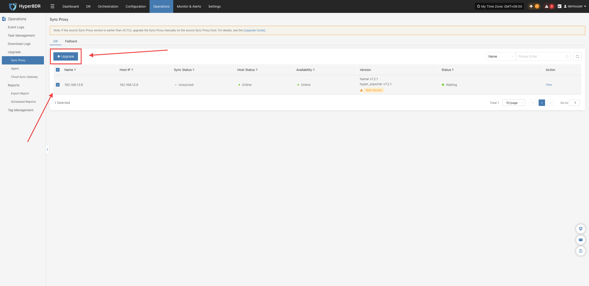
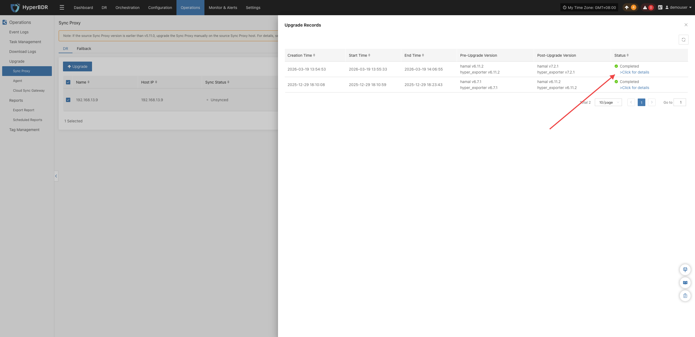
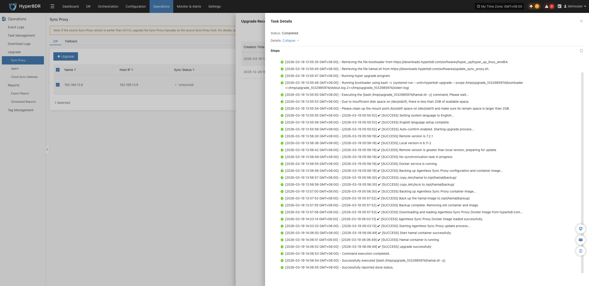

# **升级管理**

升级管理用于集中维护与在线更新平台中纳管的各端组件版本（包括源端同步代理、主机 Agent 程序及云同步网关），确保各模块保持在受支持的稳定版本。

系统提供 **【容灾】** 与 **【回切】** 两个维度的组件升级视图，两者在界面布局与升级操作上保持完全一致。登录 HyperBDR 控制台，在顶部导航栏进入 **【运维管理】>【升级管理】** 页面即可开始管理。

## **升级前置条件**

在通过控制台升级各端组件之前，**控制台核心服务必须先完成升级**。

只有当控制台中已载入更新版本的组件包时，界面才会检测并提示各组件可供升级的新版本。关于控制台安装包获取及升级操作，请参考 [【运维指南】>【升级管理】>【控制台】](../../om-guide/upgrade-maintenance/console.md)。

## **支持升级的组件说明**

用户可在 **【容灾】** 或 **【回切】** 标签页下，针对以下三大类组件执行在线版本检测与升级：

::: tip 版本提示与列表说明
当系统检测到组件存在可用的新版本时，将在列表的「版本」列显示 **▲ New Version** 标识。若当前环境中尚未创建或纳管相应类型的组件主机，则对应列表将显示为空。
:::

| **组件名称** | **部署位置** | **升级条件与说明** |
| :--- | :--- | :--- |
| **源端同步代理 (Sync Proxy)** | Sync Proxy主机 | 配置生产站点时创建的代理主机，用于无代理模式下的源端数据同步。 |
| **源端代理程序 (Agent)** | 受保护的 Linux / Windows 生产主机 | 安装了客户端 Agent 的主机。 |
| **云同步网关 (Cloud Sync Gateway)** | 目标端灾备云平台 | 容灾/回切配置【块存储】时自动创建的数据接收网关。**注意**：仅采用 S3Block 传输协议的网关支持在线升级。 |

## **组件在线升级流程**

三大组件的升级交互完全一致，均支持单台快速升级与多节点批量升级，操作流程如下：

### **1. 勾选待升级目标**

在左侧导航栏中，选择需要升级的组件类型：**【源端同步代理】**、**【源端代理程序】** 或 **【云同步网关】**，进入对应的组件列表页面。

在列表中查看「版本」列，找到显示新版本提示的主机，勾选主机名称前的复选框，选择需要升级的组件主机。支持单选或批量多选。

::: note 注意
如果需要升级的组件属于回切场景，请先在左侧导航栏中选择对应的组件类型，再点击页面上方的 **【回切】** Tab，切换至回切组件列表后进行选择。
:::

### **2. 发起在线升级**

点击列表左上方的 **【↑ 升级】** 按钮，系统将自动下发升级任务至目标主机。

### **3. 查看升级记录与任务详情**

* **查看升级历史**：点击目标主机操作列中的 **【升级记录】**，右侧将滑出历史升级记录抽屉，展示升级起止时间、升级前后版本及最终状态。

* **查看详细执行日志**：在升级记录中点击 **【点击查看详情】**，可进一步展开任务详情抽屉，查看组件下载、安装、验证各子任务的详细日志与耗时。

