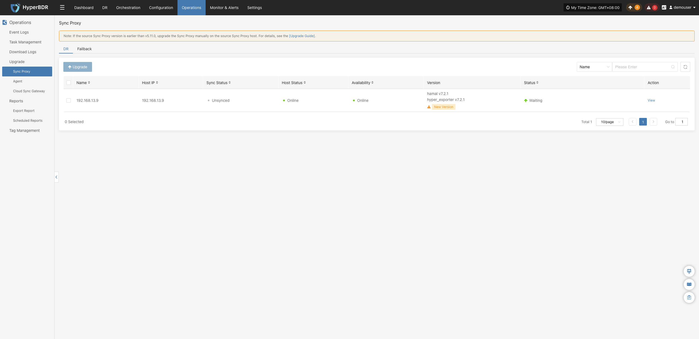
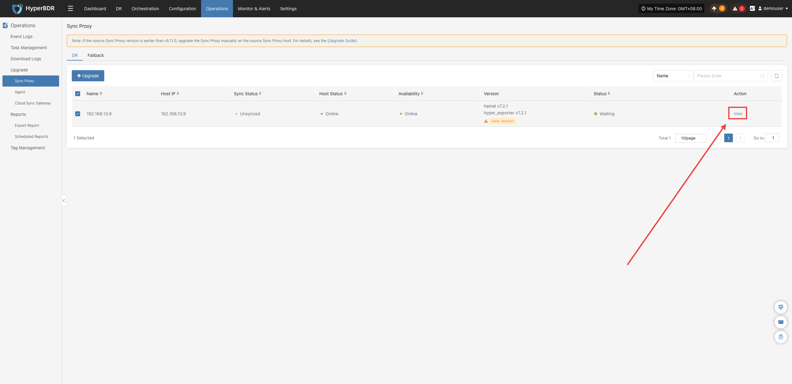
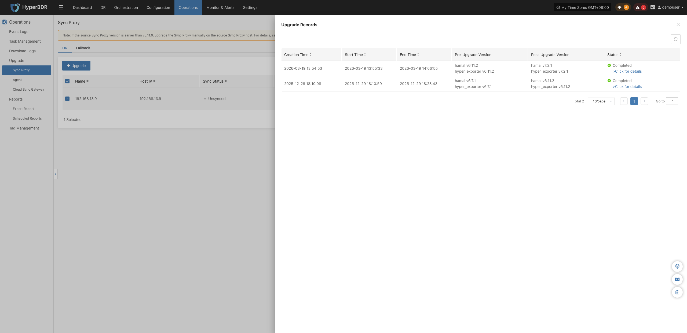
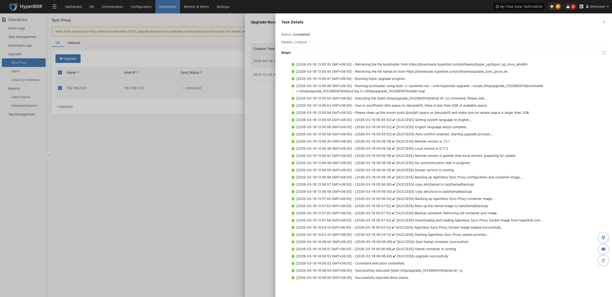
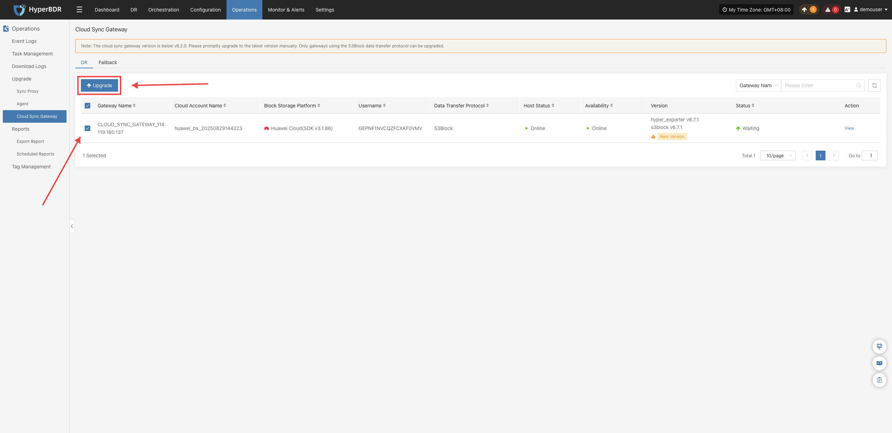
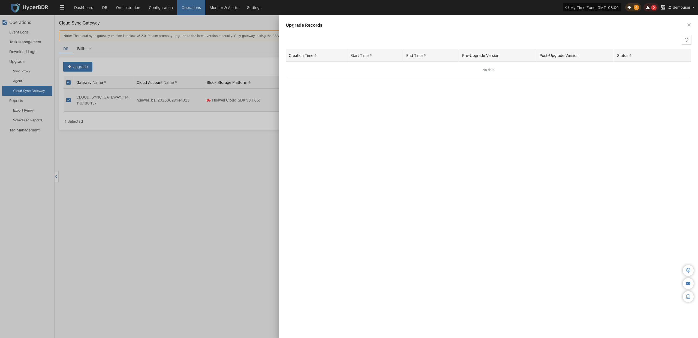

# **升级管理**

**升级管理**用于统一管理系统组件和代理程序的版本更新，确保各模块保持在受支持、稳定的版本状态。用户可通过平台界面查看当前版本信息，并按需执行在线升级操作。

## **升级准备**

在升级各功能组件（如同步代理、云同步网关等）之前，必须先完成控制台的版本升级。控制台作为系统管理核心，其版本需与其他组件保持兼容，以避免因版本不一致引发功能异常或升级失败。

### **获取安装包**

#### **在线方式：**

登录控制台安装的主机，使用本方式获取安装包。

```bash
# 获取最新的 HyperBDR 软件包 URL。
HYPERBDR_PACKAGE=$(curl -s -k https://install.oneprocloud.com/get_hyperbdr_latest/latest)
echo "HYPERBDR_PACKAGE: ${HYPERBDR_PACKAGE}"

# 获取相应的 MD5 文件 URL。
HYPERBDR_PACKAGE_MD5="${HYPERBDR_PACKAGE}.md5"
echo "HYPERBDR_PACKAGE_MD5: ${HYPERBDR_PACKAGE_MD5}"

# 使用字符串操作提取包名称。
HYPERBDR_PACKAGE_NAME="${HYPERBDR_PACKAGE##*/}"
echo "HYPERBDR_PACKAGE_NAME: ${HYPERBDR_PACKAGE_NAME}"

# 提取 MD5 文件名
HYPERBDR_PACKAGE_MD5_NAME="${HYPERBDR_PACKAGE_NAME}.md5"
echo "HYPERBDR_PACKAGE_MD5_NAME: ${HYPERBDR_PACKAGE_MD5_NAME}"

# 开始下载
curl -k -O "$HYPERBDR_PACKAGE"
curl -k -O "$HYPERBDR_PACKAGE_MD5"
```

#### **离线方式：**

> 如果已经通过在线方式获取安装包，请直接跳过该步骤。

如果安装主机无法直接访问互联网，您可以使用其他设备的浏览器访问以下地址获取安装包链接：

下载完成后使用Xftp等类似工具将安装包上传至控制台主机

```plain text
https://install.oneprocloud.com/get_hyperbdr_latest
```

### **解压至指定目录**

使用下列命令将其解压至指定目录：

```plain text
tar zxvf <更新包>.tar.gz -C /更新包解压后路径
```

### **执行升级**

执行升级命令，系统将自动加载更新内容至运行目录 `/opt/installer/production/venvs`：

```plain text
/opt/installer/production/scripts/hmctl upgrade /<更新包解压路径>/installer/venvs
```

## **容灾**

### **源端同步代理(Sync Proxy)**

#### **页面功能与字段说明**

在完成控制台升级准备后，用户可通过导航栏进入 **“运维管理 > 升级管理 > 容灾 > 源端同步代理”** 模块。系统会自动检测并提示可升级的代理组件版本：

| 字段名称 | 说明 |
| :--- | :--- |
| 名称 | 源端同步代理主机的名称 |
| 主机IP | 目标主机的 IP 地址 |
| 同步状态 | 当前主机的同步状态（如未同步、已同步） |
| 主机状态 | 主机在线或离线状态（离线主机无法执行在线升级） |
| 可用性 | 代理组件的运行可用性状态 |
| 版本 | 显示当前运行的组件版本（如 hamal、hyper_exporter），若存在新版本将提示“▲ New Version” |
| 状态 | 组件当前升级状态（如待升级、升级中、已完成等） |
| 操作 | 支持执行升级操作或查看详情 |



#### **升级执行步骤**

1. **选择升级目标**：勾选需要升级的目标主机复选框（支持单选或批量多选）。
2. **发起升级任务**：点击页面左上方的“**↑ 升级 (Upgrade)**”按钮，或点击对应主机操作列的发起按钮。



3. **查看升级记录**：点击右侧操作栏或状态链接的“**升级记录 (Upgrade Records)**”，右侧将滑出升级历史抽屉，展示每次升级的创建时间、起止时间、升级前版本、升级后版本及完成状态。



4. **查看任务执行详情**：在升级记录中点击“**点击查看详情 (Click for details)**”，可进一步展开任务详情抽屉（Task Details），查看升级包下载、安装、校验等各子任务的详细日志与执行耗时。



### **源端代理程序(Agent)**

源端代理程序（Agent）安装在受保护的 Linux 或 Windows 生产主机上。其在线升级逻辑与操作交互与**源端同步代理**保持完全一致：

1. 进入 **“运维管理 > 升级管理 > 容灾 > 源端代理程序”** 页面。
2. 页面自动列出所有受保护主机及其安装的 Agent 版本号。当检测到控制台已上传更新版本时，版本列将提示新版本信息。
3. 勾选需要升级的主机，点击页面上方的“**↑ 升级 (Upgrade)**”按钮批量发起升级任务。
4. 点击对应主机的“**升级记录**”可随时追踪升级进度与执行结果。

> 注：若当前纳管环境中暂未接入待升级的 Agent 主机，列表将显示为空。待主机纳管接入后，系统将自动识别并展示升级项。

### **云同步网关(Cloud Sync Gateway)**

云同步网关用于在容灾阶段接收并写入目标端数据。网关组件的升级操作流程同样与源端同步代理保持一致：

1. **版本识别与限制**：系统自动扫描云同步网关组件版本（注意：仅采用 S3Block 数据传输协议的网关支持在线升级）。
2. **执行升级**：勾选待升级的网关主机，点击页面左上方的“**↑ 升级 (Upgrade)**”按钮触发升级。



3. **升级记录追踪**：点击网关对应行的“**升级记录 (Upgrade Records)**”抽屉，可查看历史升级版本与执行结果。



## **回切**

回切场景下的升级管理模块入口位于 **“运维管理 > 升级管理 > 回切”**，包含：
* **源端同步代理 (Sync Proxy)**
* **源端代理程序 (Agent)**
* **云同步网关 (Cloud Sync Gateway)**

其版本兼容性要求、操作界面布局、批量勾选升级及升级记录查看流程，与**容灾**模块完全一致。用户可根据回切业务环境中的主机与网关组件状态，参照上述容灾步骤执行升级与验证。

