# **批量任务**

批量任务模块用于针对系统中的多个受保护主机资源进行批量化、次序化的任务编排与调度执行。支持将多台主机划分为不同的次序分组（Task Sequence），按定义的先后顺序自动触发数据同步等操作，大幅简化跨多主机的容灾运维流程。

## **批量任务管理**

点击左侧导航栏切换至 **【批量任务】** 标签页，集中查看与管理系统内已创建的所有批量任务：

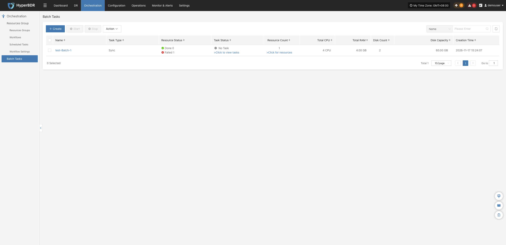

列表上方提供操作按钮：**【新建】**、**【启动】**、**【停止】**、**【更多操作】**；下方为搜索与筛选栏。列表各列清晰展示任务名称、任务类型、资源状态、任务状态、资源数量、总 CPU、总内存、磁盘数量、磁盘容量及创建时间等信息。

#### **查看明细**

批量任务列表的每行记录中，提供了明细下钻抽屉入口：

##### **查看关联任务**

点击表格对应行中的 **【点击查看任务】** 或直接点击任务名称，页面右侧滑出该批量任务的详情抽屉：

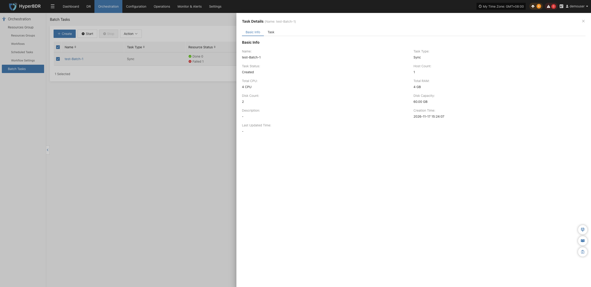

抽屉内提供 **【基本信息】** 与 **【任务】** 两个选项卡：

- **基本信息**：展示当前批量任务的名称、类型、创建状态、纳管主机数量、CPU/内存/磁盘资源规格汇总以及创建和更新时间。
- **任务记录**：点击切换至 **【任务】** 选项卡，查看该批量任务的所有历史执行记录（包括任务类型、开始时间、结束时间、执行耗时与状态）：

  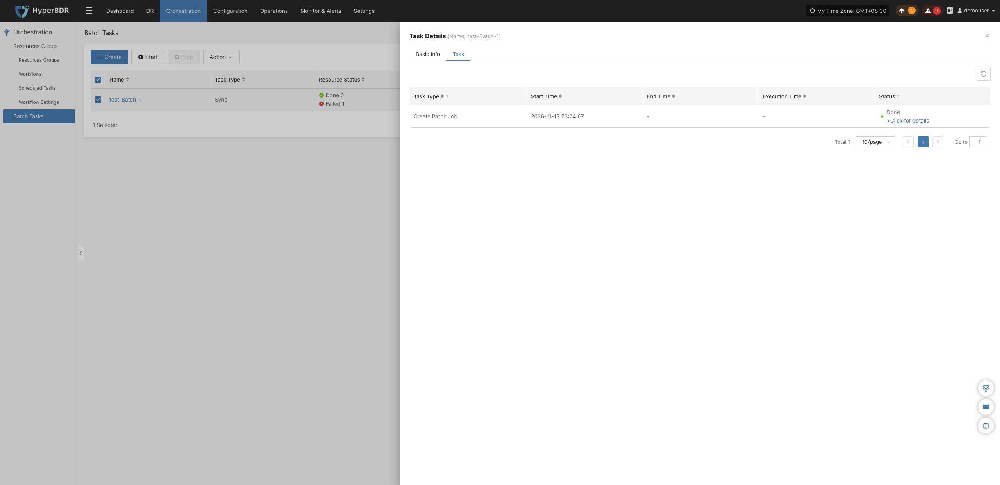

- **查看任务详情**：在任务记录列表中点击 **【点击查看详情】**，进一步展开该任务的子步骤、执行耗时与日志详情：

  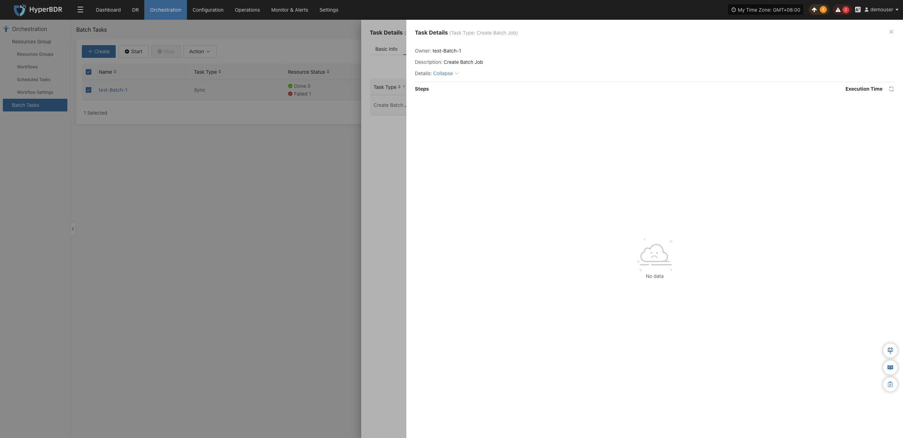

##### **查看关联资源**

点击表格对应行中的 **【点击查看资源】**，右侧滑出当前批量任务所纳管的主机资源明细抽屉（Resources List）：

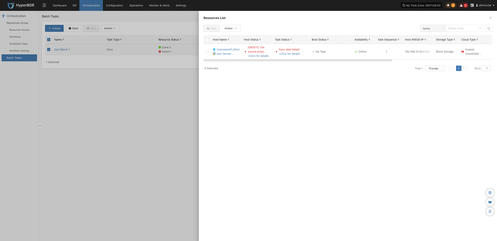

抽屉内清晰展示各受保护主机的名称、主机状态、任务状态、启动状态、在线状态、执行次序（Task Sequence）、主机 IP、存储类型及目标云平台。

- **资源抽屉内数据同步**：在主机资源抽屉中选中目标主机后点击 **【立即同步】**，系统将弹出针对该主机的快照配额与同步策略窗口：

  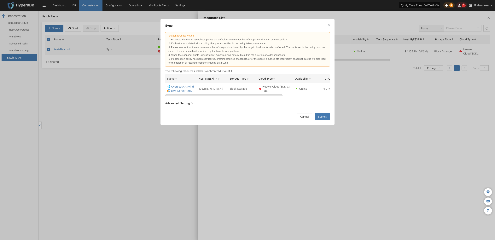

- **资源抽屉内容灾配置**：在主机资源抽屉中选中目标主机后点击 **【更多操作】**，系统将弹出针对该主机的容灾配置菜单，具体可参考[主机容灾](../dr/host-dr.md)：

  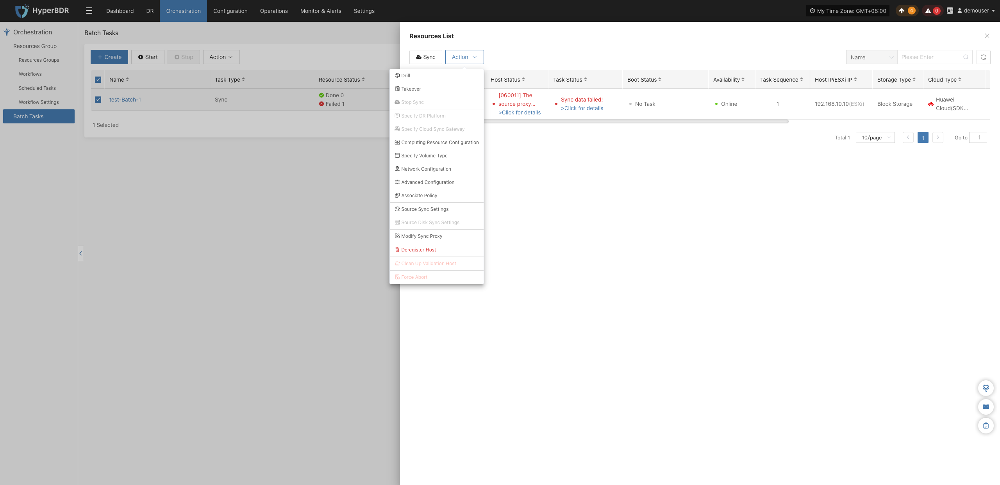

- **查看主机任务详情**：当主机在同步或容灾过程中发生异常时，点击其任务状态列的 **【点击查看详情】**，系统将滑出该主机的子步骤执行日志与报错排查信息：

  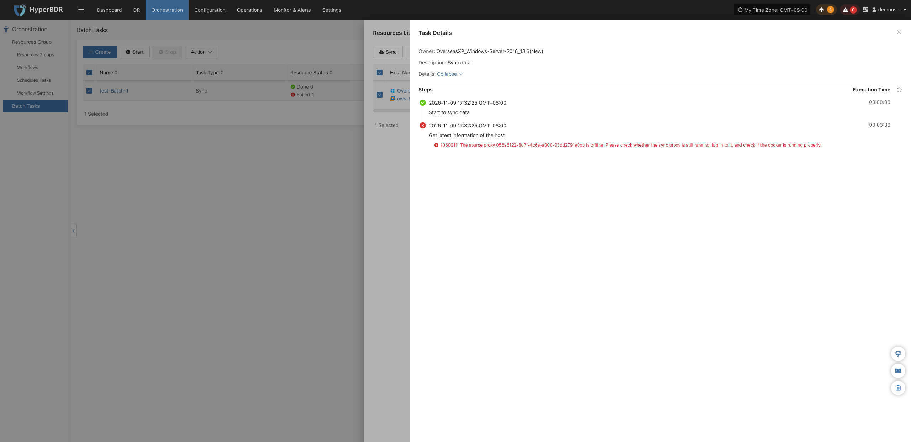

### **新建批量任务**

点击列表左上方的 **【新建】** 按钮，系统将进入全屏新建批量任务向导页面：

#### **步骤一：配置基本信息**

在向导的基本信息区域，填写任务的基础配置项：

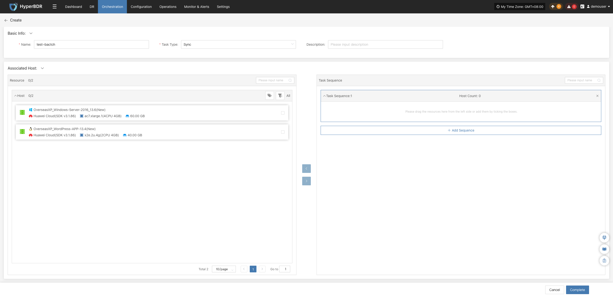

##### **配置说明**

| 配置项 | 是否必填 | 说明 |
| :--- | :---: | :--- |
| **任务名称** | 是 | 自定义批量任务名称，便于后续识别与管理 |
| **任务类型** | 是 | 下拉选择该批量任务执行的具体动作（如数据同步 `Sync` 等） |
| **备注说明** | 否 | 填写该任务的业务背景或备注信息 |

#### **步骤二：规划执行次序与关联主机**

在关联主机区域，规划各主机的次序分组：

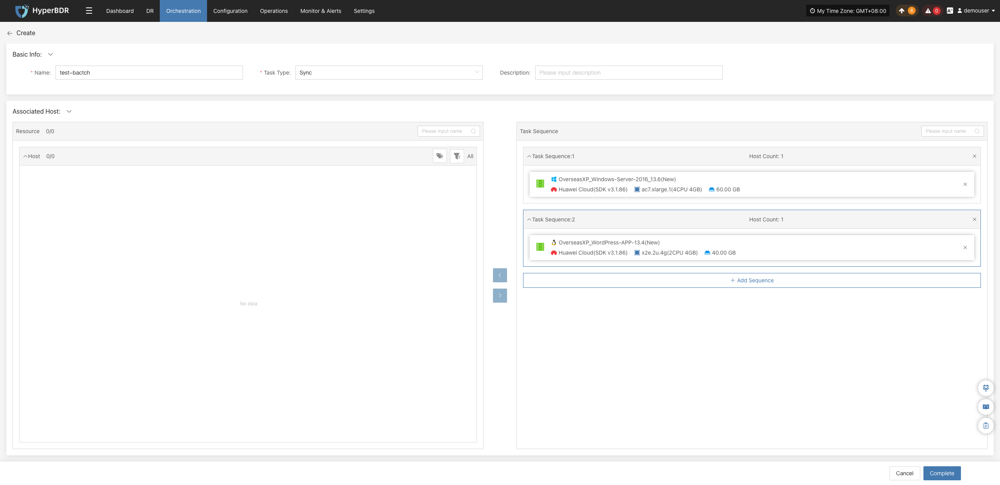

1. 左侧面板展示当前系统内可用的受保护主机清单，支持通过名称进行模糊搜索与过滤。
2. 右侧面板展示次序分组（如 Task Sequence: 1）。勾选左侧目标主机后点击向右穿梭箭头，将主机添加至对应的次序分组中。
3. 点击 **【+ 添加次序 (+ Add Sequence)】** 按钮可创建新的次序分组（如 Task Sequence: 2），并将需要后续执行的主机分配至新分组中。
4. 确认所有次序分组与关联主机无误后，点击右下角的 **【完成】** 按钮即可完成批量任务的新建。

::: tip 次序分组建议
通过将不同业务层级的主机划分到不同的 Task Sequence（例如核心数据库主机分配至 Task Sequence: 1，应用及中间件主机分配至 Task Sequence: 2），系统执行时将严格分批调度，保障业务数据的一致性与启动先后依赖。
:::

### **启动**

在批量任务列表中勾选目标任务，点击列表顶部的 **【启动】** 按钮：

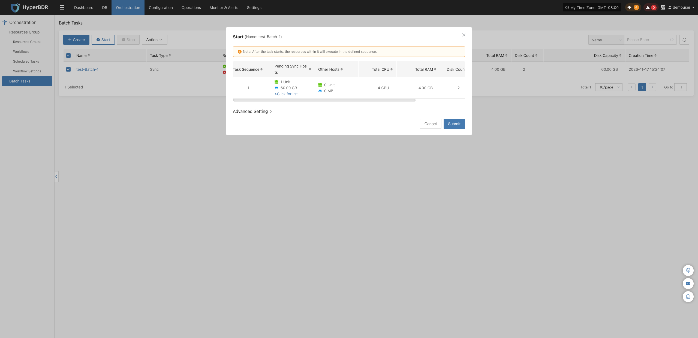

弹出的启动确认窗口中清晰展示各次序分组（Task Sequence）、待同步主机数量、其他主机数量、总 CPU 与内存规格汇总。展开 **【高级设置】** 可微调启动参数，确认无误后点击 **【确定】** 即可触发该批量任务。

::: note 执行次序说明
任务启动后，各分组内的资源将严格按照定义的次序（Task Sequence 1 → Task Sequence 2 …）依次启动并执行。
:::

### **停止**

当批量任务正在执行过程中需要紧急中断时，在列表中勾选正在执行的目标任务，点击列表顶部的 **【停止】** 按钮，系统将停止触发后续次序分组的主机任务。

### **更多操作**

在批量任务列表中勾选目标任务，点击列表顶部的 **【更多操作】** 下拉菜单：

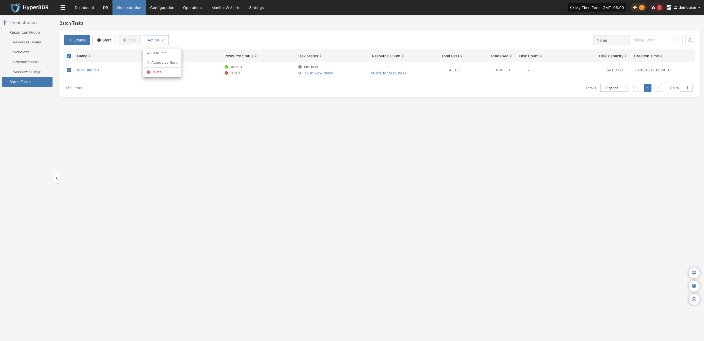

#### **基本信息**

点击 **【更多操作】>【基本信息】**，进入基本信息编辑页面，查看或重新编辑当前批量任务的名称、任务类型与备注说明：

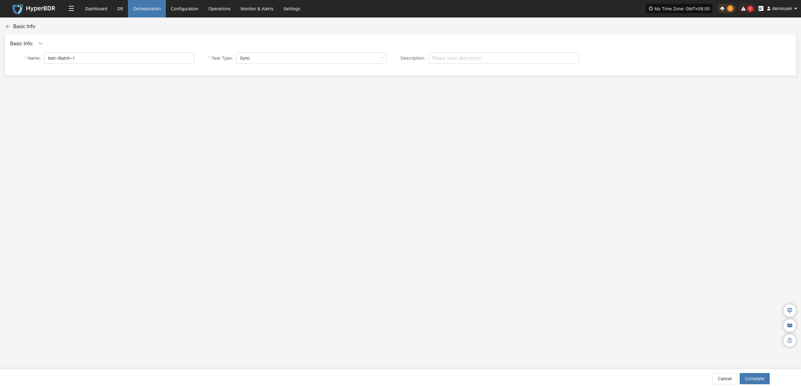

#### **关联主机**

点击 **【更多操作】>【关联主机】**，进入关联主机调整页面，支持动态调整纳管的主机清单以及各主机的次序分组：

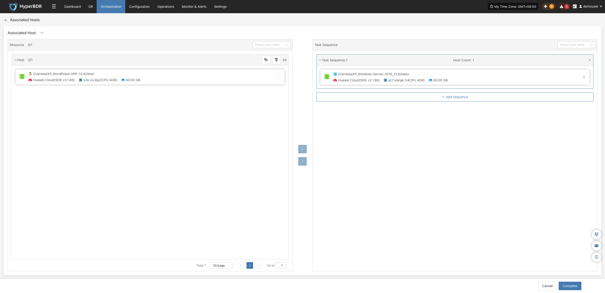

#### **删除**

点击 **【更多操作】>【删除】**，在弹出的二次确认对话框中根据提示输入 `Yes`，点击 **【确定】** 彻底删除该批量任务逻辑编排：

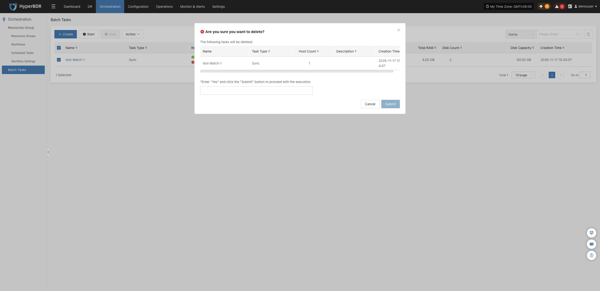

::: warning 操作影响
删除批量任务仅删除该任务的元数据编排配置，不会对纳管的源端主机数据、底层同步进度及容灾快照产生任何影响。
:::
