# **资源组**

资源组容灾模块用于对系统中的多个关联资源（包括主机、网络、存储及自定义脚本）进行统一编组、调度与全流程自动化编排。通过可视化工作流画布预先定义各资源的启动依赖次序、容灾验证脚本及定时周期性任务，确保灾难发生时业务系统能够按预期顺序自动、快速且平稳地完成跨环境恢复与接管。

## **资源组管理**

登录 HyperBDR 控制台，在顶部导航栏进入 **【资源编排】>【资源组】** 页面。

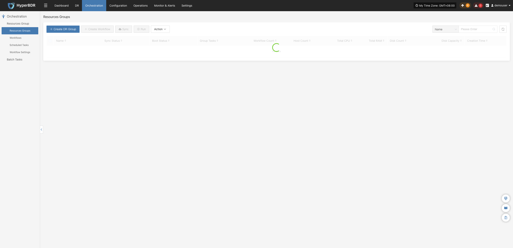

列表上方提供操作按钮：**【新建资源组】**、**【新建工作流】**、**【立即同步】**、**【运行】**、**【更多操作】**；下方为搜索与筛选栏。列表各列清晰展示资源组名称、资源同步状态、启动状态、任务状态、工作流数量、主机数量及存储容量等信息。

#### **查看明细**

资源组列表的每行记录中，提供了三个快捷明细下钻抽屉入口：

##### **查看关联任务**

点击表格对应行中的 **【点击查看任务】**，页面右侧滑出该资源组所有历史任务执行记录抽屉：

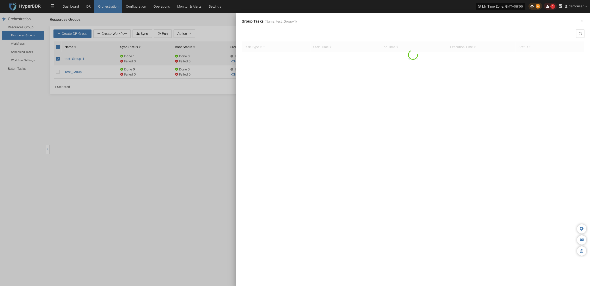

- **查看任务详情**：在任务列表抽屉中点击 **【点击查看详情】**，进一步展开该任务的子步骤、执行耗时与日志详情：

  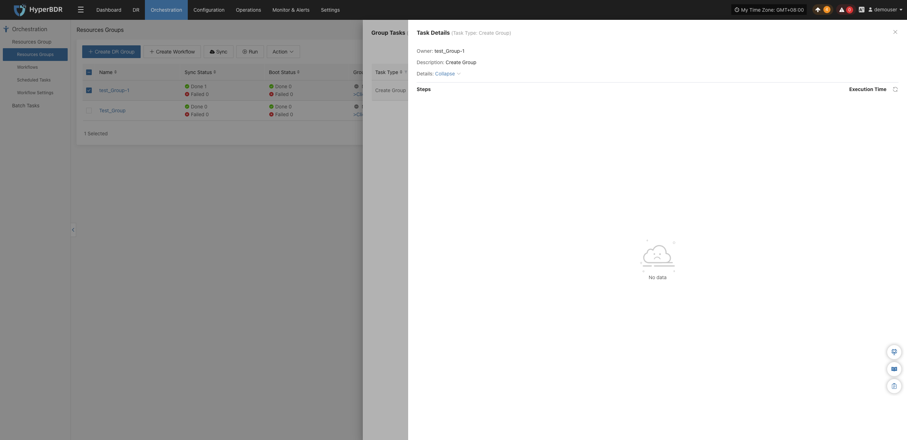

##### **查看关联工作流**

点击表格对应行中的 **【点击查看工作流】**，右侧滑出当前资源组已编排的所有工作流管理抽屉：

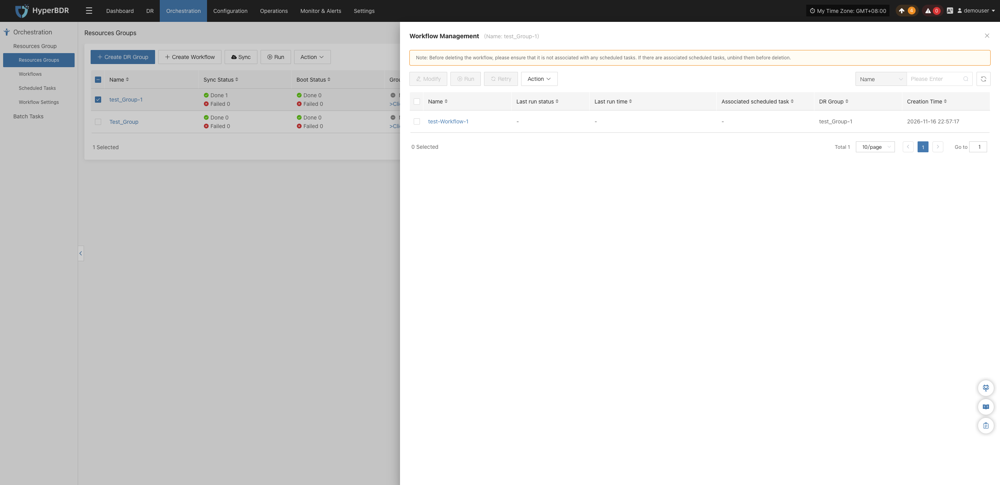

##### **查看关联资源**

点击表格对应行中的 **【点击查看资源】**，右侧滑出当前资源组所纳管的主机资源明细抽屉：

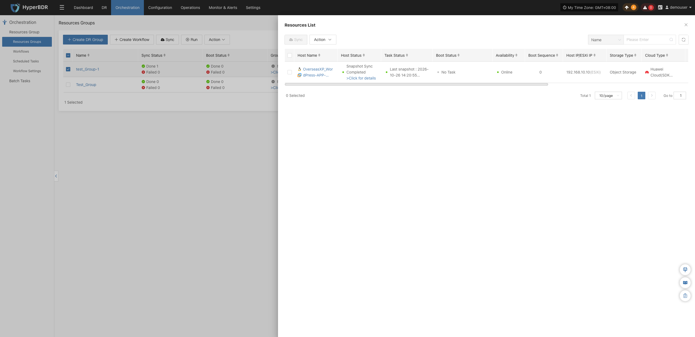

- **资源抽屉内数据同步**：在主机资源抽屉中选中目标主机后点击 **【立即同步】**，系统将弹出针对该主机的快照配额与同步策略窗口：

  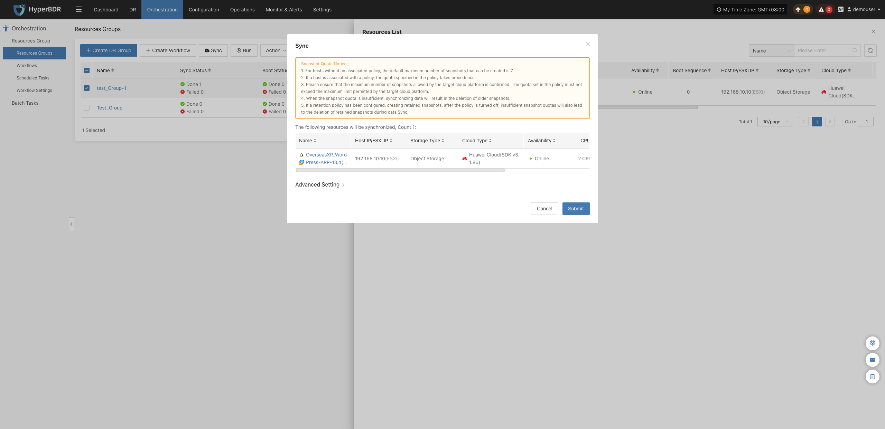

- **资源抽屉内容灾配置**：在主机资源抽屉中选中目标主机后点击 **【更多操作】**，系统将弹出针对该主机的容灾配置信息，具体可参考[主机容灾](../dr/host-dr.md)：

  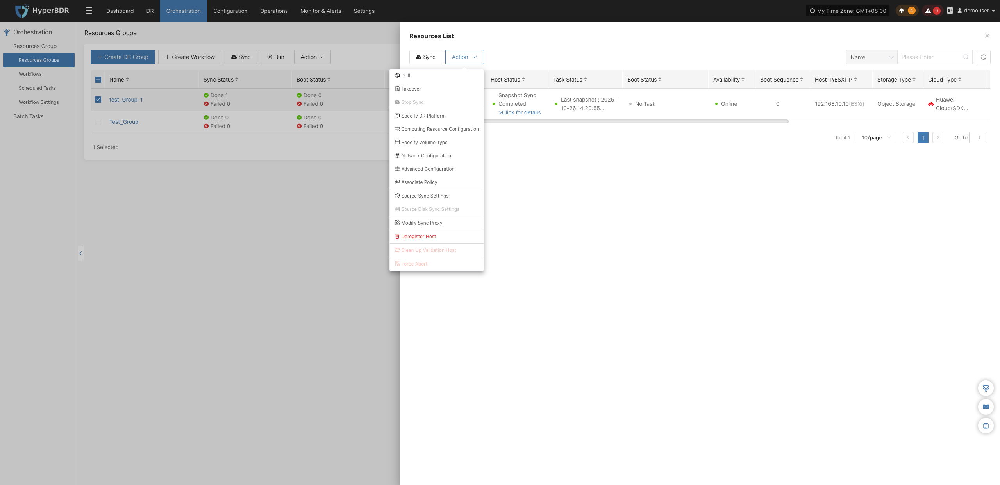

### **新建资源组**

点击列表左上方的 **【新建资源组】** 按钮，系统将弹出新建向导窗口，根据向导表单填写资源组基本信息：

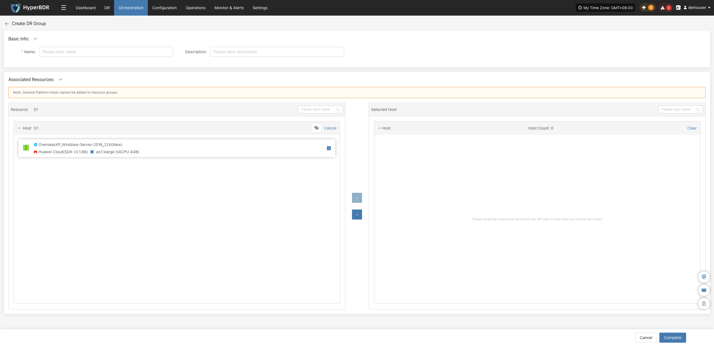

在左侧待选资源列表中勾选目标受保护主机，点击中间的 **【 > 】** 按钮（或直接拖拽），将其添加到右侧已选资源栏中（中间的 **【 < 】** 按钮可移出已选主机）：

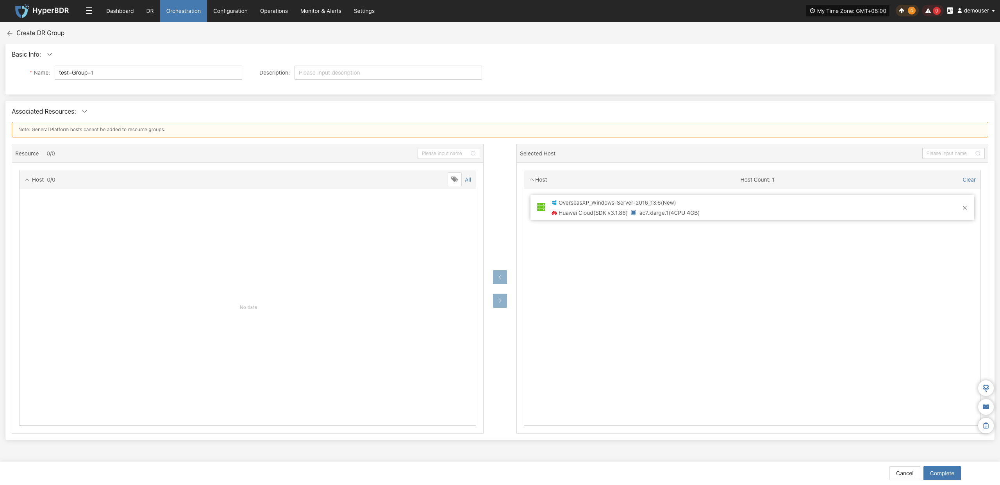

##### **参数说明**

| 参数名称 | 必填 | 说明 |
| :--- | :---: | :--- |
| **名称** | 是 | 资源组自定义唯一标识名称 |
| **描述** | 否 | 资源组备注信息及业务说明 |
| **关联资源** | 是 | 勾选加入当前资源组的目标受保护主机资源 |

::: warning 注意
通用平台主机不支持加入资源组。
:::

### **新建工作流**

在资源组列表中勾选目标资源组，点击列表上方的 **【新建工作流】** 按钮，系统将弹出工作流可视化编排画布：

- **自定义工作流名称**：在画布顶部菜单栏右侧，点击工作流名称可自定义工作流名称。

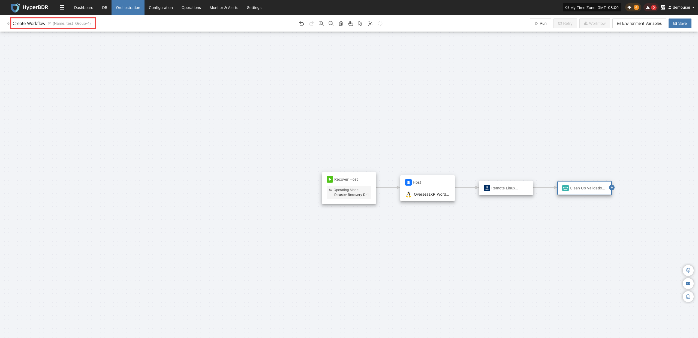

- **常用画布工具**：画布顶部菜单栏中间区域提供常用画布操作，支持撤销、放大、缩小及拖动画布等功能。

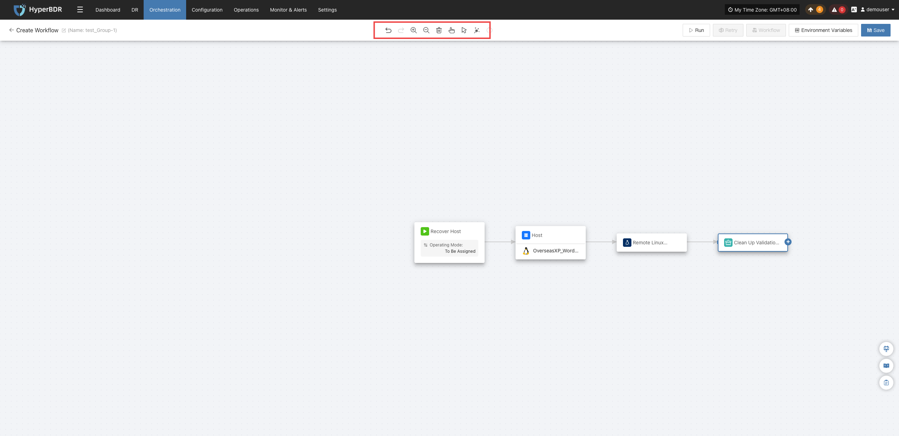

- **工作流控制栏**：画布顶部菜单栏左侧区域提供工作流运行、重试、环境变量配置及保存等功能，可用于编辑工作流、配置运行环境和测试工作流的执行情况。

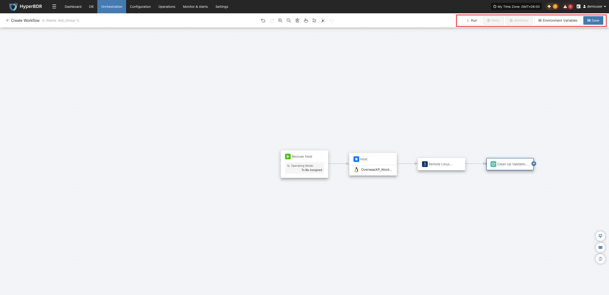

#### **步骤一：选择运行模式**

点击根节点卡片，在右侧面板中选择工作流的运行模式（【容灾演练】或【容灾接管】）：

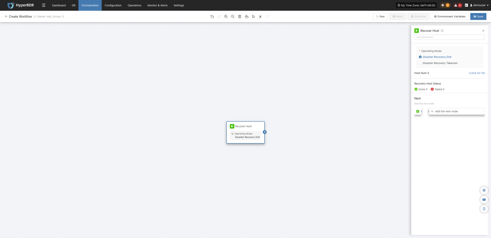

#### **步骤二：添加节点（资源与工具）**

点击节点旁的 **【+】**（点击添加节点）按钮，在弹出的节点选择窗口中挑选所需节点类型。面板支持【资源】与【工具】两大类：

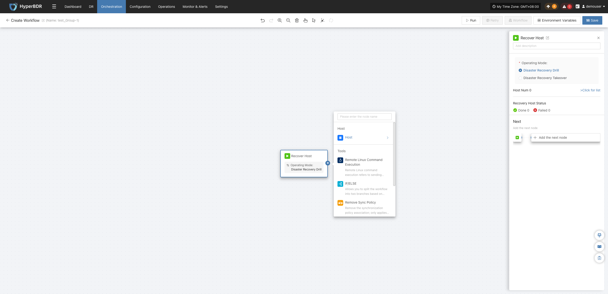

| 节点分类 | 节点名称 | 说明 |
| :--- | :--- | :--- |
| **资源** | **主机** | 添加受保护的主机节点，编排主机的启动顺序与依赖 |
| **工具** | **远程 Linux 命令执行** | 向目标主机发送并执行自定义命令或运维脚本 |
| | **条件分支** | 根据执行状态或条件表达式将工作流拆分为不同分支 |
| | **解除同步策略** | 解除父级资源节点当前绑定的数据同步策略 |
| | **停止同步** | 强制停止父级资源节点正在执行的数据同步任务 |
| | **清理验证资源** | 仅清理该节点对应在目标端拉起的容灾验证资源 |

- **添加受保护主机节点**：选择【主机】节点类型，并在弹出的主机资源列表中勾选目标受保护主机：

  ::: tip 主机选择限制
  每个主机只能被选择一次。
  :::

  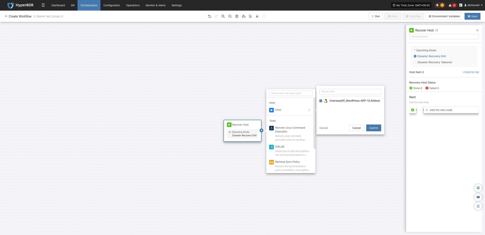

  勾选确认后，画布中生成主机节点卡片及其拓扑连接：

  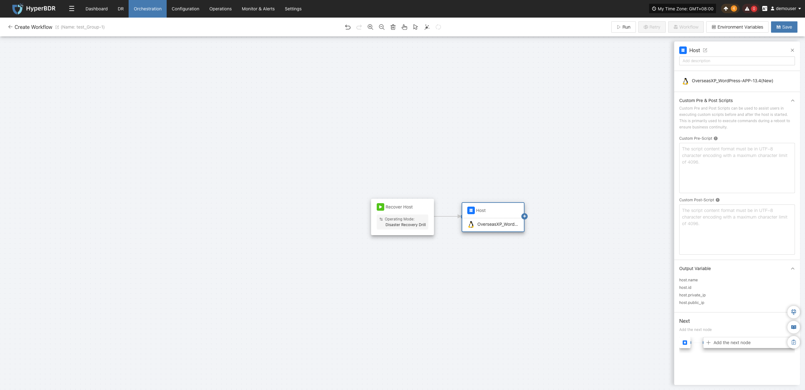

- **添加工具节点**：在已添加的主机节点之后继续点击 **【+】**（点击添加节点）入口，选择【远程 Linux 命令执行】等下游节点：

  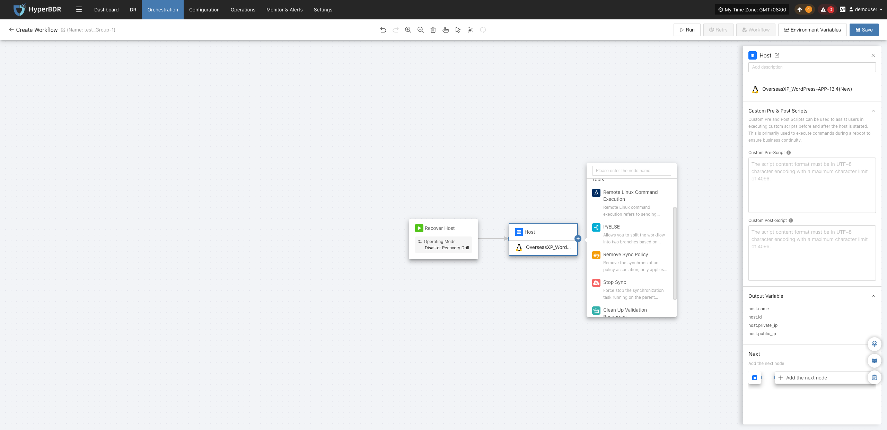

  在弹出的节点列表中选择【远程 Linux 命令执行】：

  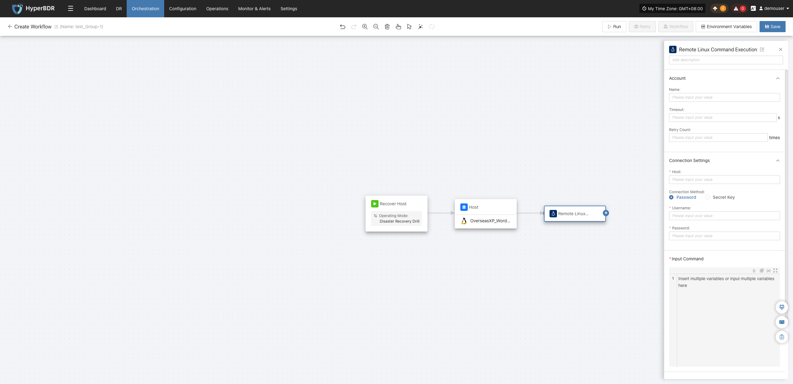

  确认后，画布中生成远程命令执行节点与上下游依赖连接线：

  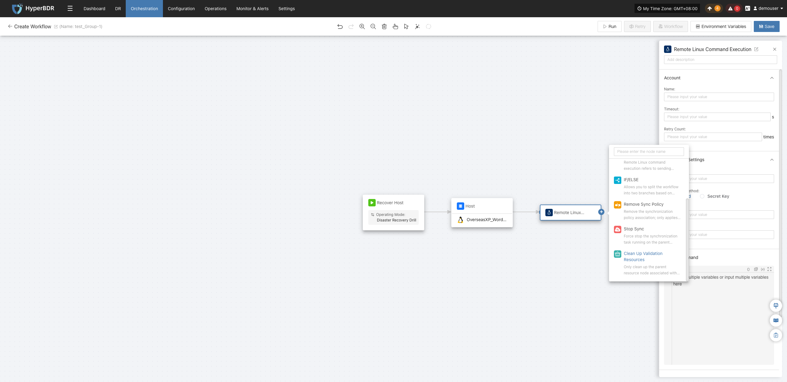

#### **步骤三：配置节点属性**

点击画布中的目标节点卡片，页面右侧将滑出属性面板，可按需配置基础信息、连接凭据、执行脚本或环境变量：

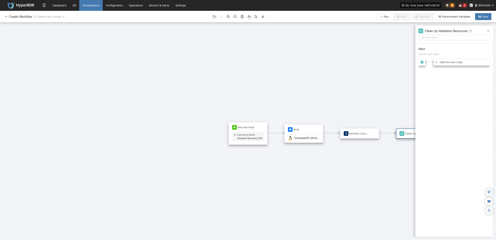

::: tip 最佳实践
关于企业级多层业务架构（如 WordPress + MySQL HA 等）的端到端容灾编排场景、自动化切换脚本规范及实战演练案例，请参考 [HyperBDR编排功能最佳实践](../../technical-practices/hyperbdr-orchestration-best-practices.md)。
:::

### **立即同步**

在资源组主列表中勾选目标资源组，点击列表上方的 **【立即同步】** 按钮，系统将针对该资源组内所有关联主机发起整组数据同步：

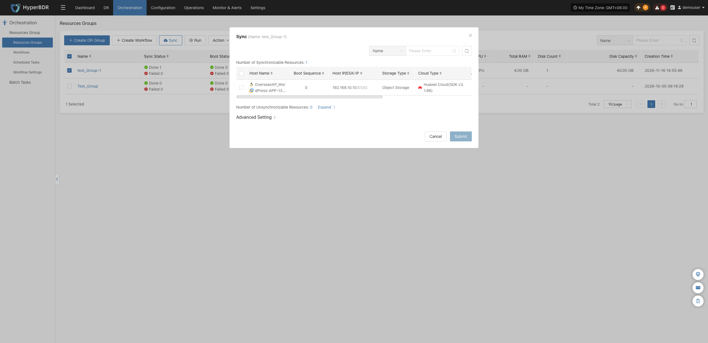

### **运行**

在资源组主列表中勾选目标资源组，点击列表上方的 **【运行】** 按钮，系统将弹出工作流详情列表抽屉，展示该资源组已绑定的工作流：

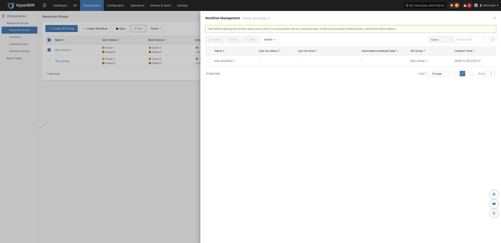

#### **修改**

勾选工作流后，点击列表上方的 **【修改】** 按钮，进入工作流可视化编排画布，支持对已保存的节点拓扑与配置参数进行编辑调整：

#### **运行**

勾选目标工作流后，点击列表上方的 **【运行】** 按钮，系统弹出运行参数确认窗口，可为各主机选择恢复时间点及高级设置后发起运行：

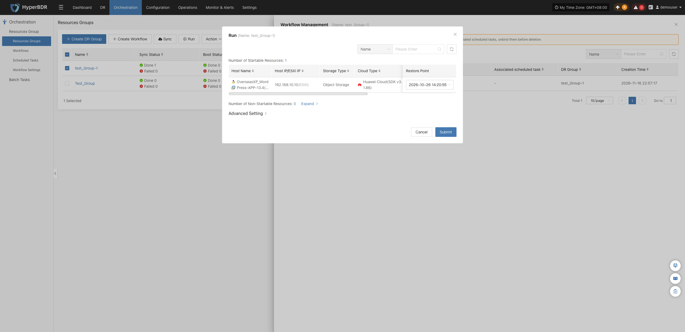

#### **重试**

当工作流运行失败或部分节点出现异常时，点击 **【重试】** 按钮可对失败的节点及下游任务重新发起执行。

#### **更多操作**

选中工作流后点击 **【更多操作】** 下拉菜单，可对该工作流进行以下操作：

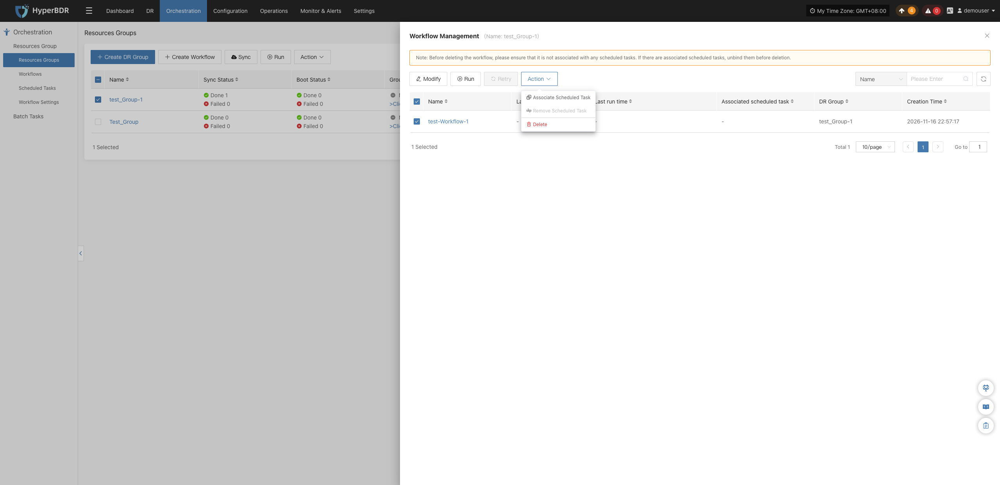

##### **关联计划任务**

点击 **【更多操作】>【关联计划任务】**，在弹出的窗口中选择需要绑定的计划任务，实现该工作流的定时自动化调度：

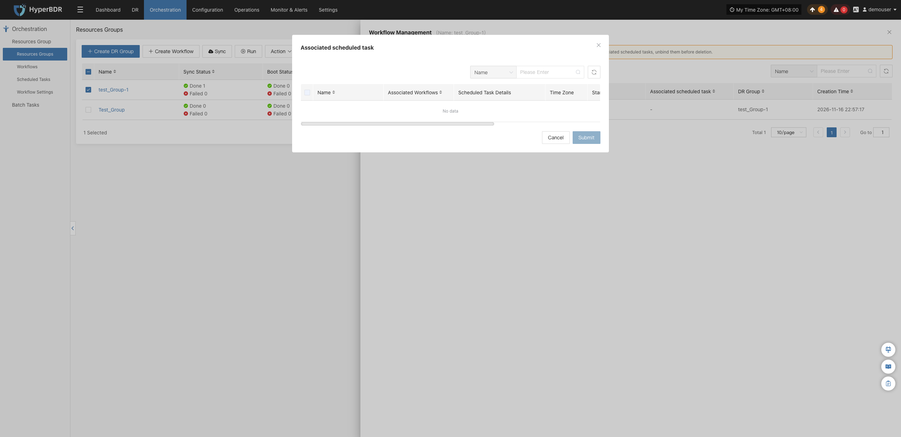

##### **解除计划任务**

点击 **【更多操作】>【解除计划任务】**，解除当前工作流与已关联计划任务的绑定关系；解除后计划任务不再自动触发该工作流。

##### **删除**

点击 **【更多操作】>【删除】**，在弹出的二次确认窗口中点击 **【确定】** 彻底删除该编排工作流：

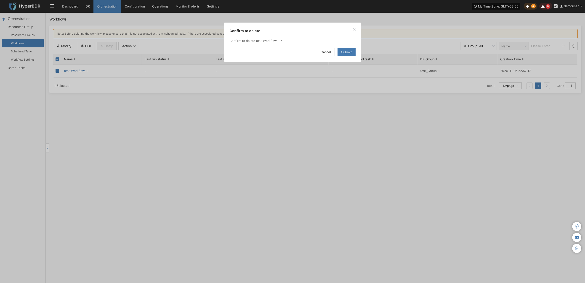

### **更多操作**

在资源组列表中勾选目标资源组，点击列表顶部的 **【更多操作】** 下拉菜单：

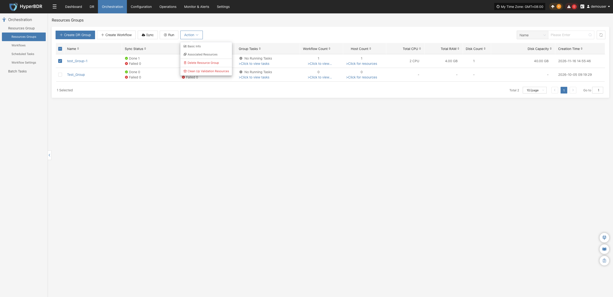

#### **基本信息**

点击 **【更多操作】>【基本信息】**，在弹出的基本信息窗口中查看或编辑当前资源组的基本信息（包括资源组名称和备注说明）：

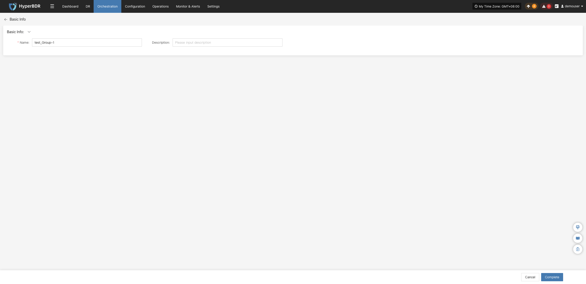

#### **关联资源**

点击 **【更多操作】>【关联资源】**，在弹出的关联资源窗口中查看当前资源组所纳管的受保护主机清单，并支持调整或转移关联主机：

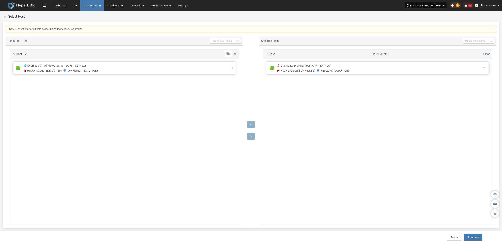

#### **清理验证资源**

点击 **【更多操作】>【清理验证资源】**，在二次确认弹窗中确认后，一键释放当前资源组在容灾演练过程中拉起的目标端云上测试验证实例及关联资源：

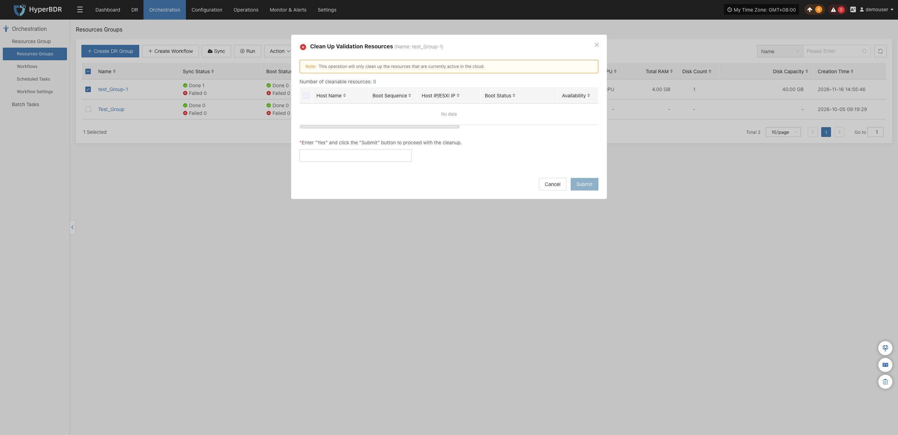

#### **删除资源组**

点击 **【更多操作】>【删除资源组】**，在弹出的二次确认对话框中点击 **【确定】** 彻底删除该资源组元数据逻辑配置：

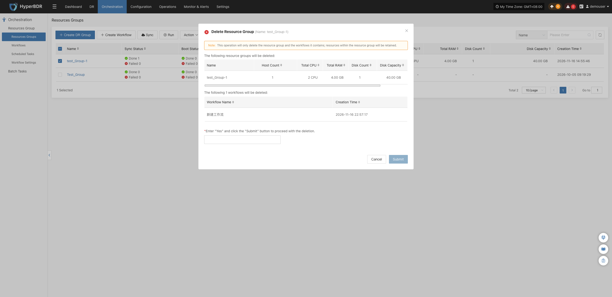

::: warning 操作影响
清理验证资源只会释放云上已拉起的测试验证实例，不会对源端生产主机及同步数据产生影响；删除资源组仅删除元数据逻辑，主机数据将完整保留。
:::

## **工作流管理**

点击左侧导航栏切换至 **【工作流】** 标签页，集中查看与管理系统内已创建的所有编排工作流：

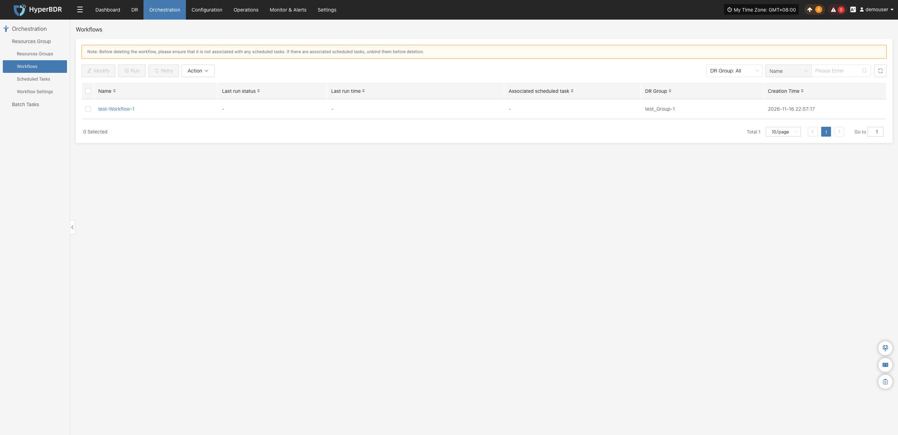

#### **查看工作流任务**

在工作流列表中直接点击目标工作流名称，页面右侧将滑出该工作流的执行拓扑详情与历史任务记录抽屉：

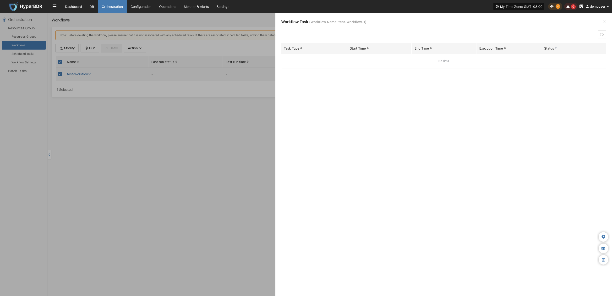

### **修改**

在工作流列表中选中目标工作流，点击列表上方的 **【修改】** 按钮：

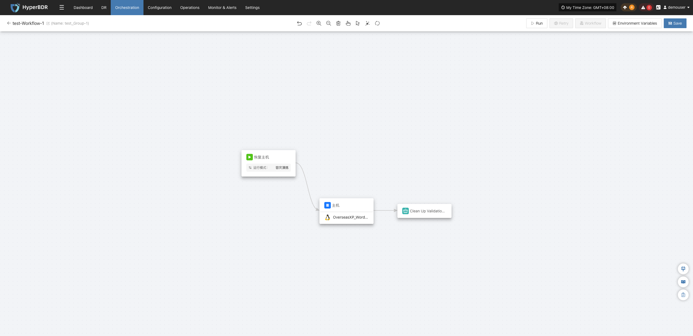

系统将重新打开可视化编排画布，支持对已保存的工作流节点拓扑与配置参数进行编辑调整：

### **运行**

在工作流列表中勾选目标工作流，点击列表上方的 **【运行】** 按钮（或直接点击操作列的运行图标），系统将弹出运行工作流参数确认窗口：

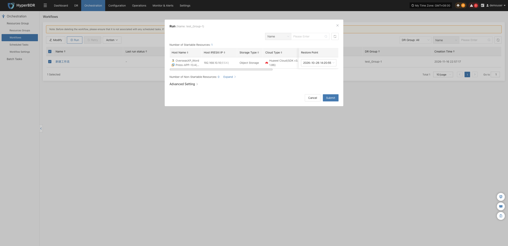

在弹出的运行配置窗口中，可查看该工作流纳管的可启动资源数量、受保护主机名称、主机 IP、存储类型、目标云平台以及还原点快照，并可展开 **【高级设置】** 进行启动参数调整。确认无误后点击 **【确定】** 即可触发该工作流执行。

### **重试**

当工作流在执行过程中由于网络抖动、目标端资源配额不足或脚本执行超时等异常导致执行失败时，列表上方的 **【重试】** 按钮（及操作列的重试图标）将被激活。

在工作流列表中勾选执行失败的目标工作流，点击 **【重试】** 按钮，系统将从失败的节点断点处继续执行，或根据预设重试策略重新触发工作流，无需重新从头配置与运行。

::: tip 重试可用条件
仅当工作流的最近执行状态为失败时，**【重试】** 按钮才处于可用状态；未执行或最近一次执行成功的正常工作流该按钮为置灰状态。
:::

### **更多操作**

选中目标工作流后，点击操作列的 **【更多操作】** 下拉菜单：

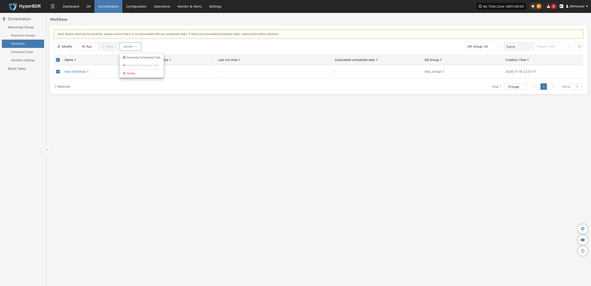

#### **关联计划任务**

点击 **【更多操作】>【关联计划任务】**，在弹出的窗口中选择已创建的定时任务策略进行绑定，使工作流可按预设计划自动定时执行：

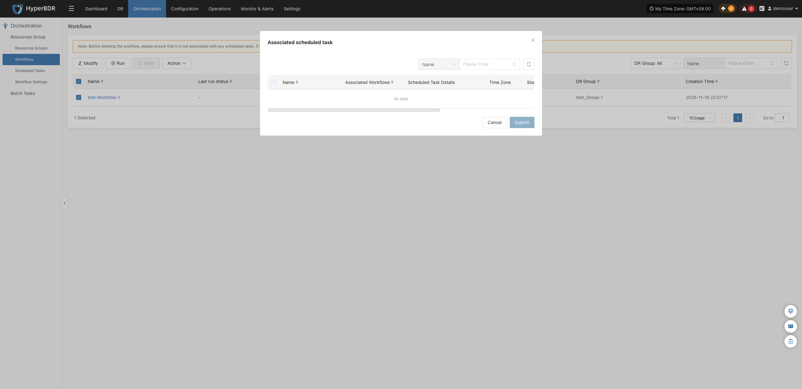

#### **解除计划任务**

若当前工作流已绑定计划任务，点击 **【更多操作】>【解除计划任务】** 可解除绑定关系；解除后该工作流将不再随定时任务周期性触发，但工作流本身不受影响。

::: note 删除前检查
在删除工作流之前，必须确保其未关联任何处于启用状态的计划任务；若存在关联，需先在此处解除绑定。
:::

#### **删除**

点击 **【更多操作】>【删除】**，在弹出的二次确认对话框中点击 **【确定】** 彻底删除该工作流配置：

::: warning 操作影响
删除工作流只会删除其元数据编排逻辑与拓扑配置，不会删除源端主机数据及底层快照。
:::

## **计划任务**

点击左侧导航栏切换至 **【计划任务】** 标签页，统一配置和调度定时自动化容灾任务：

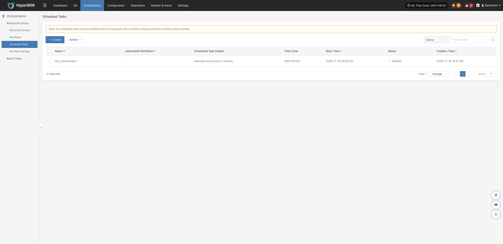

### **创建**

点击页面左上方的 **【创建】** 按钮，弹出创建计划任务向导窗口：

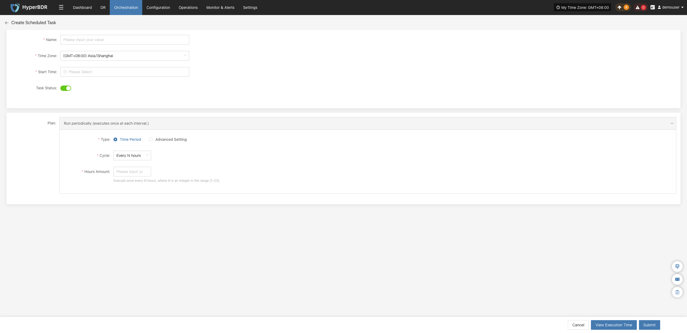

- **配置时间周期与调度参数**：设置执行周期（如每 N 小时、每 N 天等）及具体小时数：
  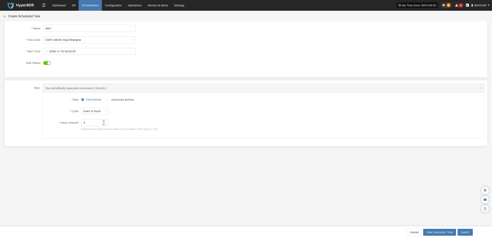
- **查看执行时间**：点击表单底部的 **【查看执行时间】**，预览未来各个周期的具体触发时间点：
  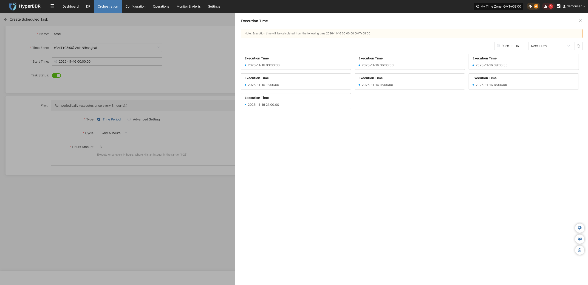

##### **配置说明**

| 配置项 | 说明 |
| :--- | :--- |
| **名称** | 计划任务自定义唯一名称 |
| **时区** | 计划任务生效的时区，默认为 (GMT+08:00) Asia/Shanghai |
| **起始时间** | 计划任务开始生效并首次执行的时间 |
| **任务状态** | 开关控制，默认开启 |
| **类型** | 支持时间周期与高级设置（Crontab 表达式） |
| **周期** | 支持每 N 小时、每 N 天、每周、每月 |

### **更多操作**

在列表中选中目标计划任务，点击 **【更多操作】** 菜单：

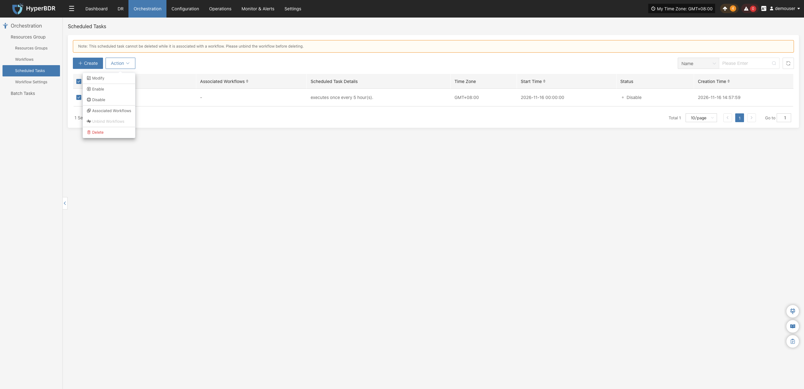

#### **修改**

点击 **【更多操作】>【修改】**，重新编辑计划任务的基本信息与调度周期策略：

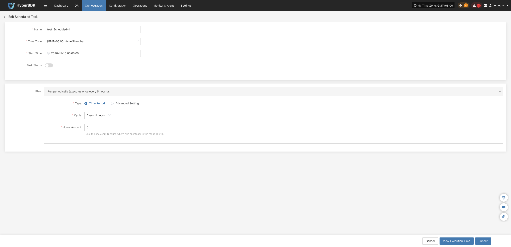

#### **启用**

点击 **【更多操作】>【启用】**，启用处于暂停状态的定时任务：

#### **禁用**

点击 **【更多操作】>【禁用】**，暂停该定时任务的周期调度：

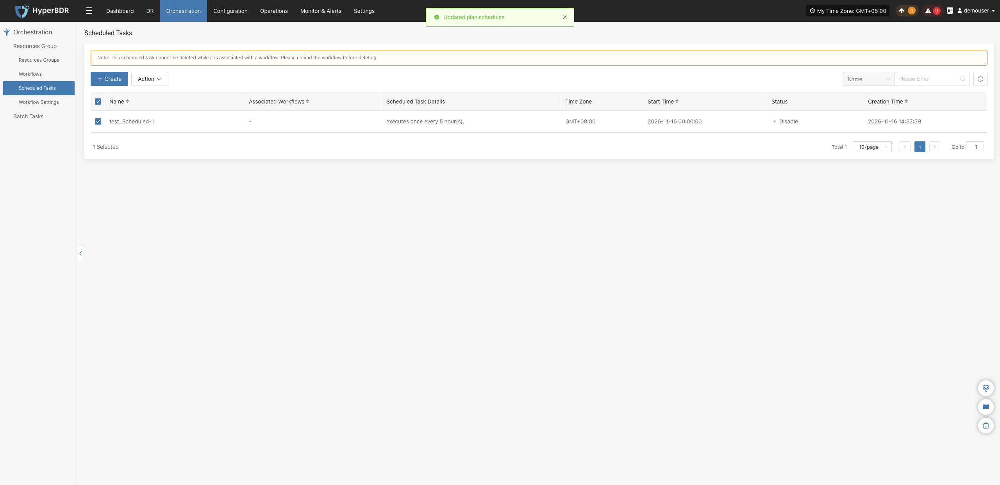

#### **关联工作流**

点击 **【更多操作】>【关联工作流】**，弹窗查看并管理该计划任务所绑定的容灾工作流：

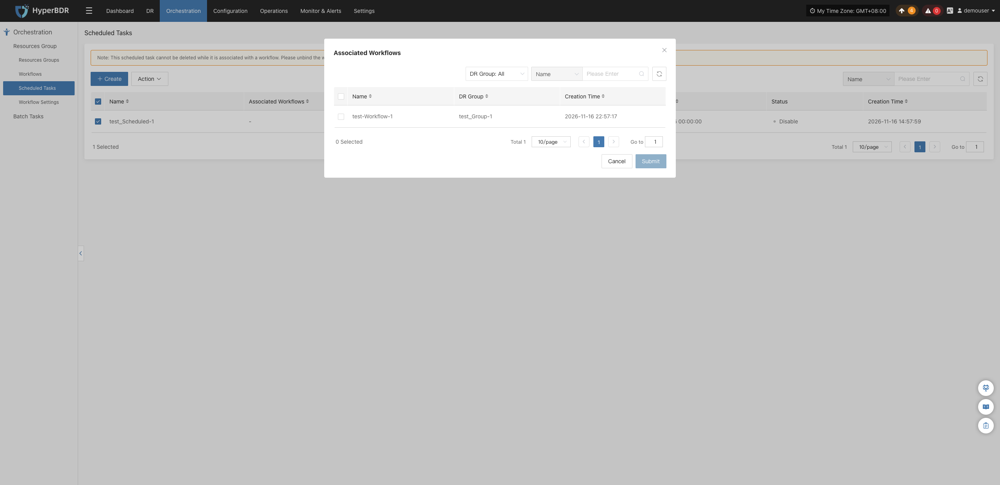

#### **解绑工作流**

点击 **【更多操作】>【解绑工作流】**，解除定时任务与已关联工作流的绑定关系。

#### **删除**

点击 **【更多操作】>【删除】**，在弹出的确认提示框中点击 **【确定】** 删除该计划任务：

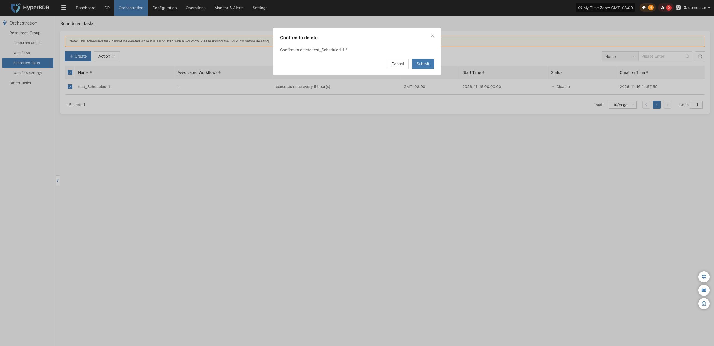

::: warning 删除限制
已关联工作流的定时任务无法直接删除，需先解除与工作流的关联。
:::

## **工作流设置**

点击左侧导航栏切换至 **【工作流设置】** 标签页，统一配置系统全局的工作流并发与超时策略：

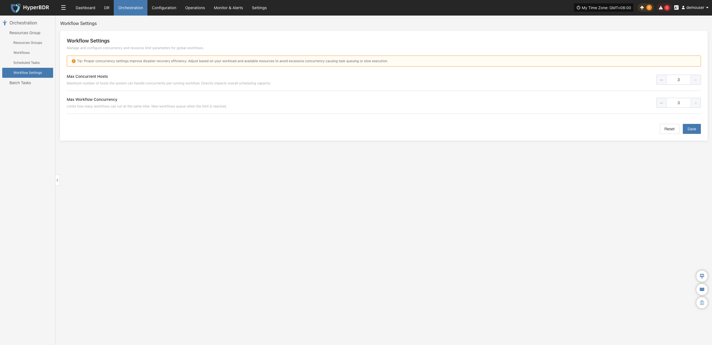

### **最大并发主机数**

配置运行中的工作流可并发处理的最大主机数上限：

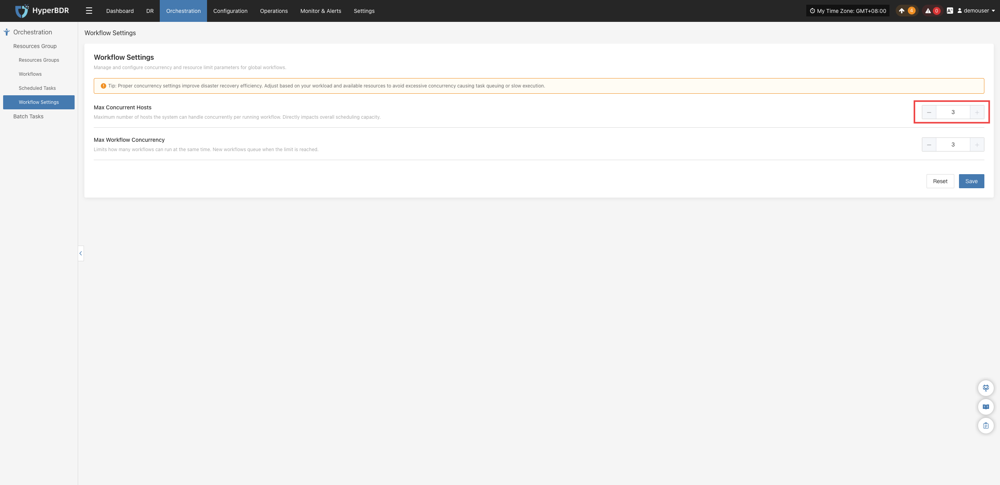

### **单节点默认超时时间**

设定命令执行等单节点的全局默认超时耗时限制：

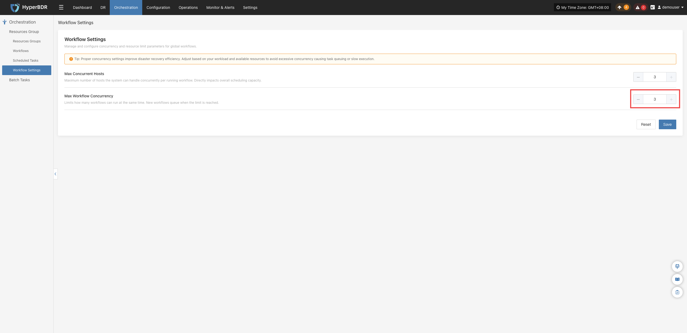

##### **参数说明**

| 配置项 | 说明 |
| :--- | :--- |
| **最大并发主机数** | 每个运行中的工作流系统可并发处理的最大主机数 |
| **单节点默认超时时间** | 设定自定义命令节点的默认最长超时时间，超时未完成将中断并告警 |
| **失败中断策略** | 当工作流中某一节点执行失败时，决定是终止后续执行还是跳过非关键节点继续运行 |
