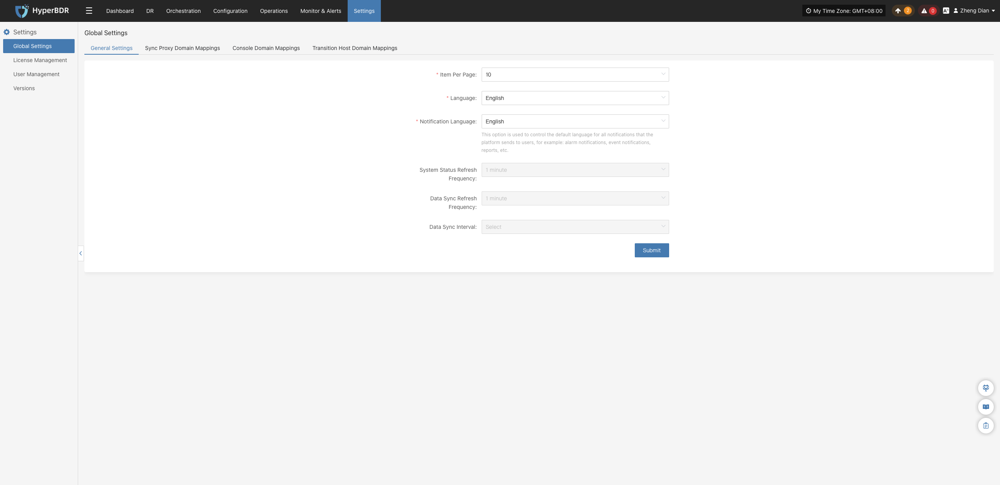
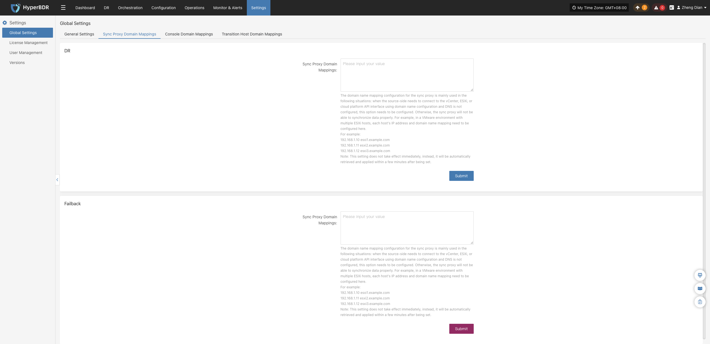
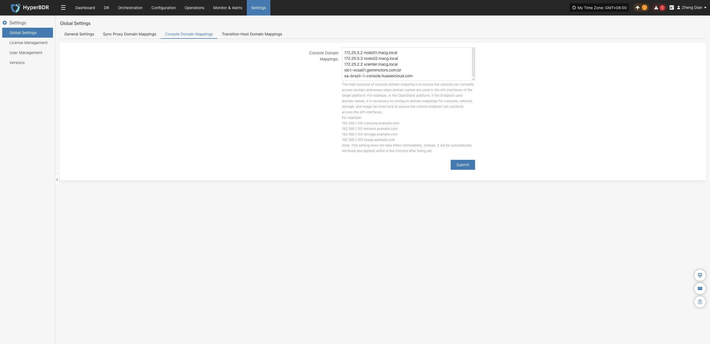
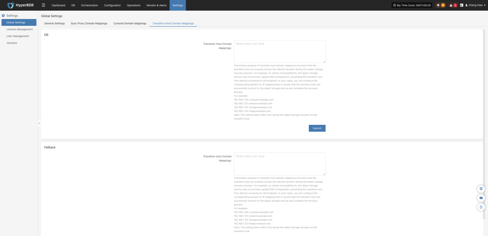

# **全局设置**

全局设置模块用于配置 HyperBDR 平台的基础运行环境，包含控制台界面参数显示、语言偏好、系统刷新频率，以及源端同步代理、控制台、过渡主机的域名与 IP 地址映射。

## **基本设置**

根据实际业务需求，配置平台侧的基础运行参数与界面展示偏好。

**配置方法：**

进入 **【设置】>【全局设置】**，默认处于 **【基本设置】** 标签页。根据需求调整表格展示条目、界面显示语言及告警通知语言。配置完成后，点击 **【保存】**。



**参数配置说明：**

| **参数** | **可选配置** | **说明** |
| :--- | :--- | :--- |
| **每页显示条目** | 10 / 20 / 30 / 40 / 50 / 60 | 设置平台表格展示页面的每页显示条目数，默认为 10。 |
| **切换语言** | 简体中文 / English / Español | 平台控制台展示语言，仅作用于当前用户，不影响其他用户。 |
| **通知语言** | 简体中文 / English | 设置系统发送告警通知的语言类型（适用于邮件、短信、Webhook 等）。 |
| **系统状态刷新频率** | 1 分钟 | 默认 1 分钟，当前版本不支持修改。 |
| **数据同步刷新频率** | 1 分钟 | 默认 1 分钟，当前版本不支持修改。 |
| **数据同步速率时间间隔** | N/A | 默认不可修改。 |

## **源端同步代理域名设置**

源端同步代理（Sync Proxy）的域名映射主要用于以下场景：当源端需要连接的 vCenter、ESXi 或云平台 API 接口使用了域名，但内网未配置 DNS 解析服务时，必须在此处完成域名映射，否则同步代理将无法正常进行数据同步。例如在 VMware 环境中，若包含多台 ESXi 宿主机，每台主机的 IP 地址与域名均需逐行配置。

**配置方法：**

进入 **【设置】>【全局设置】**，切换至 **【源端同步代理域名设置】** 标签页。在配置框中按 `[IP地址] [域名]` 的格式填写映射规则，每行填写一条。配置完成后，点击 **【保存】**。



**配置示例：**

```plaintext
192.168.1.10 esxi1.example.com
192.168.1.11 esxi2.example.com
192.168.1.12 esxi3.example.com
```

::: note
该项设置并非立即生效，系统会在保存后的几分钟内自动拉取并应用至对应的同步代理节点。
:::

## **控制台域名映射**

控制台域名映射主要用于目标端云平台的 API 接口使用域名通信的场景，确保 HyperBDR 控制端能够准确解析并调用目标端服务的各 API 接口。例如在对接 OpenStack 平台时，若各个服务的 Endpoint 使用了域名，则需在此处集中配置计算（Nova）、网络（Neutron）、存储（Cinder）及镜像（Glance）等服务的域名映射。

**配置方法：**

进入 **【设置】>【全局设置】**，切换至 **【控制台域名映射】** 标签页。在配置框中按 `[IP地址] [域名]` 的格式填写映射规则，每行填写一条。配置完成后，点击 **【保存】**。



**配置示例：**

```plaintext
192.168.1.100 compute.example.com
192.168.1.101 network.example.com
192.168.1.102 storage.example.com
192.168.1.103 image.example.com
```

::: note
该项设置并非立即生效，系统会在保存后的几分钟内自动拉取并应用生效。
:::

## **过渡主机域名映射**

过渡主机（Transition Host）在灾备接管和演练恢复时负责卷挂载、驱动适配与数据格式转换。当目标平台的云服务接口（如镜像服务、云硬盘服务、对象存储 Endpoint）采用域名通信且内网缺乏 DNS 时，需在此处配置映射关系，确保过渡主机启动后能够顺畅解析目标端服务接口并通信。

**配置方法：**

进入 **【设置】>【全局设置】**，切换至 **【过渡主机域名映射】** 标签页。在配置框中按 `[IP地址] [域名]` 的格式填写映射规则，每行填写一条。配置完成后，点击 **【保存】**。



**配置示例：**

```plaintext
192.168.1.100 compute.example.com
192.168.1.101 network.example.com
192.168.1.102 storage.example.com
192.168.1.103 image.example.com
```

::: note
该项设置并非立即生效，系统会在保存后的几分钟内自动拉取并应用生效。
:::
