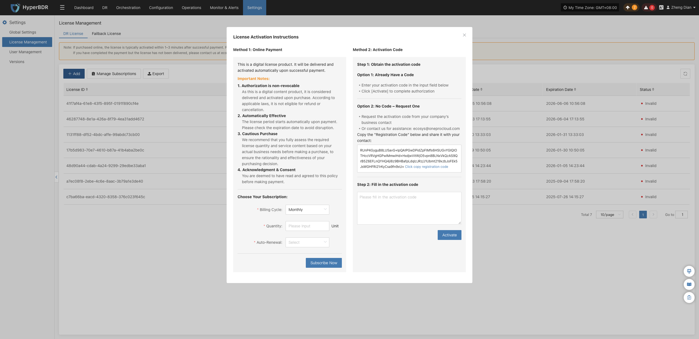
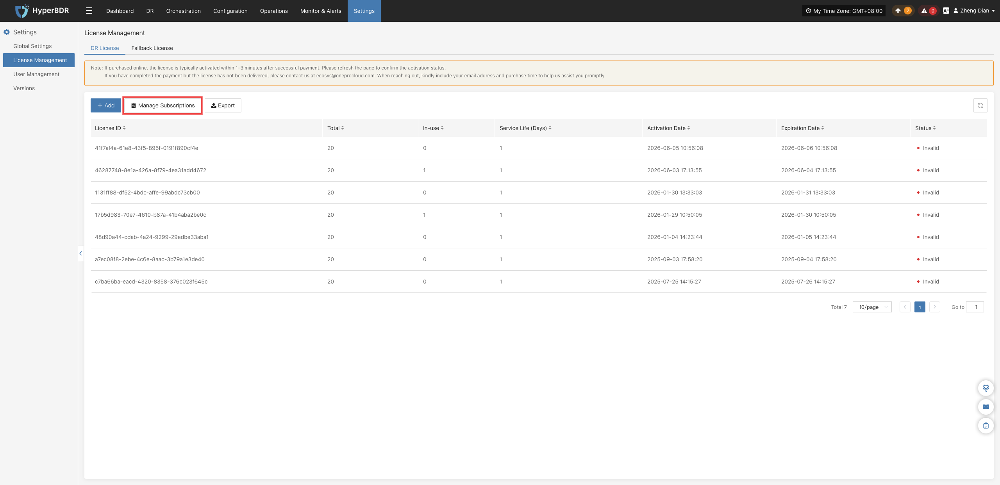
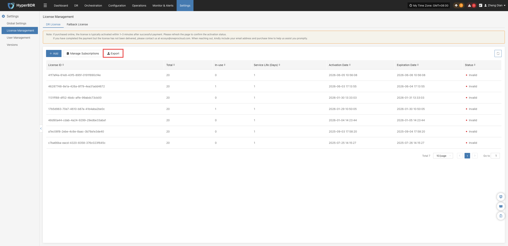
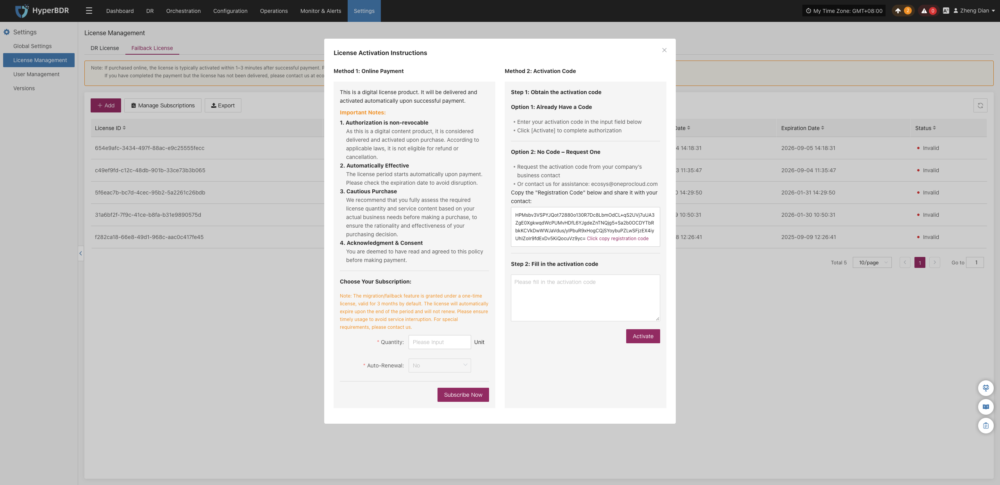
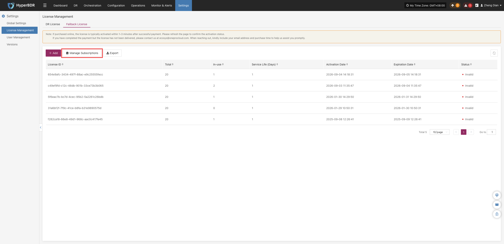
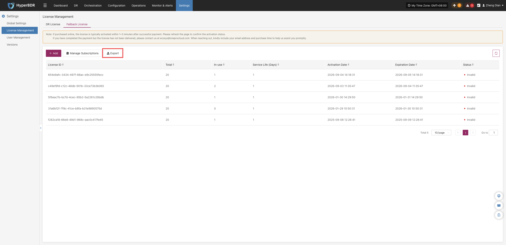

# **授权管理**

授权管理用于控制平台中各类资源在容灾与数据迁移功能中的使用权限，确保用户在执行数据同步、容灾演练、容灾接管及回切等操作时具备相应的授权许可。

平台提供两类核心授权：**容灾授权**（DR License）与**回切授权**（Failback License）。

## **容灾授权**

容灾授权用于控制平台中纳管主机在同步数据与容灾演练、容灾接管功能中的授权配额与有效期限。

### **添加**

进入 **【设置】>【授权管理】>【容灾授权】** 页面，点击顶部 **【+ 添加】** 按钮，系统弹出授权激活对话框，支持两种获取与激活方式：

1. **方式一：线上支付订阅（Online Payment）**
   - **选择计费周期**（Billing Cycle）：支持按月度或年度进行订阅；
   - **设置主机配额**（Quantity）：输入需要购买纳管的主机数量；
   - **自动续费**（Auto-Renewal）：根据业务需要勾选是否到期自动续费。核对订单无误后完成支付，支付成功后授权通常在 1~3 分钟内自动下发。
2. **方式二：激活码激活（Activation Code）**
   - 若已有激活码，直接在激活码输入框中粘贴并点击 **【Activate】** 完成激活；
   - 若无激活码，可复制界面展示的本机专属注册码（Registration Code），联系商务或技术支持团队（ecosys@oneprocloud.com）获取对应授权码。

### **管理订阅**

在容灾授权页面顶部操作栏，点击 **【Manage Subscriptions】**（管理订阅）按钮。

系统将打开订阅管理控制台页面，便于管理员集中查验线上订阅订单、续约状态、账单周期及历史采购明细。

::: note
该功能主要用于查验和管理通过线上支付渠道开通的云端自动订阅服务。
:::

### **导出**

在容灾授权页面顶部操作栏，点击 **【Export】**（导出）按钮，系统将自动生成并下载当前纳管主机的授权消耗明细与关键操作记录表格（Excel/CSV 文件）。

## **回切授权**

回切授权用于在业务容灾接管后，将业务从目标端云平台平滑迁回源端站点时的授权管理。系统需具备有效的回切授权码，以确保数据回迁及反向恢复过程中的合法性与完整性。

### **添加**

在 **【设置】>【授权管理】** 页面切换至 **【回切授权】** 标签页，点击顶部 **【+ 添加】** 按钮。在弹出的激活对话框中，同样支持线上支付订阅与激活码激活两种方式，操作流程与容灾授权一致。

### **管理订阅**

在回切授权页面顶部操作栏，点击 **【Manage Subscriptions】**（管理订阅）按钮，前往订阅中心核验与维护回切授权的订阅配额与生命周期。

### **导出**

在回切授权页面顶部操作栏，点击 **【Export】**（导出）按钮，即可导出当前回切主机的授权使用情况与操作记录文件。

