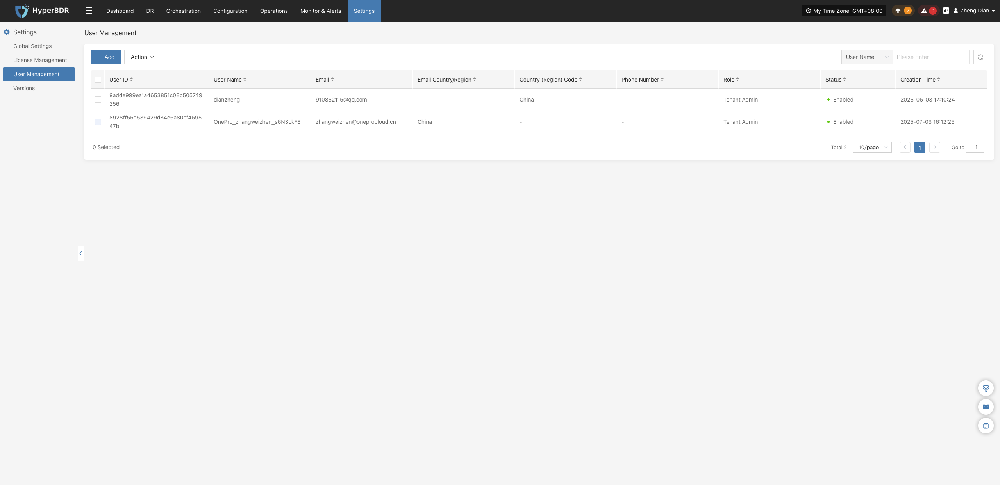
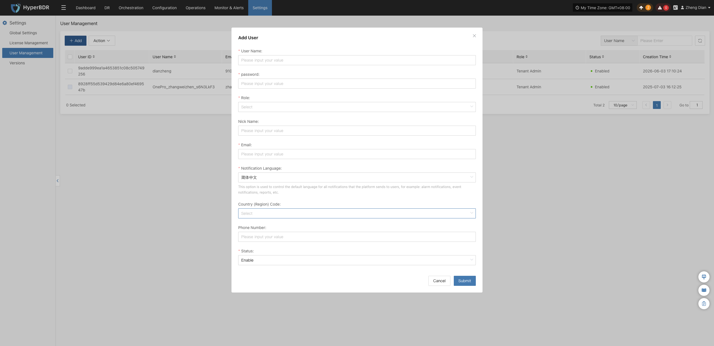
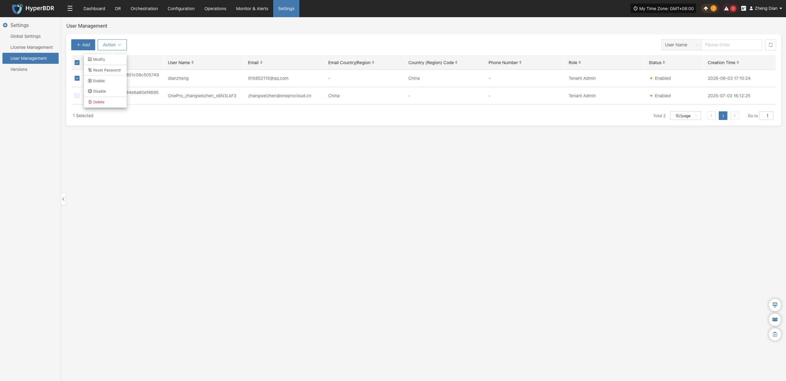
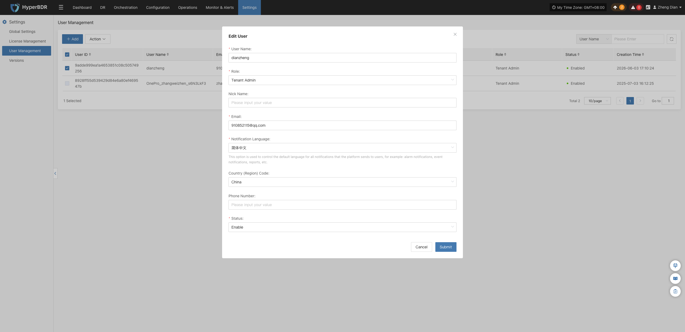
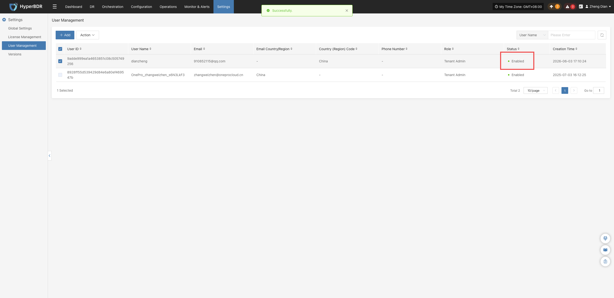
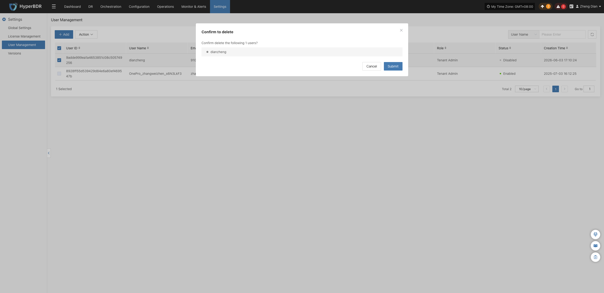

# **用户管理**

用于租户账号全生命周期管控的核心模块，支持新增系统账号、分配角色权限、查看账号信息、检索筛选账号等能力，实现多操作人员分级分权管理，保障备份平台操作安全。

## **用户列表字段说明**

列表中每条用户记录包含以下字段，含义如下：

| **字段名称** | **说明** |
| :--- | :--- |
| **用户 ID** | 系统自动生成的唯一标识，不可修改，用于后台区分账号。 |
| **用户名** | 登录系统的账号名称，登录必填凭证。 |
| **邮箱** | 用户绑定联系邮箱，用于密码找回与告警邮件推送。 |
| **邮箱国家 / 地区** | 邮箱归属区域标识，无特殊地区则显示 “-”。 |
| **用户手机国家 (区) 码** | 手机号归属国家代码，默认中国（+86）。 |
| **用户手机号** | 绑定联系手机，用于账号安全验证。 |
| **角色** | 账号权限等级，分为三类： • **租户管理员**：全平台最高权限； • **配置用户**：仅备份业务操作权限； • **只读用户**：仅查看全平台数据，无编辑操作权限。 |
| **状态** | 账号登录状态：绿色圆点表示已启用（可正常登录）；灰色/禁用状态表示无法登录。 |
| **创建时间** | 账号创建的精确时间戳。 |

## **添加**

登录控制台后，导航至 **【设置】>【用户管理】** 页面，点击顶部 **【+ 添加】** 按钮。在弹出的新增用户表单内填写用户名、邮箱、地区、手机号及分配角色，核对无误后点击保存完成账号创建。

## **更多操作**

在用户列表中，点击目标用户所在行右侧的 **【更多操作】**，可在下拉菜单中执行修改、重置密码、启用、禁用及删除等管理操作。

### **修改**

点击 **【更多操作】>【修改】**，系统将弹出编辑用户对话框。管理员可对该账号的联系邮箱、手机号、角色权限及启用状态进行重新编辑与调整，保存后立即生效。

### **重置密码**

点击 **【更多操作】>【重置密码】**，在弹出的对话框中输入新密码并确认，完成密码重置。

::: note
密码重置成功后，原密码立即失效，请通过安全保密渠道将新密码交付对应使用人员。
:::

### **启用**

当目标账号处于禁用状态时，点击 **【更多操作】>【启用】**，即可启用该账号。启用成功后，账号恢复登录权限，列表中的账号状态更新为已启用。

### **禁用**

当目标账号处于启用状态时，点击 **【更多操作】>【禁用】**，即可禁用该账号。禁用成功后，该账号将无法登录，列表中的账号状态更新为已禁用。

::: warning
账号被禁用后，该用户已登录的会话将无法继续执行业务操作，操作前请确认相关任务已妥善交接。
:::

### **删除**

点击 **【更多操作】>【删除】**，系统弹出二次确认警示框。确认删除后，该用户账号将被永久清除，账号配置及关联登录凭据全部失效。

::: danger
删除操作不可逆，执行前请确认该账号无正在进行中的任务或关联依赖资源，核对用户名后谨慎确认。
:::

