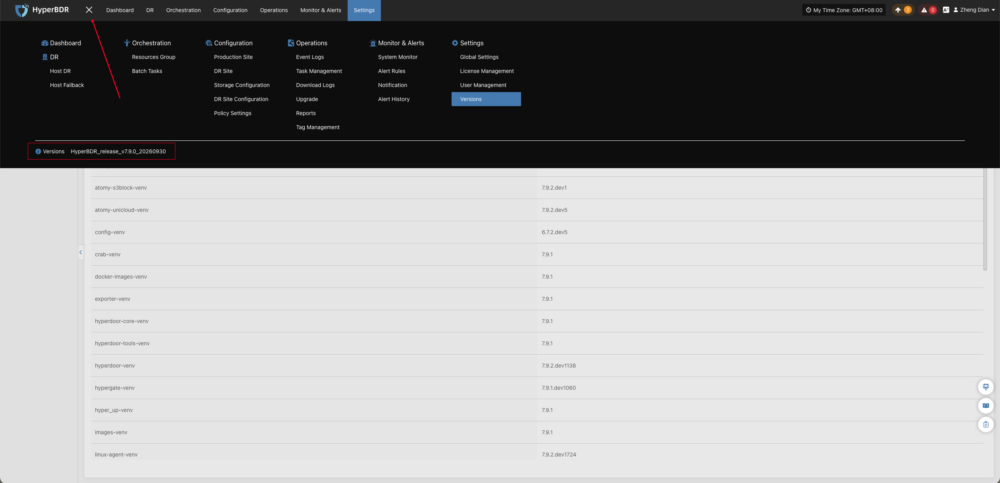
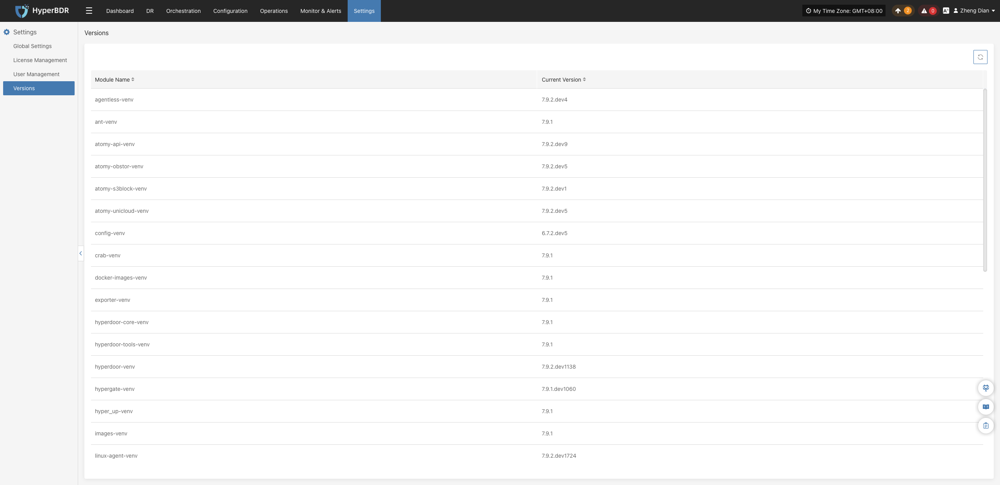

# **版本信息**

版本信息模块用于展示 HyperBDR 平台当前运行的软件版本数据。系统支持通过**顶部导航菜单**快速查看平台整体程序包大版本，或进入**版本信息设置页**查看各核心微服务与运行组件的详细版本。

## **查看系统程序包版本**

登录 HyperBDR 控制台后，找到页面左上角顶部导航栏的菜单图标（三横线），即可查看当前部署的 HyperBDR 系统程序包版本。

## **查看组件详细版本**

登录 HyperBDR 控制台，点击顶部导航栏的 **【设置】**，再在左侧导航栏中点击 **【版本信息】**。页面将以卡片形式展示当前环境中各微服务及运行组件的详细版本信息。

::: tip 技术支持建议
当您在日常运维中遇到异常并联系技术支持时，建议截取系统程序包版本及本页面的完整版本信息，并将截图附在工单中，以便技术支持工程师快速了解系统环境并排查版本兼容性问题。[获取支持](https://support.oneprocloud.com/target/opc)
:::

### **展示组件说明**

页面通常包含以下核心运行组件的版本数据：

| **组件名称** | **说明** |
| :--- | :--- |
| **控制端服务** | HyperBDR 核心控制台、调度引擎及 API 网关服务的当前运行版本与构建编号（Build ID）。 |
| **源端同步代理（Sync Proxy）** | 部署于源端虚拟化或云平台内的数据同步代理组件版本。 |
| **源端代理程序（Agent）** | 部署在受保护源主机操作系统内部的轻量级 Agent 客户端版本。 |
| **云同步网关 / 过渡主机** | 目标灾备端负责数据接收、驱动适配及接管启动的核心运行环境镜像与服务版本。 |

