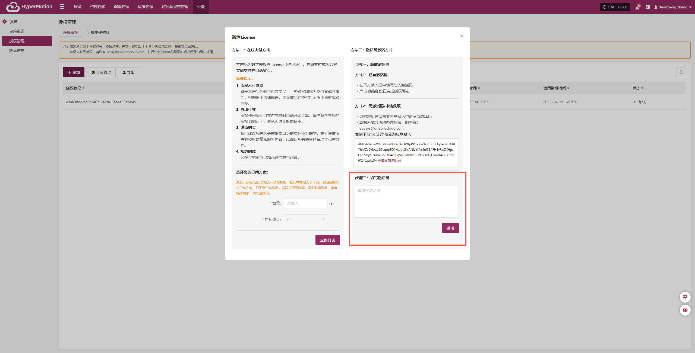
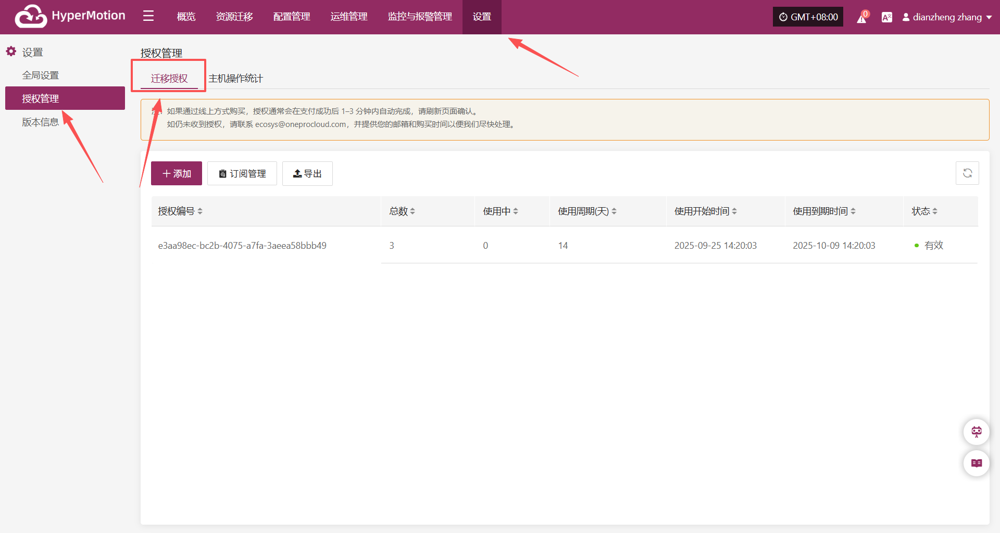
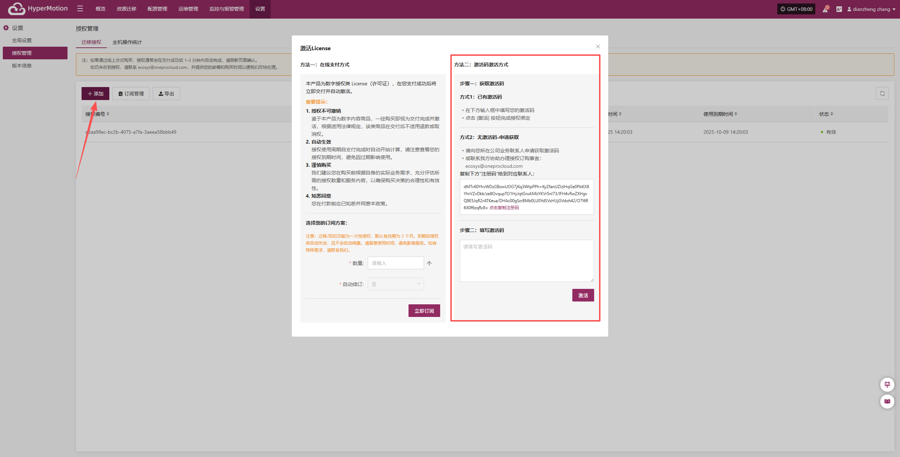
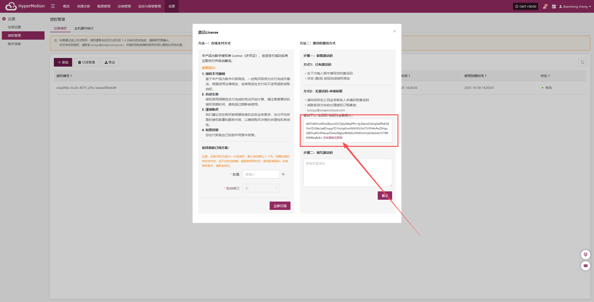
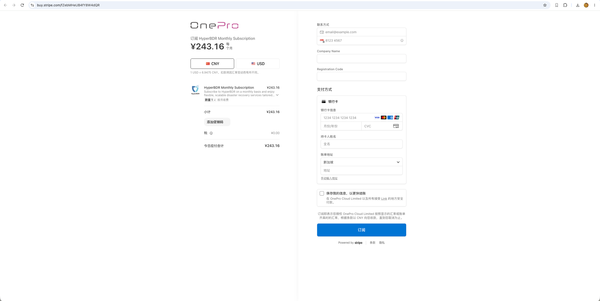

# **激活码激活**

## **迁移授权步骤**

### **已有激活码**

1. 登录控制台后，依次点击上方导航栏的“设置” > “授权管理” > “迁移授权”，进入授权管理页面。

2. 点击页面右上角的“添加”按钮，进入授权信息填写页面。

3. 在下方输入框中填写您的激活码，点击 **激活** 按钮完成授权绑定

### **无激活码-申请获取**

1. 登录控制台后，依次点击上方导航栏的“设置” > “授权管理” > “迁移授权”，进入授权管理页面。

2. 点击页面右上角的“添加”按钮，进入授权信息填写页面。

3. 请向您所在公司业务联系人申请获取激活码或联系我方协助办理授权订购事宜：

- 方法一：复制下方的注册码，并发送至邮箱 ecosys@oneprocloud.com，我们将在收到邮件后尽快处理。

- 方法二：访问 https://oneprocloud.com/where-to-buy 购买页面，选择对应的产品并按照页面提示完成自助支付。请务必准确填写接收邮箱和注册码，以确保激活码能够正常发放。

4. 获取激活码后在下方输入框中填写您的激活码，点击 **激活** 按钮完成授权绑定

